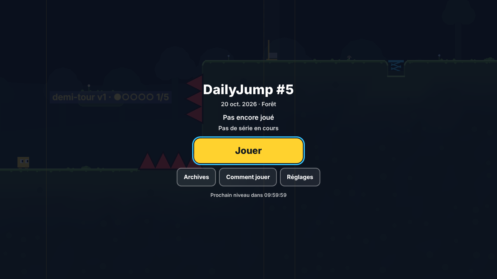
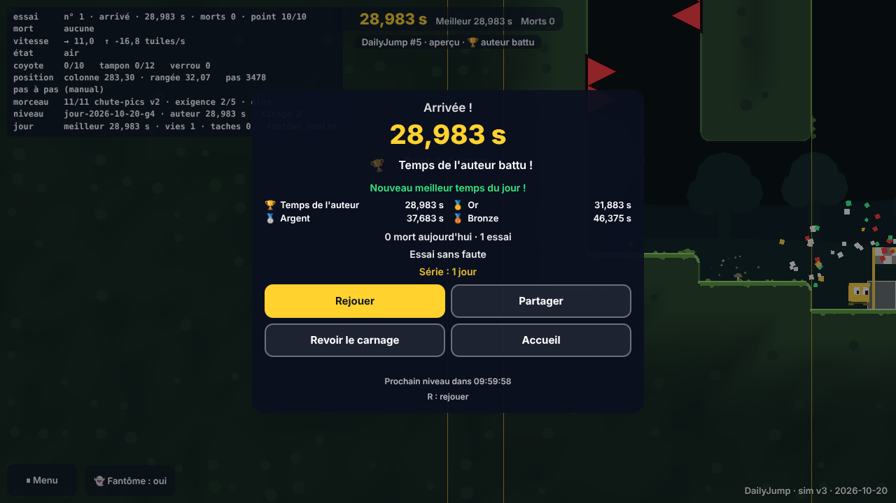
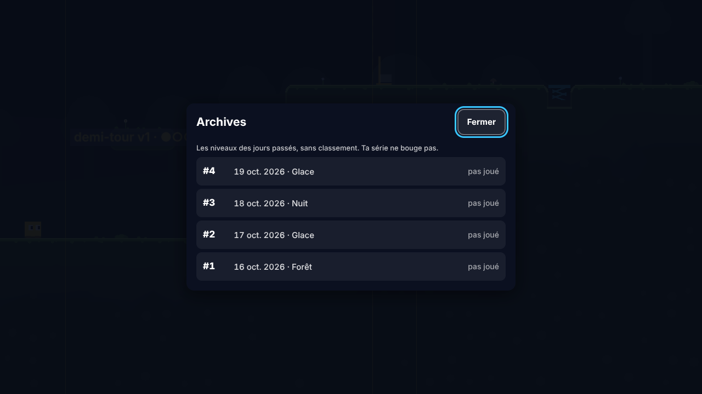
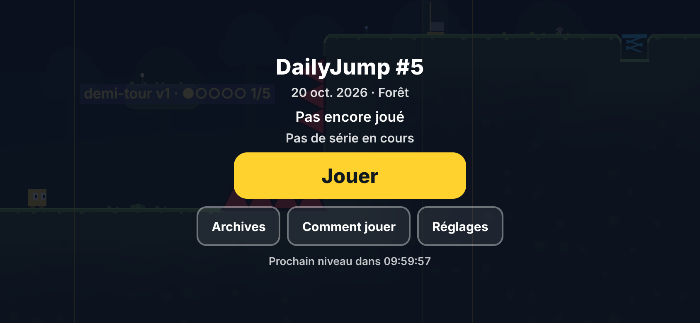
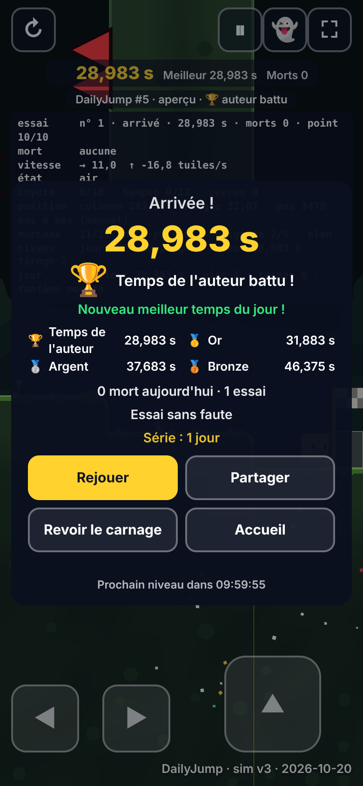
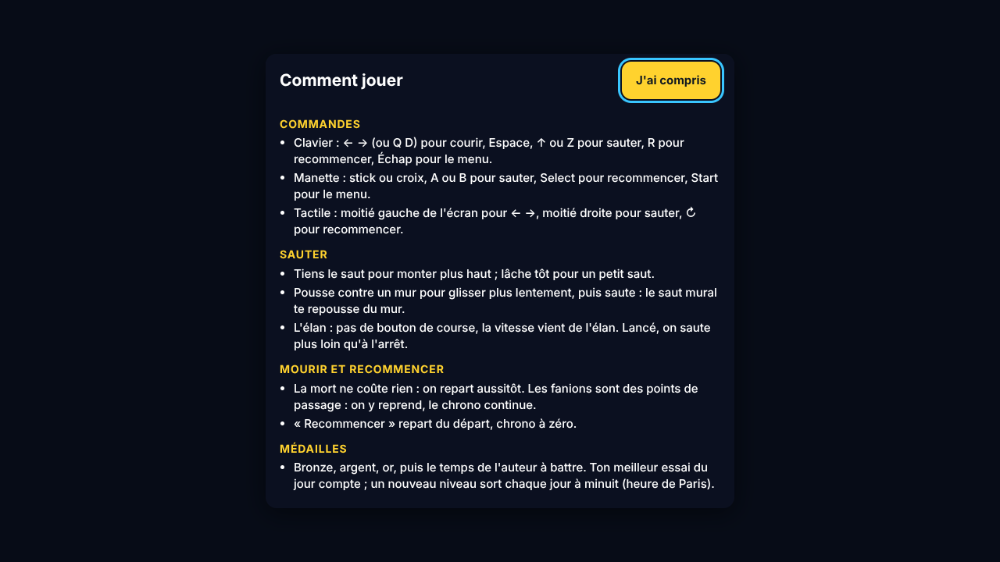
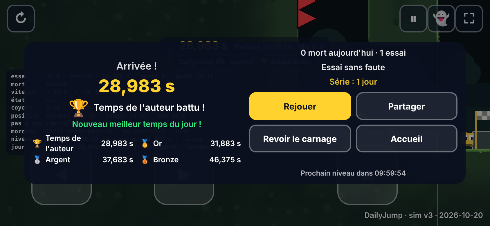
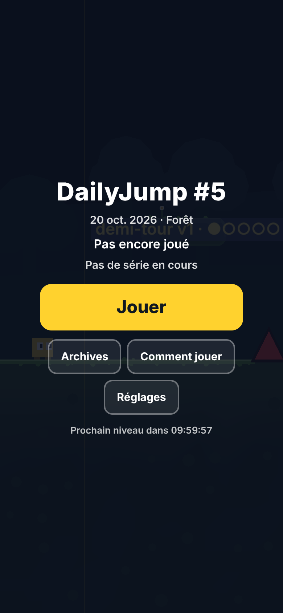

# Lot 10 — L'arrivée, le partage et les archives (DailyJump)

## À tester
Aperçu de la branche `claude/loving-turing-rc761o` (toutes les dates y sont ouvertes : c'est un aperçu) :
- **La page par défaut : [`https://nathan-te.github.io/DailyTrack/b/claude-loving-turing-rc761o/jump/`](https://nathan-te.github.io/DailyTrack/b/claude-loving-turing-rc761o/jump/)** — elle s'ouvre sur l'**accueil**, avec « Comment jouer » par-dessus à la toute première visite.
- **Le parcours** : accueil → **Jouer** (le son se réveille) → finir → le **carnage** (une commande le passe) → l'**écran d'arrivée** (temps, médaille qui s'anime avec sa phrase musicale, seuils, morts et essais du jour, série, compte à rebours) → **Partager** (feuille de partage au téléphone, presse-papiers ailleurs : coller le texte quelque part) → **Revoir le carnage** → **Accueil** (ton résultat et ta série) → **Archives** → toucher un jour → le jouer (« Archive » dans le HUD) → à l'arrivée, « Archive : ne compte pas dans ta série » → **Accueil** (la série n'a pas bougé). Le menu ⏸ a maintenant un bouton **Accueil**.
- Liens directs, qui ouvrent toujours leur contenu sans accueil : [`?seed=2026-10-18`](https://nathan-te.github.io/DailyTrack/b/claude-loving-turing-rc761o/jump/?seed=2026-10-18), `?module=cheminee`, `?scenario=essai`. [`?archives`](https://nathan-te.github.io/DailyTrack/b/claude-loving-turing-rc761o/jump/?archives) ouvre l'accueil sur la liste ; `?accueil=0` saute l'accueil.
- **Au téléphone**, en portrait et en paysage (l'écran d'arrivée passe sur deux colonnes en paysage).
- Avant le 16/10/2026 (n° 1), l'accueil dit « DailyJump » sans numéro et les archives sont vides ; pour voir une liste, ouvrir l'aperçu à partir du 17/10.

| Accueil | Écran d'arrivée | Archives |
|---|---|---|
|  |  |  |
|  |  |  |
|  |  |  |

## Format de partage
`DailyJump #12 — 31,402 s — 🥇 — 47 💀` puis, à la ligne, le lien de la page **construit depuis l'adresse courante** (`origin + pathname`, aucun paramètre : un aperçu partage un lien d'aperçu). Le temps est le **meilleur du jour** (celui du rejeu), la médaille la sienne (🏆 auteur, 🥇, 🥈, 🥉 ; sans médaille, le morceau est omis), les morts celles du jour sur ce niveau (0 s'écrit). Une archive : `DailyJump #3 (archive) — … — 🥇 — 2 💀` et le lien `?seed=2026-10-18`. Avant le n° 1, la date remplace le numéro. Envoi : feuille de partage (Web Share API) quand les commandes tactiles sont actives, sinon presse-papiers (« Copié dans le presse-papiers »), sinon le texte s'affiche sélectionné. La **série n'y est pas** (format du seed) ; le rang viendra en phase 2.

## Ce qui est fait
- **Accueil** (`home.ts`, logique `homeLogic.ts`) : « DailyJump #N », date, thème du jour, état (« Pas encore joué », ou 🥇 meilleur temps et morts, ou « Pas encore d'arrivée · N morts · M essais »), série, **Jouer** (« Préparation du niveau… » tant que le niveau se charge : l'accueil s'affiche avant, le niveau se charge derrière), Archives, Comment jouer, Réglages (le menu ⏸), compte à rebours. Ouvert, la partie est en pause (aucun pas, clavier et doigts coupés). Jouer après une arrivée repart d'un essai neuf ; après minuit, ouvre le nouveau niveau.
- **Écran d'arrivée** (`arrival.ts`) pour le niveau du jour, **après** le carnage (inchangé : n'importe quelle commande le passe) ; les morceaux, scénarios, lectures et parties aux réglages modifiés gardent le bandeau du lot 2. La médaille sonne à l'ouverture de l'écran (plus à l'instant de l'arrivée). Un bouton ne répond qu'à un appui **commencé sur l'écran** : le doigt qui passe le carnage ne déclenche rien en se levant (trouvé par le test au doigt).
- **Historique** (`history.ts`, `jump:historique`, 400 jours au plus, lectures et écritures protégées) : par niveau du jour, meilleur temps (rejoué), sa médaille, morts et essais du jour (nouveaux compteurs de `DayMemory` : les morts ne sont plus plafonnées à 300 pour le compte). Mis à jour à chaque essai rejoué, **seulement** pour le niveau du jour joué le jour même (`mayRecord`). **Série** (`streakOf`) : jours consécutifs avec au moins une arrivée, jusqu'à aujourd'hui, ou hier si aujourd'hui n'est pas encore fini.
- **Archives** : du n° 1 à hier (jamais le futur, la porte reste), numéro, date, thème, médaille et temps si joué ; liste qui défile, lignes de 52 px. Une archive : badge « Archive » dans le HUD, médailles, fantôme, carnage, écran d'arrivée ; **n'entre jamais dans l'historique**.
- **Comment jouer** : commandes (clavier, manette, tactile), saut variable, murs, élan, fanions et recommencer, médailles (`HELP`, à retoucher quand le 8c adoptera l'élan). S'ouvre seul à la première visite de l'accueil (`jump:aide`).
- **Outils** : `?accueil=0|1`, `?archives` (dans `urlOptions.ts`) ; `__jump.home`, `__jump.history`, `__jump.streak`, `__jump.arrival`, `__jump.autoplay(code)` (joue une rediffusion comme les commandes du joueur), `__jump.daily.load.frozenMiss`.

## Niveaux figés
- **Fichier** `apps/jump/public/levels/AAAA-MM-JJ.json` (≈ 5,5 ko) : grille codée par rangée (`#40.12^3`), bloc annexe (sections, scies) tel quel, empreinte, preuve de l'auteur, temps de l'auteur, **médailles**, morceaux, `simVersion`, `generatorVersion`, identifiant d'origine (`frozen.ts`).
- **Écriture** : `npm run freeze:days -w @cdj/jump -- <AAAA-MM-JJ | demain>` (de `PREMIER_JOUR_JUMP` à la date comprise ; `--dir=` pour écrire ailleurs). Un fichier existant **n'est jamais réécrit** ; s'il ne se relit plus, le script le dit et sort en erreur.
- **Lecture** (`loadDaily`) : la liste des dates figées est écrite dans le jeu à la construction (`vite.config.ts`) : seules ces dates déclenchent une requête. Le fichier est lu, vérifié (date, versions, identifiant, empreinte, médailles) et **sa preuve rejouée** ; accepté, il sert tel quel (son identifiant d'origine, même si le générateur a changé depuis) ; refusé (absent, illisible, corrompu, autre physique), le jeu génère le niveau comme avant (cache, worker, repli) et `frozenMiss` dit pourquoi.
- **Aucun niveau n'est figé dans ce lot** : `public/levels/` n'existe pas ; le mécanisme est testé sur des fichiers fabriqués dans `test/arrivee.test.ts`.
- **Règle, une fois le jeu lancé** : tout lot qui change `JUMP_SIM_VERSION` ou `JUMP_GENERATOR_VERSION` lance d'abord `npm run freeze:days -w @cdj/jump -- demain` (sur la version d'avant, **jusqu'à demain compris**) et commite les fichiers : les jours joués ou en cours ne changent plus.
- **Limite : `JUMP_SIM_VERSION`**. Un niveau figé est rejoué avec la physique du jeu : sous une autre physique, sa preuve ne tient plus et il est refusé ; le jeu **génère alors un autre niveau pour cette date** (celui du générateur courant), différent de celui qui a été joué. Propositions (décision 1).

## Checklist du jour du lancement
1. Régler `PREMIER_JOUR_JUMP` (`packages/jump-sim/src/daily.ts`) sur la date du n° 1. Les niveaux ne changent pas (la graine est la date), seuls les numéros : régénérer `fixtures/daily-golden.json` (`UPDATE_GOLDEN=1 npx vitest run packages/jump-sim/test/golden-daily.test.ts`, il contient les numéros) et reprendre les numéros attendus des tests (`jour.spec.ts`, `arrivee.spec.ts`, `arrivee.test.ts` : « #5 » le 20/10/2026…). Pas de changement de version.
2. Fusionner sur `main`, vérifier le site publié (`…/DailyTrack/jump/`) : accueil « DailyJump #1 », date future refusée, archives vides le premier jour.
3. Prévenir les testeurs : leur `jump:historique` d'avant le lancement reste (jours sans numéro, hors archives) ; `__jump.storage.clear()` avec `?debug` repart à zéro.
4. Dès ce jour, la règle « figer avant de changer de version » s'applique (ci-dessus) ; la consigne est dans `docs/jump/consignes.md`.
5. Après le premier changement de version, vérifier que `public/levels/` est publié (`…/jump/levels/AAAA-MM-JJ.json`) et que `__jump.daily.load.source` vaut `fige` pour un jour figé.

## Vérifié / non vérifié / décisions
**Vérifié** : typecheck ; Vitest DailyJump et socle (543 tests, dont 35 nouveaux ; `npm test` complet : 1 478 SQLite + 158 libSQL : ligne à partager (format, virgule, médailles, archive, lien d'aperçu), série (consécutifs, trou, minuit de Paris été et hiver, archive et lecture sans effet), historique (plafond, stockage qui lève, illisible, survit à la purge), compte à rebours (25 h et 23 h aux changements d'heure), niveaux figés (aller-retour du texte, preuve rejouée, fichier trafiqué, corrompu, autre physique, générateur ancien, repli sur la génération)) ; e2e **Chromium** en local : les 6 nouveaux tests (`e2e/arrivee.spec.ts` : parcours complet avec presse-papiers simulé, aide à la première visite seulement, archives sans effet sur la série, compte à rebours, au doigt en portrait et en paysage avec cibles ≥ 44 px) et toute la suite DailyJump (90 réussis, 4 outils de mesure et de captures sautés comme d'habitude) ; **golden des deux jeux inchangés** (aucun fichier de `packages/`, ni de DailyTrack, ni de zone partagée touché ; aucune dépendance).
**Non vérifié** : Firefox et WebKit (absents ici : la CI tranche) ; un vrai téléphone (feuille de partage réelle, son au premier Jouer sur iPhone) ; la manette sur l'accueil (Jouer se fait au clavier, à la souris ou au doigt ; Start ouvre le menu).

**Décisions pour Nathan**
1. **Niveaux figés et nouvelle physique** : (a) *recommandé* : une archive d'une ancienne physique reste **listée avec ton résultat, mais ne se joue plus** (« joué avec une ancienne version du jeu ») — quelques lignes à ajouter quand le cas arrivera ; (b) garder l'ancienne physique dans le code (`stepPlayer` par version) : coûteux et risqué ; (c) laisser le repli actuel (l'archive devient un autre niveau) : simple mais faux pour les archives. À trancher avant le premier changement de `JUMP_SIM_VERSION` après le lancement.
2. **La série dans la ligne à partager** : absente (format du seed) ; une mention « 🔥 5 » se rajoute en une ligne.
3. **Série** : elle tient jusqu'à minuit (heure de Paris) le lendemain d'une arrivée ; une arrivée sur le niveau d'hier finie après minuit (page restée ouverte) ne compte pas.
4. **Accueil et `?debug`** : `?debug` montre l'accueil (les tests de navigateur qui veulent le jeu tout de suite ajoutent `&accueil=0`, ce qui est fait pour les tests existants).
5. **Écran d'arrivée** seulement pour le niveau du jour (et ses archives) ; une partie aux réglages modifiés garde le bandeau (rien n'est enregistré, rien à partager).
6. **Aide** : sans stockage, elle ne s'ouvre pas d'elle-même (sinon à chaque page).
7. **Branche** : la session imposait `claude/loving-turing-rc761o`, repartie de `main` à jour (elle portait un ancien état de `main`).
