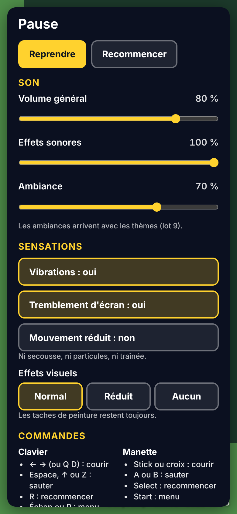
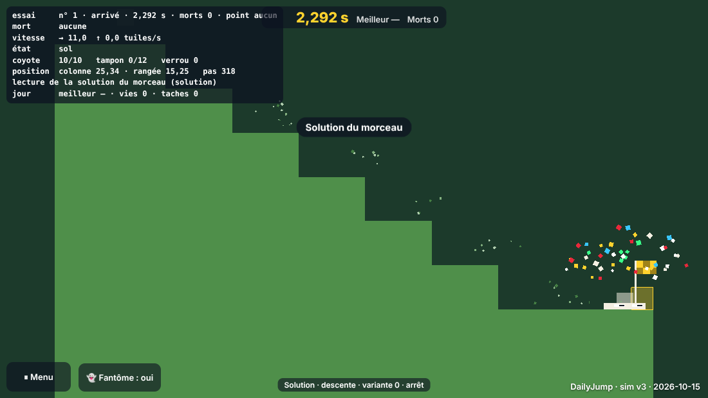

# Lot 8 — Les sensations (DailyJump)

## À tester
Aperçu de la branche `ccr-b9d3e574-5beme1` (celle de cette session), **avec le son** (un premier geste le déverrouille : une touche ou un toucher) :
- **`https://nathan-te.github.io/DailyTrack/b/ccr-b9d3e574-5beme1/jump/`** : le niveau du jour. **Écouter** : les pas discrets au rythme de la course, le « hop » du saut et le claquement plus brillant du saut mural, l'atterrissage (plus fort après une grande chute), le frottement continu de la glisse murale, le sifflement des scies qui vient de leur côté (gauche / droite) et s'éteint au-delà de ≈ 8 tuiles, le « boing » du ressort, le craquement puis l'éboulis d'un bloc friable, le tintement d'un point de passage, le « splat » de la mort (un peu différent pour un pic, une scie, une chute), le petit « pop » de la réapparition, la fanfare d'arrivée puis la phrase de ta médaille (bronze, argent, or, auteur : de plus en plus longue et haute). **Regarder** : poussière au saut et à l'atterrissage (selon la chute), poussière de course et traînée à pleine vitesse, frottement contre le mur, bouffée au saut mural, débris des friables, éclat du ressort (qui se comprime puis rebondit), confettis à l'arrivée, fanion qui se lève en franchissant un point, yeux qui clignent, écrasement et étirement plus marqués, petite secousse aux grosses chutes. **Au téléphone (Android)** : vibrations très courtes à la mort, aux grosses chutes et à l'arrivée.
- **Menu ⏸** : Échap ou P au clavier, Start à la manette (Select reste « recommencer »), ⏸ dans la bande haute au téléphone, « ⏸ Menu » en bas à gauche sur ordinateur. Le chrono s'arrête. Changer un réglage, recharger : il est gardé.
- **`…/jump/?scenario=essai&carnage=demo`** : le carnage avec ses sons (les morts des autres vies, peu à la fois et plus bas). **`…/jump/?scenario=essai&fx=off`** : plus de particules ni de secousse, mais les taches restent.

 

## Événements et sons
`eventsBetween(avant, après)` (`apps/jump/src/events.ts`, pur) déduit les événements de deux états successifs ; le son, les particules et les vibrations ne s'abonnent qu'à eux (`__jump.events` avec `?debug`).

| Événement | Lu dans l'état | Son | Effet visuel | Vibration |
|---|---|---|---|---|
| `saut` / `sautMural` | appui ou tampon, `buffer` remis à 0 par le saut (sinon montée nouvelle) ; au sol / coyote ou non | « hop » carré qui monte / claquement + triangle plus aigu | poussière / bouffée côté mur ; étirement | — |
| `atterrissage` (intensité = chute ÷ chute max.) | `ground` 0 → 1 | bruit sourd + note grave, volume selon l'intensité | 2 à 12 grains de poussière ; écrasement ; secousse si ≥ 0,85 | ≥ 0,85 : 18 ms |
| `pas` (cadence) | au sol, tous les 1,5 tuile parcourues | « tap » filtré discret | poussière à pleine vitesse | — |
| `glisseDebut` / `glisseFin` | `slide` | boucle de bruit frotté | frottement continu ; écrasé contre le mur | — |
| `mort` (pic, scie, chute) | `status` → mort | « splat » + couleur de la cause | éclatement (déjà au lot 2), secousse | 35 ms |
| `reapparition` | mort → vivant | « pop » | — | — |
| `pointDePassage` | `checkpoint` | tintement | le fanion se lève | — |
| `arrivee` | `status` → arrivé | fanfare ta-ta-taa | 46 confettis | 25-50-40 ms |
| `ressort` | `springTime` / `springCell` | « boing » | éclat ; le ressort rebondit | — |
| `friableCraque` / `friableTombe` | minuterie lancée / bloc tombé | deux grains secs / éboulis | éclats / débris | — |
| `medaille` (poussé par le jeu) | médaille du niveau du jour | phrase propre à chaque médaille | — | — |
| scies (continu) | `sawCenters`, à chaque image | dent de scie filtrée, trémolo ; volume (1 − d/8)², stéréo = écart ÷ 8 ; les 3 plus proches | — | — |

**Plafonds** : 12 sons ponctuels à la fois (`MAX_VOICES` ; mort, arrivée et médaille passent toujours) ; carnage : seulement les morts et arrivées des autres vies, 6 événements par 100 ms, dont 3 sons atténués (× 0,35) ; particules : un pool de 220 (plus 64 pour la mort, 384 pour le carnage) ; traînée : 5 carrés ; vibrations espacées d'au moins 120 ms.

## Réglages (`jump:settings`)
| Réglage | Défaut |
|---|---|
| Volume général · effets sonores · ambiance (bus vide jusqu'au lot 9) | 80 % · 100 % · 70 % (gain au carré du curseur) |
| Vibrations · tremblement d'écran | oui · oui |
| Effets visuels | normal (réduit : moitié des particules, ni poussière de course ni traînée, secousse ÷ 2 ; aucun : ni particules ni secousse) |
| Mouvement réduit | oui si le système le demande (`prefers-reduced-motion`) : ni secousse, ni particules, ni traînée, écrasement discret, fanion posé |
`?fx=off` vaut « effets : aucun » sans toucher au réglage. Aucun réglage ne rend la partie `tuned`.

## Mesures du carnage
`MESURE=1 [RATES=4 NS=0,150 EFFETS=oui,non] npx playwright test mesure-carnage --project=chromium` : téléphone 844 × 390 @2, SwiftShader, Chromium ×4 ; « oui » = son déverrouillé et particules normales, « non » = `?fx=off`, sans son. Image à 60 i/s = 2 pas + un dessin (méthode du lot 3). Deux passages chacun, **même machine** pour `main` :

| Version | Foule 0 (héros seul) | Foule 150 (150 vies en course) | Démo 150 (≈ 48 en course) |
|---|---|---|---|
| `main` (avant le lot) | 9,6 · 11,4 ms | 9,9 · 11,9 ms | 6,8 · 5,2 ms |
| lot 8, effets **non** | 10,4 · 12,0 ms | 12,5 · 13,6 ms | 7,5 · 6,3 ms |
| lot 8, effets **oui** | 9,6 · 13,5 ms | 12,1 · 14,7 ms | 6,6 · 7,1 ms |

Simulation par pas (150 vies) : 0,44 ms avant, 0,50 à 0,58 ms (les événements de chaque vie). Sons joués en 4 s : 25 à 27 (foule), 40 (démo) ; à 300 vies de démo, 7 événements écartés par le filtre. **Sous 16,7 ms partout** : rien n'a été réduit. Le bruit d'un passage à l'autre (±2 ms) dépasse l'écart avec et sans effets ; le surcoût du lot (≈ 1 à 2 ms dans le pire cas) vient du dessin (particules, traînée, fanions) et des événements.

## Vérifié / non vérifié / décisions
**Vérifié** : typecheck ; `npm test` (1 374 SQLite + 158 libSQL) dont `apps/jump/test/sensations.test.ts` (31 tests : événements sur des suites de commandes — saut, atterrissage faible et fort, glisse, saut mural, morts par pic, scie et chute, réapparitions, ressort, friable, point de passage, arrivée, solution de l'essai sur des états gelés ; son : correspondance, timbres, médailles, scies, polyphonie, débit du carnage ; réglages : défauts, mémoire, stockage qui lève, enregistrement abîmé ; effets : poussière, secousses, vibrations, pools, traînée, clignement) ; **golden des deux jeux inchangés** (`JUMP_SIM_VERSION` 3, `JUMP_GENERATOR_VERSION` inchangée, aucun fichier de `packages/` touché) ; e2e Chromium (69 tests, dont 7 nouveaux dans `e2e/sensations.spec.ts` : `__jump.events` en pas à pas, son déverrouillé par un geste sans erreur, menu au clavier (Échap, P, chrono figé, réglages gardés au rechargement, « Recommencer »), au doigt en portrait et en paysage (cibles ≥ 44 px, dans l'écran), `?fx=off` et mouvement réduit (aucune particule ni secousse, la tache reste)) ; captures relues.
**Non vérifié** : Firefox et WebKit (absents ici : la CI tranche ; hors Chromium, le test du son accepte un contexte resté suspendu faute de sortie audio, mais exige zéro erreur) ; **un vrai téléphone** ; **les vibrations réelles** (Android) ; **le son sur iPhone** (déverrouillage au `touchend`/`click` et son vide joué pendant le geste, d'après les règles connues de Safari) ; le ressenti du mixage.

**Décisions pour Nathan**
1. **Start ouvre le menu** (il recommençait aux lots 1 à 7) ; Select recommence. Le test de la manette a été mis à jour en conséquence.
2. **Un geste de manette ne déverrouille pas le son** (les navigateurs ne le comptent pas comme une activation) : au clavier ou au doigt, tout de suite ; à la manette seule, le son attend un clic ou une touche.
3. **Le carnage ne vibre pas et ne secoue pas** (seule la partie du joueur le fait) ; le héros du carnage a tous ses sons et particules, les autres vies seulement leurs morts et arrivées.
4. **Mouvement réduit** : il coupe aussi l'éclatement de la mort (« aucune particule ») ; la tache reste et le « splat » se fait entendre.
5. **Pas de vibration en lecture** (`?watch=best`, `&solution`).
6. L'outil de mesure du lot 3 mesure maintenant avec et sans effets (`EFFETS`), et accepte `NS` pour un sous-ensemble.
