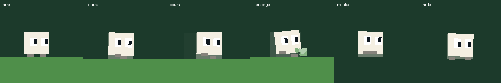

# Lot 8b — Le personnage s'anime, et un essai d'élan progressif (DailyJump)

## À tester
Aperçu de la branche `claude/dailyjump-lot-8b-animation-elan` :
- **`https://nathan-te.github.io/DailyTrack/b/claude-dailyjump-lot-8b-animation-elan/jump/`** (le niveau du jour, l'animation). **Regarder** : les deux pieds qui alternent en course, au rythme des bruits de pas (le cycle suit la distance : lent quand on démarre, rapide à pleine vitesse) ; le corps qui se penche vers l'avant en accélérant et en arrière en freinant, qui rebondit à chaque pas ; les pieds repliés en montée, pendants en chute (plus écartés après une grande chute), plaqués contre le mur en glisse (le corps reste un peu écrasé contre lui), posés à l'arrêt ; la respiration à l'arrêt ; les pupilles qui regardent devant, vers le haut au saut, vers le bas à la chute (clignement gardé). **Faire un demi-tour en pleine course** : dérapage (poussière devant, petit frottement, inclinaison en arrière). Traînée plus pâle, seulement à pleine vitesse. Menu ⏸ → mouvement réduit : pieds et yeux gardés, plus de rebond ni de penché ni de traînée. `…/jump/?scenario=bac-a-sable&debug&hitbox` : la boîte verte de collision n'a pas changé (au repos, corps + pieds la remplissent exactement).
- **`https://nathan-te.github.io/DailyTrack/b/claude-dailyjump-lot-8b-animation-elan/jump/?scenario=bac-a-sable&debug&tune&sprint=1`** (l'élan). **Essayer** : courir sur la piste du départ, droite tenue : après 0,4 s à pleine vitesse, la vitesse monte jusqu'à 15 tuiles/s (surimpression « vitesse »), la traînée se marque un peu ; sauter en élan (la vitesse est gardée en l'air, on atterrit toujours lancé) ; lâcher, faire demi-tour ou heurter un mur : l'élan est perdu. Les trous du bac à sable et les deux trous sous plafond bas se franchissent bien plus facilement. Section « Élan progressif (essai) » du panneau : interrupteur et trois curseurs ; le badge « réglages modifiés : rien n'est enregistré » est là.

## Valeurs de départ de l'élan (`SPRINT_TRIAL_PARAMS`, pas des défauts)
| Réglage | Valeur | Unité humaine |
|---|---|---|
| `sprintMode` | 1 (0 ou absent : aucun élan, le défaut) | — |
| `sprintSpeed` | 512 unités/pas | 15,0 tuiles/s (course : 11,0 ; `MAX_SPEED` : 61) |
| `sprintDelay` | 48 pas | 0,4 s au sol à pleine vitesse |
| `sprintAccel` | 2 unités/pas² | élan atteint en 69 pas ≈ 0,57 s (3 donnerait 0,38 s : l'entier le plus proche de 0,5 s est 2) |

**Règles** (`stepPlayer`) : les pas au sol à la course exacte (direction tenue) se comptent dans `PlayerState.sprint`, **cumulés d'un saut à l'autre** (sauter ne coupe pas l'élan) ; à `sprintDelay`, la vitesse visée devient `sprintSpeed` au sol ; en l'air, en élan, la vitesse acquise est gardée telle quelle (ni réaccélérée, ni freinée) ; lâcher la direction, demi-tour, mur heurté, glisse ou saut mural : compteur à 0 (au sol la vitesse revient à la course par le freinage ordinaire, et le compteur ne repart qu'à la course exacte).

## Mesures (`npm run measure:elan -w @cdj/jump-sim`, valeurs de départ)
| Où | Sans élan | Avec l'élan | Gagné |
|---|---|---|---|
| Bac à sable, piste d'élan (départ → première marche, 30 tuiles, depuis l'arrêt) | 2,742 s | 2,242 s | **0,500 s (18 %)** |
| Plat 10 / 20 / 40 / 80 tuiles | 1,02 / 1,93 / 3,74 / 7,38 s | 0,97 / 1,64 / 2,98 / 5,64 s | 5 / 15 / 21 / 24 % |
| Portée d'un saut complet / d'un saut court sur du plat | 7,9 / 4,9 tuiles | 10,8 / 6,6 tuiles | +37 % / +35 % |
| `scie-ronde` v0 (entrée élan → sortie, solution stockée rejouée) | 1,708 s | 1,408 s | 0,300 s |
| `saut-long` v0 | 1,725 s | 1,442 s | 0,283 s |
| `pont-friable` v0 | 2,275 s | 2,083 s | 0,192 s |

Les trois morceaux sont ceux dont la solution stockée court le plus longtemps droite tenue (1,25 / 0,88 / 0,76 s de course continue). **Les 233 solutions stockées (entrée élan) rejouées avec l'élan** : 51 identiques, 131 plus rapides, **51 cassées** (mort ou sortie manquée : le personnage arrive trop tôt ou trop loin). **Les preuves de l'auteur de six niveaux du jour** rejouées avec l'élan : aucune n'arrive (1 à 21 morts).

**Morceaux qui deviendraient probablement trop faciles** (estimation, aucun n'est modifié) : `saut-long` (le seul `elan: oui` : son trou est fait pour la portée de la course, +37 % de portée le rend banal) ; les trous et îles qu'on franchit en courant : `petits-trous`, `ressorts-trous`, `mur-trous`, `tremplin`, `pont-friable`, `pont-patrouille`, `marelle`, `piliers`, `piliers-scie`, `iles-friables`, `iles-scie` (un saut en élan peut sauter un pilier ou une île) ; les plafonds bas qui limitent la hauteur du saut, contournés par un saut court plus long : `plafond-pics`, `saut-plafond`, `tunnel`, `tunnel-scies`, `lucarne` ; les morceaux de cadence où l'on passe une scie en arrivant au bon moment, que l'élan décale : `scie-ronde`, `grande-scie`, `descente-scies`, `scies-jumelles` (plus faciles ou plus durs selon la phase). Les morceaux muraux (cheminées, `mur-seul`, `puits`) changent peu : le saut mural coupe l'élan.

## Ce que coûterait l'adoption (lot dédié)
- `JUMP_SIM_VERSION` 3 → 4 (et `JUMP_GENERATOR_VERSION` +1) : les rediffusions, fantômes, meilleurs temps et caches de niveau d'avant ne se rejouent plus ; golden du personnage, de l'essai, des rediffusions et des niveaux régénérés ; solutions de l'essai et de la galerie (`SOLVE=1`).
- **Le raccord strict (lot 6) est à repenser** : la sortie canonique est une « course propre » à exactement `runSpeed` (`isCleanRun`) ; avec l'élan, deux personnages qui courent n'ont plus le même état (compteur, vitesse jusqu'à 15 tuiles/s). Il faudrait soit remettre l'élan à zéro sur chaque palier, soit faire entrer l'élan dans l'état canonique et dans le test de raccord (25 positions × compteurs).
- Catalogue entier re-résolu (`solve:modules`, 233 variantes × 2 entrées), exigences re-mesurées (gigue, raccord), morceaux trop faciles repris ou retirés, plats (`FLAT_MAX`, `ELAN_FLAT_MAX`) et course la plus longue (`LONGEST_RUN_MAX`) revus, `measure:jump` sur 120 dates (taux de validation, budget d'exigence), médailles recalibrées.

## Animation (affichage seul, `apps/jump/src/look.ts`)
Le corps dessiné commence à 0,08 tuile du sol ; les pieds (0,2 × 0,09) remplissent le dessous : au repos, corps + pieds = la boîte. Cycle des pieds = **distance au sol** (`Look.stride`, un cycle = deux pas de 1,5 tuile : un pied se pose à chaque bruit de pas). Rebond ≤ 0,04 tuile, penché ≤ 0,14 rad (≈ 8°), respiration ± 2,2 % sur 2,4 s. `FeelLevels.body` (1 / 0,6 effets réduits / 0 mouvement réduit ou effets aucun) règle rebond, penché, respiration et inclinaison du dérapage ; pieds et yeux toujours animés. Traînée : opacité 0,14 (0,24 au lot 8), seulement à `runSpeed` ou au-delà (×1,5 au plus en élan). Le héros du carnage court aussi. **Correction** : le ressort de l'écrasement est intégré en sous-pas de 1/120 s (une image longue le faisait osciller d'un extrême à l'autre, visible en rendu logiciel). `__jump.look` (pose, distance, phase, pieds, rebond, penché, respiration, dérapage, écrasement, amplitude).

## Vérifié
- Golden des deux jeux inchangés (aucun fichier de `fixtures/` modifié), `JUMP_SIM_VERSION` = 3 : l'élan éteint ne change aucun calcul, et le champ `sprint` n'existe dans l'état qu'en mode 1 (empreintes `Object.values` identiques). Fuzz : mêmes états au pas près avec les défauts et avec l'élan éteint (réglages d'élan extrêmes présents), échantillon de solutions de morceaux et du niveau d'essai rejoués à l'identique.
- Mode 1 (`test/elan.test.ts`) : départ après exactement `sprintDelay` pas, perte au lâcher, au demi-tour, au mur (sol, glisse, saut mural), gardé en l'air, ≤ `MAX_SPEED` ; fuzz d'intégrité (entiers, sans −0) ici et dans `player.test.ts`.
- `derapage`, pieds, rebond, mouvement réduit, panneau (`apps/jump/test/animation.test.ts`) ; e2e `e2e/animation.spec.ts` (élan en pas à pas, partie `tuned` non enregistrée, cycle des pieds lu via `__jump.look`, mouvement réduit) et toute la suite DailyJump en Chromium localement.

## Non vérifié
- Firefox et WebKit en local (absents de l'environnement) : laissés à la CI. Sensation sur un vrai téléphone.

## Décisions pour Nathan
- L'élan se cumule d'un saut à l'autre (sautiller garde l'élan) : à garder, ou exiger une course continue au sol ?
- Valeurs de départ (15 tuiles/s, 0,4 s, 0,57 s) et l'idée même : à adopter (lot dédié, ci-dessus), à régler, ou à abandonner.
- Pieds plus marqués ou plus discrets (couleur, taille), amplitude du penché et du rebond.
