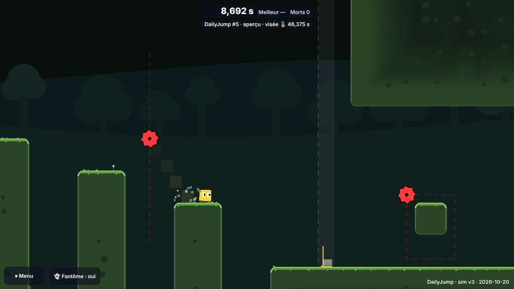
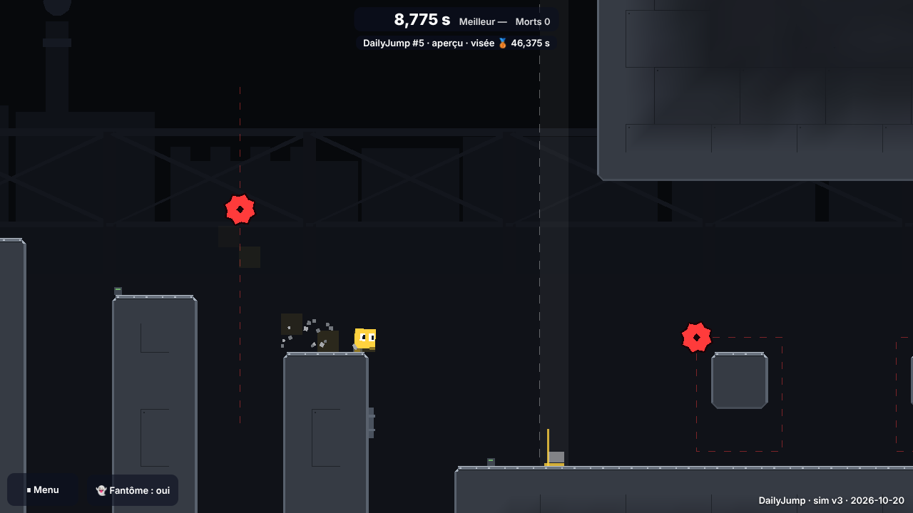
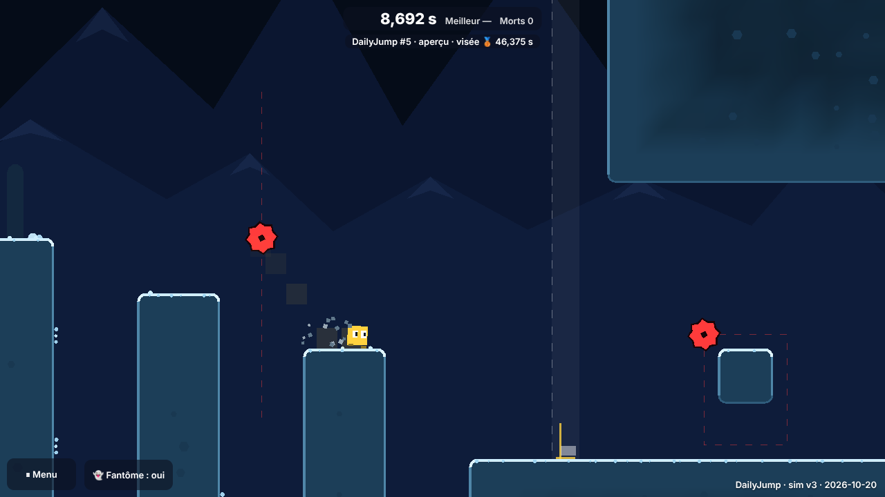
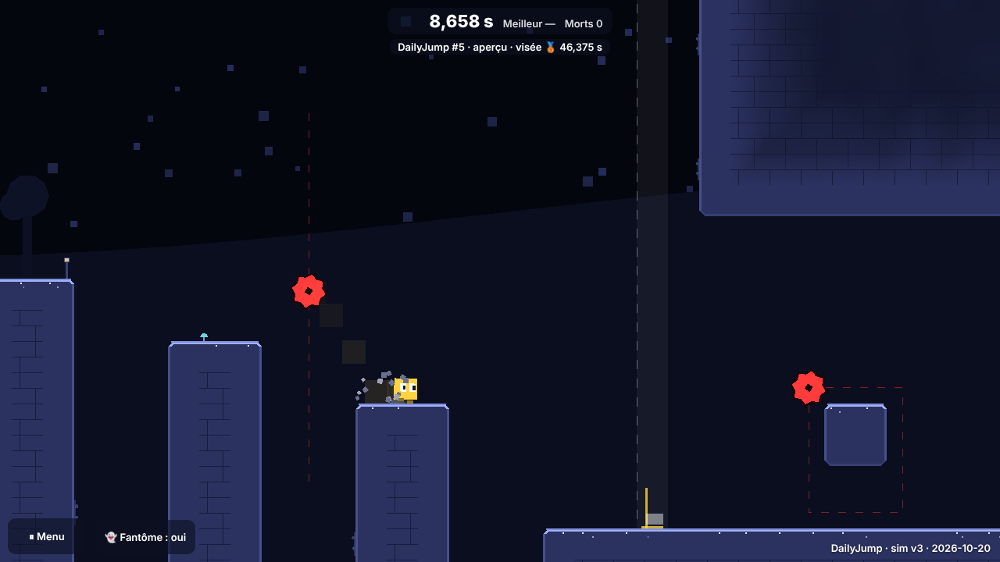
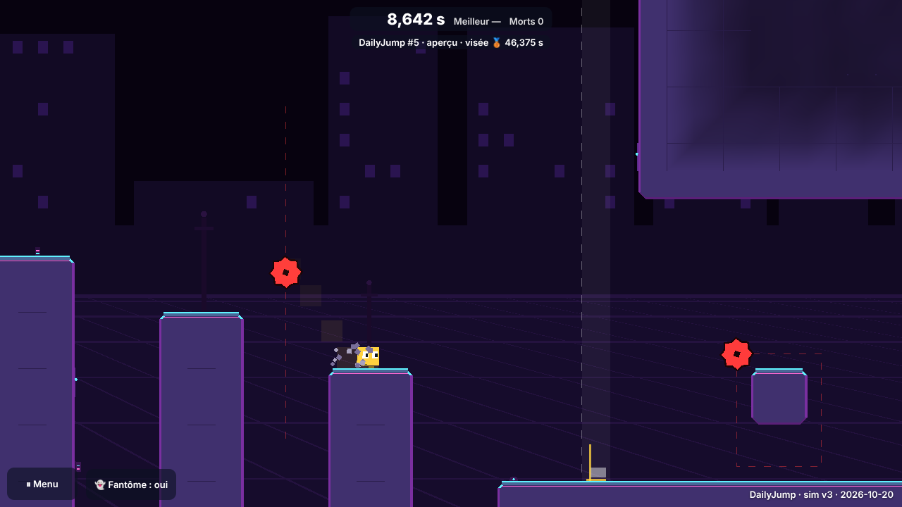

# Lot 9 — Les thèmes visuels (DailyJump)

## À tester
Aperçu de la branche `claude/dailyjump-lot-9-themes` (toutes les dates y sont ouvertes), **avec le son** (un premier geste le déverrouille) :
- **Le niveau du jour : [`…/b/claude-dailyjump-lot-9-themes/jump/`](https://nathan-te.github.io/DailyTrack/b/claude-dailyjump-lot-9-themes/jump/)** — son thème est celui de la date (jamais le même deux jours de suite).
- **Le même niveau (20 oct.) dans les cinq thèmes** (ajouter `&solution` pour regarder la rediffusion de l'auteur) :
  - [forêt](https://nathan-te.github.io/DailyTrack/b/claude-dailyjump-lot-9-themes/jump/?seed=2026-10-20&theme=foret) (le thème de cette date) — coins arrondis, herbe et mousse qui coule sur les faces, galets dans le plein ; collines et arbres ; touffes, fleurs, champignons, lierre ; **écouter** le vent et des oiseaux espacés.
  - [usine](https://nathan-te.github.io/DailyTrack/b/claude-dailyjump-lot-9-themes/jump/?seed=2026-10-20&theme=usine) — coins chanfreinés, bande d'acier et rivets, plaques en quinconce ; cheminées et poutres ; tuyaux, vannes, manomètres ; machines lointaines.
  - [glace](https://nathan-te.github.io/DailyTrack/b/claude-dailyjump-lot-9-themes/jump/?seed=2026-10-20&theme=glace) — coins arrondis, givre et petits tas de neige, cristaux ; montagnes de glace ; congères, rochers gelés ; vent froid.
  - [nuit](https://nathan-te.github.io/DailyTrack/b/claude-dailyjump-lot-9-themes/jump/?seed=2026-10-20&theme=nuit) — chanfreins, lisière étoilée, briques ; ciel étoilé, lune, collines ; lanternes, champignons lumineux ; grillons.
  - [néon](https://nathan-te.github.io/DailyTrack/b/claude-dailyjump-lot-9-themes/jump/?seed=2026-10-20&theme=neon) — chanfreins, liseré cyan et trait rose, grille ; skyline et sol en grille ; bornes et panneaux néon ; nappe synthétique.
- **Regarder** : les masses de remplissage ne sont plus des rectangles (bord éclairé, plein qui s'assombrit vers l'intérieur, motif) ; les **pics et scies** gardent leur rouge et un cerne sombre dans tous les thèmes, et la face qui porte un pic n'a ni contour ni garniture ; le **personnage** est jaune partout (taches comprises) ; aucun décor près d'un danger, d'un ressort, d'un fanion, du départ ou de l'arrivée. **Menu ⏸** : « Effets visuels : réduit » → moitié du décor, un seul plan de fond ; « Mouvement réduit » → le fond ne défile plus ; curseur « Ambiance » → le volume de la boucle.

    

## Ce qui est fait
- **Thème du jour** : `themeForDay(jour)` (`apps/jump/src/themes.ts`, pur) — un jour pair tire parmi les cinq, un jour impair parmi ceux que n'ont pas ses deux voisins : jamais deux fois de suite (vérifié sur 2 000 jours) ; 120 dates : forêt 31, nuit 27, glace 23, néon 23, usine 16. `?theme=<nom>` (accents permis) l'impose. **Cosmétique** : ni l'identifiant du niveau, ni `JUMP_SIM_VERSION`, ni `JUMP_GENERATOR_VERSION`, ni la sim ne le lisent (golden inchangés). La palette du jour est celle du thème (`paletteForDay`).
- **Auto-tuilage** (`autotile.ts`, `tileArt.ts`, purs) : forme de chaque bloc selon ses 8 voisins (256 configurations testées) — coins extérieurs arrondis ou chanfreinés, coins intérieurs raccordés, contour clair (dessus plus clair, dessous plus sombre), garniture des faces du dessus ; profondeur par parcours en largeur, couleur par sommet (dégradé vers le plein profond, bruit déterministe qui n'assombrit que) ; motif intérieur (joints arrêtés à 3 tuiles du bord). **Fusionné** : un tampon par tronçon de 32 colonnes (≈ 9 appels de dessin pour un niveau du jour, écartés hors champ), aucun maillage par tuile.
- **Décor** (`decor.ts`, pur, graine = identifiant du niveau + thème) et **parallaxe** (`parallax.ts`, 2 ou 3 plans, facteurs 0,04 à 0,4) ; **ambiance** (`audioLogic.ts` : `AMBIENCES`, `AmbientScheduler`, `ambienceTarget` ; `audio.ts` : nappes et événements sur le bus « ambiance »).

## Règles de décor (testées, `test/themes.test.ts`)
Formes possibles : rectangle, disque, demi-disque bombé — **aucune pointe, aucune dent**, jamais au plafond, aucune couleur de la teinte des dangers ; **≥ 1,5 tuile** (boîte contre boîte) d'un pic, du **trajet complet** d'une scie, d'un ressort, d'un fanion, du départ, de l'arrivée ; un décor de face reste dans des cases vides ; **rien au premier plan** (décor à z −0,2 / −0,6, derrière tuiles, dangers et personnage) ; plafond 0,4 par colonne, dont 45 % au plus sur les murs ; effets réduits : la moitié (les premiers tirés). Niveau du 20 oct. (285 colonnes) : 80 à 92 décors selon le thème, distance minimale mesurée 1,50 à 1,55 tuile.

## Contrastes mesurés (rapport WCAG)
| Thème | Danger / pire fond ou tuile (≥ 3) | Personnage / pire fond ou tuile (≥ 3) | Friable / bord des tuiles (≥ 2,5) | Plein des plans / tuiles (≥ 1,45) | Plans / ciel (≤ 1,6) |
|---|---|---|---|---|---|
| forêt | 3,04 | 7,45 | 3,82 | 1,56 | 1,20 |
| usine | 3,18 | 7,79 | 3,27 | 1,66 | 1,13 |
| glace | 3,16 | 7,74 | 5,28 | 1,51 | 1,31 |
| nuit | 3,44 | 8,42 | 3,44 | 1,58 | 1,51 |
| néon | 3,18 | 7,79 | 2,87 | 1,66 | 1,28 |
Danger / son cerne : 5,58. Ressorts et arrivée : teinte à ≥ 30° du personnage et des dangers (testé).

## Performance et poids
`MESURE=1 npx playwright test mesure-themes --project=chromium` (téléphone 844 × 390 @2, SwiftShader, **processeur ×4**, image à 60 i/s = 2 pas + un dessin), même machine :

| | Niveau du jour (rediffusion) | Carnage, 150 vies |
|---|---|---|
| `main` (avant) | 6,83 ms | 12,62 ms |
| lot 9, effets normaux (pire thème) | 4,57 à **6,28 ms** (forêt) | 7,78 à **11,18 ms** (glace) |
| lot 9, effets réduits | 5,16 à 6,31 ms | 6,86 à 10,73 ms |

**Sous 16,7 ms partout**, pas plus cher que `main` (le découpage en tronçons écarte ce qui est hors champ). Construction de la scène : 0,4 à 0,6 s à ×4 (une fois, au chargement ; 9 k à 58 k triangles). Mesuré avant le plafond des décors de mur (moins de décor depuis). **Poids** : +11,1 ko gzip (+28,5 ko bruts) : `main` 36,0 → 44,3 ko, `urlOptions` 0,7 → 3,5 ko (les données des thèmes) ; Three.js inchangé.

## Vérifié / non vérifié / décisions
**Vérifié** : typecheck ; `npm test` (1 441 SQLite + 158 libSQL), dont `themes.test.ts` (27 tests : `themeForDay`, contrastes, 256 formes, dessin dans les tuiles, décor sur 7 niveaux × 5 thèmes, parallaxe, ambiance) ; **golden des deux jeux inchangés** (aucun fichier de `packages/` touché, versions inchangées) ; e2e Chromium complet (84 tests, 4 outils de mesure ou de capture sautés hors `MESURE` / `CAPTURES`), dont `themes.spec.ts` (portrait et paysage sans erreur, `?theme=`, allègements, ambiance branchée) ; captures relues.
**Non vérifié** : Firefox et WebKit en local (la CI tranche) ; un vrai téléphone ; l'écoute réelle des ambiances (seulement leur logique et leurs niveaux) ; la mesure de perf sur un vrai GPU.

**Décisions pour Nathan**
1. **Tuiles sombres** : le rouge des dangers (luminance ≈ 0,25) ne tient 3:1 que contre des fonds **et** des tuiles sombres ; la lecture des blocs passe donc par le contour clair et la garniture. Si c'est trop sombre : baisser le seuil des dangers contre les tuiles (le cerne sombre les détache déjà), ou rendre les tuiles claires et le ciel clair.
2. **Personnage jaune** (`#ffd23f`) dans tous les thèmes (il changeait avec la palette) ; ressorts et arrivées recolorés pour ne pas lui ressembler.
3. **Pas de stalactite ni de glaçon**, même hors du chemin (règle simple : rien ne pend d'un plafond) ; les montagnes du fond, elles, ont des pointes (sombres, lointaines).
4. La face qui porte un pic perd contour et garniture ; l'arrivée de l'usine est bleue (l'orange était trop proche du rouge).
5. `?theme=` est gardé par les liens internes (galerie, morceau, passage de minuit).
