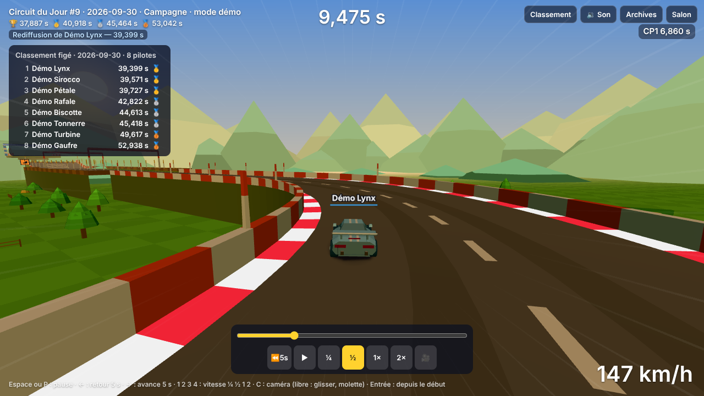

# Retouche 27b — Le Salon oublie chaque session ; revoir le meilleur tour

**À essayer** (aperçu de la branche `ccr-7a787c67-0to9vn`)

1. **Une bascule : tout repart de zéro** — [`?mode=salon&api=demo&salonMinutes=2`](https://nathan-te.github.io/DailyTrack/b/ccr-7a787c67-0to9vn/?mode=salon&api=demo&salonMinutes=2). Laisse passer la fin de la session (« dernier essai » à 30 s, podium 10 s) : le classement de la session suivante est **vide**, ta course précédente n'y est pas, et rien de l'ancienne session n'est accessible (le serveur répond 404 pour elle après la minute de grâce ; le podium s'affiche pendant la grâce, à partir du classement qui existe encore).
2. **Revoir le meilleur tour d'un jour passé** — [`?api=demo&day=2026-09-30&watch=best`](https://nathan-te.github.io/DailyTrack/b/ccr-7a787c67-0to9vn/?api=demo&day=2026-09-30&watch=best) : la voiture du premier (pleine, avec son pseudo), la barre de lecture en bas. Essaie : Espace (pause), `←` (retour de 5 s), `1` `2` `3` `4` (¼, ½, 1×, 2×), **C** (proche, loin, capot, puis la **caméra libre** : glisser pour tourner, molette pour zoomer), la barre de progression. À l'arrivée : « Rejouer la rediffusion » ou « Courir contre ce fantôme ».
3. **Revoir le premier d'une session du Salon** — [`?mode=salon&api=demo&watch=best`](https://nathan-te.github.io/DailyTrack/b/ccr-7a787c67-0to9vn/?mode=salon&api=demo&watch=best) : si personne n'a encore de temps dans la session, la page attend le premier (« En attente du premier temps de la session… »). Quand la session finit, retour au Salon normal.
4. **Depuis les archives** : [`?api=demo`](https://nathan-te.github.io/DailyTrack/b/ccr-7a787c67-0to9vn/?api=demo) → touche **H** → sous chaque jour, « ▶ Revoir le meilleur tour ». Même lien sous le classement du jour (jour passé), sur l'écran d'arrivée, et sous le classement du Salon.
5. **Téléphone** : ouvre le lien 2 sur le téléphone. Il n'y a **aucune commande de conduite** (donc aucune zone tactile, `&zones=1` ne dessine rien) ; la barre de lecture est en bas, boutons de 44 px.

## Ce que fait le lot

### 1. Le Salon oublie (`apps/api/src/salon.ts`)
- **Décision de Nathan : une fois le circuit changé, on ne garde rien.** À `fin de session + 60 s` (la minute de grâce où un envoi est encore accepté), les courses, la version du classement et le circuit de la session sont **effacés**. `GET /api/salon/podiums` et la table `salon_podiums` n'existent plus (`MIGRATIONS` la supprime d'une base existante). Le jeu n'appelait pas cette route. Le podium de fin se calcule, comme avant, sur `board` : il reste servi pendant la grâce.
- **À la demande, pas en tâche de fond** : `forget()` est appelé au début de chaque route du Salon. Tant que la session n'a pas changé c'est une comparaison d'entiers ; à la première requête qui voit une session terminée, quelques `DELETE` (sans effet s'il n'y a rien à effacer). Une instance qui démarre refait le nettoyage une fois (rattrape un arrêt prolongé, ou les sessions que la version précédente gardait 48 h). Sur Cloud Run le service peut être éteint : rien ne dépend d'une minuterie (`api.tick()` ne sert plus qu'à préparer le circuit suivant).
- **Numéros de session servis** : de la plus ancienne dont la grâce court à la suivante (404 `unknown_session` au-delà).
- **Mode démo** (`salonDemo.ts`, `forget`/`served`) : mêmes règles ; la course du joueur disparaît avec la session.

### 2. Présence allégée
- **Une écriture par joueur et par 30 s au plus.** L'instance retient sa dernière écriture par joueur (aucune requête dans l'intervalle) **et** l'`upsert` est conditionnel (`… WHERE seen_at <= excluded.seen_at − 30 s`) : une seconde instance sur la même base n'écrit pas de plus (testé avec deux `createApi` sur une même base).
- **Choix : base + mémoire, pas la mémoire seule.** La présence en mémoire seule compterait mal avec deux instances (chacune ne verrait que ses joueurs). Avec l'écriture espacée, le retard de la dernière écriture est de 30 s au plus (40 s dans le pire cas à deux instances) : la fenêtre « présent » passe donc de 30 s à **60 s** (`PRESENCE_MS`) ; un joueur qui lit en continu est toujours compté (testé : 60 lectures sur 5 minutes, 10 écritures).
- **Le débit des lectures est passé en mémoire** (par instance) : la mesure a montré que le compteur `rate` écrivait à **chaque lecture** (947 lignes par joueur et par heure, autant que la présence). Avec deux instances la limite réelle est au plus doublée ; une lecture coûte < 1 ms, et les envois (le seul poste qui coûte un rejeu) gardent leur compteur **en base**, exact.
- `INSERT` du joueur au `submit` : ne réécrit plus la ligne si le pseudo est inchangé (`WHERE players.name <> excluded.name`).

### 3. Mesures (`npm run measure:salon`, 50 joueurs, session de 10 minutes, même machine : Xeon 2,1 GHz, `MEM=1`)
Le script compte maintenant les **lignes écrites** par table (`changes()` après chaque `INSERT`/`UPDATE`/`DELETE`), ce que facture Turso.

| Écritures par joueur et par heure | avant (lot 27) | après (27b) |
|---|---:|---:|
| `rate` (débit) | 947,3 | **84,8** (envois seulement) |
| `salon_presence` | 902,8 | **118,6** (≈ 2 par minute) |
| `salon_throttle` (un envoi toutes les 5 s) | 84,8 | 84,8 |
| `players` | 84,8 | **6,0** (pseudo inchangé : plus de réécriture) |
| `salon_runs` + `salon_sessions` | 23,8 | 23,8 |
| `salon_circuits` | 0,2 | 0,2 |
| **Total** | **2 043,7** | **318,2** (÷ 6,4) |

- Pour un joueur présent 4 h par jour pendant un mois : ≈ 245 000 → **38 000 lignes écrites par mois** (l'offre gratuite de Turso en compte 10 millions : ≈ 260 joueurs « à plein temps » contre ≈ 40 avant). Le reste est le prix d'un envoi toutes les 40 s (`throttle`, `rate`, `runs`) : incompressible sans affaiblir la défense.
- **Requêtes par joueur et par heure** : 947 (classement 699, `now` 119, fantômes 45, envois 85) — **inchangé**, seules les écritures baissent. Le calcul du serveur est un peu plus léger (fil occupé 3,0 % → 2,6 %).
- **Coût d'un rejeu serveur** (envoi, même machine) : médiane 16,1 ms avant, 14,5 ms après (bruit de mesure : aucun code de rejeu n'a changé).
- Les effacements de fin de session ne sont pas dans ce tableau (la mesure ne traverse pas la fin d'une session) : 3 `DELETE` par session, de l'ordre d'une ligne par joueur classé — déjà comptées à l'écriture.

### 4. Revoir le meilleur tour (mode spectateur)
- **`?watch=best`** (avec `?day=` / `?seed=` ou `?mode=salon`) ; `watchHref` ajoute le paramètre à l'adresse actuelle. Accès : écran d'arrivée (jour et Salon), classement du jour, carte d'un jour des archives, classement du Salon, option « Revoir le meilleur tour » de `/admin/` + préréglage de démonstration.
- **Qui est regardé** : le premier du classement (jour : `online.remoteGhost("first")` ; Salon : `salon.bestGhost()`), sinon **ton record local** ; rien → course normale et un bandeau.
- **Lecture** : la rediffusion est rejouée par `RunSession` + `ReplayPlayer`, le code même du fantôme et du serveur, **sans toucher à `sim`**. La voiture du tour est **pleine** (`createCarMesh(true, couleur, false, true)`), à la couleur du fantôme (bleu pour le jour, rose pour le premier du Salon), son pseudo au-dessus (même étiquette que les fantômes du Salon). Chrono, temps intermédiaires (sans comparaison à ton record), vitesse : ceux du tour regardé. Bandeau « Rediffusion de <pseudo> — <temps> ».
- **Commandes** : pause (Espace / P / bouton), ralenti ¼ et ½, accéléré 2× (touches 1–4 / boutons), retour de 5 s (← / bouton), avance de 5 s (→), barre de progression, caméras proche / loin / capot (**C**) puis **caméra libre** (glisser, molette, pincement).
- **Fin** : « Rejouer la rediffusion » (ou Entrée) ou « Courir contre ce fantôme » (course normale avec ce fantôme ; dans le Salon : retour au Salon, qui montre déjà les premiers).
- **Retour en arrière — méthode retenue : rejouer depuis le départ.** Mesuré dans `apps/web/test/watch.test.ts` : **20,8 ms** pour revenir à la fin d'un tour de 32,2 s (3 864 pas, circuit d'essai ; une cuve ajoute environ le double — voir le coût d'un rejeu du lot 18 : ≈ 38 ms). Un instantané toutes les quelques secondes aurait ramené cela à < 5 ms au prix d'un état copié (donc d'une dérive possible) ; 20–40 ms, soit une ou deux images, ne se remarquent pas. Le test vérifie que sauter n'importe où (ou revenir de 5 s) puis finir donne **le même temps au pas près** et que l'état après un saut égale celui d'une lecture continue.
- **Aucune requête d'écriture** : rien n'est envoyé au serveur, `cdj:best:*` ne bouge pas (testé). **Un spectateur ne compte pas dans la présence du Salon** : `SalonApi.now(null)` / `board(session, null)` n'envoient aucun `player=` (testé côté client ; côté serveur, `me` nul ne touche pas la présence).
- **Tactile** : en spectateur le jeu **ne monte pas les commandes de conduite** (`mountDrivingTouch` n'est appelé qu'en course) : pas de zones, pas de frontières à éviter ; la barre de lecture a ses boutons à 44 px, la vitesse et les indicateurs passent au-dessus d'elle sur petit écran.

## Garde-fous
- `packages/sim` : **aucun changement** ; `SIM_VERSION` et `GENERATOR_VERSION` inchangées ; golden inchangés ; pas de `history:seed`.
- Le serveur ne fait toujours pas confiance à un temps annoncé (rien n'a bougé du rejeu) ; la lecture affiche le temps **recalculé** par la simulation.
- Le jeu marche sans API ; sans rediffusion à revoir, course normale.

## Vérifications faites
- Tests Vitest : API (`apps/api/test/salon.test.ts` — oubli après la grâce, podium servi pendant la grâce, session en cours et suivante intactes, arrêt prolongé, nettoyage une seule fois par session, présence espacée juste pour un joueur qui lit en continu et avec deux instances, lecture sans écriture) ; web (`watch.test.ts` : règles pures, rejeu identique après saut / retour, `HttpSalonApi` sans identifiant, démo qui oublie, voiture pleine).
- E2E (Chromium, `e2e/watch.spec.ts`) : depuis les archives en démo la lecture finit sur **exactement** le temps du premier ; pause, ¼ ½ 1 2, retour de 5 s et barre de progression ne changent pas ce temps ; « Courir contre ce fantôme » lance une course avec le bon fantôme ; caméras (dont la libre) et pseudo ; liens du classement du jour, de l'arrivée (ton record), du Salon ; attente du premier temps ; fin de session → Salon normal ; téléphone (3 formats, aucune zone, rien ne se chevauche).

## Non vérifié
- Un **vrai Salon en ligne** (Turso, Cloud Run, deux instances) : les écritures sont comptées sur SQLite en mémoire ; le chiffre « lignes écrites » de Turso peut différer légèrement (index compris).
- **Firefox et WebKit** (la CI les lance), un **vrai téléphone** (pincement de la caméra libre notamment).
- Le retour en arrière sur un circuit lourd (cuves en nombre) en navigateur : mesuré en Node seulement.
- La caméra libre ne détecte pas le décor : elle peut passer sous la route ou dans un mur.
