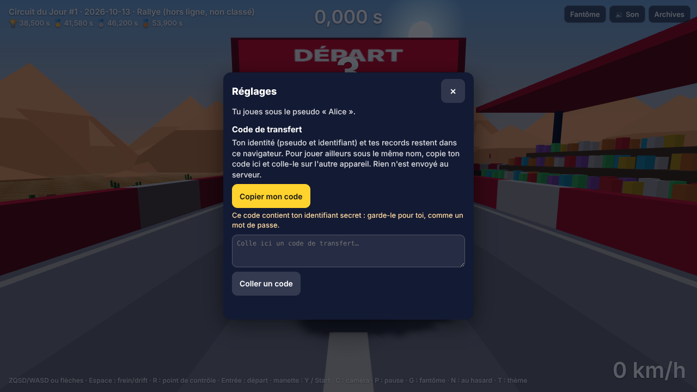
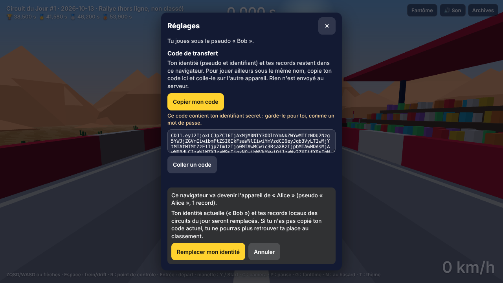

# Lot 28 — Mise en ligne : Cloud Run + Turso

**Aperçu** : <https://nathan-te.github.io/DailyTrack/b/ccr-e2518709-sy32q7/?api=demo> — le **mode démo est intact** (archives de quatorze jours depuis le 13/10/2026, classements figés). Le **code de transfert** est dans les réglages : touche **P** (pause) → **Réglages** → *Copier mon code* / *Coller un code* (sur téléphone : ⚙ → *Code de transfert…*). L'aperçu de branche **n'a volontairement pas d'API** : `VITE_API_URL` n'est injectée que dans la construction de `main`.

**Pour mettre en ligne pour de vrai : suis [`docs/mise-en-ligne.md`](../mise-en-ligne.md)** (30 minutes, pas à pas, avec ce que tu dois voir à l'écran). Un agent cloud ne peut ni créer de compte ni entrer une carte bancaire : tout est préparé dans le dépôt, la mise en ligne réelle est à faire par Nathan.

 

## Livré
- **Turso** : `SqlDb` sur libSQL (`libsql.ts`, `libsql-open.ts`). En ligne : client HTTP pur JavaScript embarqué dans le paquet (`libsql://` lu comme `https://`, aucune connexion qui dure) ; en local et dans les tests : fichier libSQL (client natif, chargé à la demande). Choix par `TURSO_DATABASE_URL` / `TURSO_AUTH_TOKEN` ; sans elles, SQLite comme avant. **Schéma** créé ou mis à jour au démarrage, reconnu par une empreinte (table `meta`) : une seule lecture au réveil, aucun numéro à incrémenter.
- **Conteneur** : `PORT`, `NODE_ENV=production`, un seul fichier JavaScript (pas de `node_modules`), image de 327 Mo (`node:22-slim` pèse 329 Mo ; le paquet de l'API, 0,4 Mo, est l'unique fichier ajouté). **Aucune tâche de fond en production** : le circuit du jour et celui d'une session du Salon sont générés à la première requête qui en a besoin, un seul calcul même si deux requêtes arrivent ensemble, puis gardés en base. Le serveur **refuse de démarrer** (code 1, ligne JSON « configuration refusée ») avec `SALON_MINUTES`, sans `ALLOWED_ORIGINS` ni `RATE_SALT`, ou sur Cloud Run sans Turso.
- **CORS** par liste (`ALLOWED_ORIGINS`, sans chemin : `https://nathan-te.github.io` couvre le jeu et ses aperçus) ; **adresse du client** lue depuis la droite de `X-Forwarded-For` (le début est écrit par le client) ; **`/api/health`** (base, versions, `SALON_MINUTES`, révision ; 503 si la base ne répond pas) ; **journaux JSON** courts, sans rediffusion, pseudo, identifiant ni adresse.
- **CI** : `deploy-api.yml` (image → Artifact Registry → Cloud Run `europe-west1`, `--min-instances=0 --max-instances=2`, 1 vCPU, 512 Mo, concurrence 40, secrets de Secret Manager ; **ignoré proprement sans configuration**, puis contrôle de santé) ; job `api-image` de `ci.yml` (construit l'image, la lance contre un vrai serveur libSQL `sqld`, refuse `SALON_MINUTES`, passe `npm run smoke`) ; `pages.yml` : `VITE_API_URL` seulement pour `main`.
- **`PREMIER_JOUR` = 13/10/2026** ; golden : **seuls les `number` ont changé** (7 lignes) ; `history:seed` refait (14 jours du 13 au 26/10) ; avant le premier jour l'en-tête n'affiche pas de numéro.
- **Code de transfert** (`transfer.ts`, `transferUi.ts`) : `CDJ1.<base64url>.<CRC-32>` ; identifiant secret, pseudo, records et temps confirmés des circuits du jour ; rediffusions pour les 3 derniers jours et les courses pas encore classées. Coller = somme de contrôle, validation de chaque champ, confirmation, **remplacement** (réglages et essais gardés), rechargement. Rien n'est envoyé au serveur.
- **Mesures** : `npm run smoke`, `npm run measure:budget` (ci-dessous).

## Garde-fous
- Tests d'API : **les mêmes sur SQLite et sur libSQL** (deux projets Vitest) ; `production.test.ts` : schéma (neuf, ancien sans `meta`, démarrage simultané, échec non gardé), santé (200, 503), circuit calculé une fois pour trois requêtes simultanées, CORS, adresse du client, configuration, adaptateur ; **un test vérifie que les journaux ne contiennent ni pseudo, ni identifiant, ni rediffusion**.
- Code de transfert : 13 tests unitaires (aller-retour, code tronqué ou modifié refusé, code piégé : seuls des champs propres sont écrits, remplacement idempotent) et `e2e/transfer.spec.ts` (deux navigateurs, presse-papiers réel, annulation, taper dans la zone ne déclenche aucune commande de jeu, trois formats de téléphone).
- Aucun secret dans le dépôt (balayage du diff) ; `sim` : seule la constante `PREMIER_JOUR` change (`SIM_VERSION` 14 et `GENERATOR_VERSION` 15 inchangées, rediffusions de référence inchangées).

## Mesures (même machine : Xeon 2,8 GHz, 1 cœur utilisé, sqld local)
- **Réveil** (image Docker contre `sqld`, 5 démarrages) : processus prêt en **75–85 ms**, schéma reconnu en **35–47 ms** (une lecture), première réponse de `/api/health` **0,37–0,42 s** `docker run` compris. Sur Cloud Run s'y ajoutent le démarrage du conteneur et l'aller-retour vers Turso : compter **1 à 2 s** pour la première requête après un repos (seed § 7).
- **Première requête qui génère** : circuit du jour **0,5 s** (une fois par jour), circuit d'une session du Salon **0,3–0,5 s** (au premier envoi de chaque session, qui paie donc la génération en plus du rejeu).
- **Mémoire** : 16 Mo au repos, **43 Mo** après un circuit généré et deux rejeux (d'où 512 Mo : très large).
- **Coût d'un rejeu (même machine, alterné, 40 rejeux, avant = `main`, après = ce lot)** : **12,1 ms → 12,3 ms** par `decodeReplay` + `replayRace` d'une course de 39 s (trois passages alternés de 40 rejeux : 12,1 / 13,2 / 11,2 ms avant, 11,9 / 12,8 / 12,2 ms après : le bruit entre passages dépasse l'écart ; code de `sim` identique, seule la constante `PREMIER_JOUR` change). Requête `submit` complète : 25–40 ms de calcul.

### Budget d'un joueur (`npm run measure:budget`, `rows_read` / `rows_written` de `sqld` = ce que facture Turso)
| Requête | instr. SQL | lignes lues | écrites | calcul |
|---|---|---|---|---|
| circuit du jour, déjà en base | 1 | 1 | 0 | 2 ms |
| envoi d'un temps (rejeu) | 9,7 | 110 | 6,3 | 29 ms |
| classement du jour | 6 | 85 | 0 | 10 ms |
| Salon : `now` / classement sans nouveauté / classement changé (50 présents) | 1,5 / 4,1 / 6,5 | 50 / 100 / 218 | 1 / 0,1 / 0 | 2 / 6 / 11 ms |
| Salon : envoi (rejeu) | 14–16 | 315–418 | 7–12 | 41–43 ms |

| Un joueur, une journée | requêtes | lignes lues | lignes écrites | calcul |
|---|---|---|---|---|
| circuit du jour seul (1 circuit, 3 classements, 2 fantômes, 3 temps) | **9** | 644 | 19 | 0,1 s |
| + 30 min de Salon, 10 présents | **567** | 13 410 | 281 | 5,7 s |
| + 30 min de Salon, 50 présents | **567** | 63 672 | 281 | 4,2 s |

Hypothèse du Salon de 30 minutes : 3 sessions, `now` toutes les 10 s (180), classement toutes les 5 s (360, dont 30 % ont changé), 12 lots de fantômes, 6 envois.

**Joueurs par jour que tient l'offre gratuite** (÷ 30 jours ; Cloud Run : 2 M requêtes, 180 000 vCPU-s ; Turso : 500 M lignes lues, 10 M écrites) :
| | requêtes | Turso lu | Turso écrit | vCPU (calcul seul / borne haute) |
|---|---|---|---|---|
| circuit du jour seul | 7 400 | 25 900 | 17 500 | 44 000 / 3 300 |
| + 30 min de Salon (10 présents) | **117** | 1 240 | 1 190 | 1 050 / 60 |
| + 30 min de Salon (50 présents) | **117** | **260** | 1 190 | 1 440 / 60 |

- **Le circuit du jour tient plusieurs milliers de joueurs par jour dans le gratuit.** **Le Salon est ce qui consomme** : un joueur connecté fait ≈ 0,3 requête par seconde (classement toutes les 5 s, `now` toutes les 10 s), soit ≈ **1 100 requêtes par heure** : l'offre de 2 M requêtes = ≈ **60 heures-joueur de Salon par jour**, ≈ 120 joueurs de 30 minutes. Au-delà, ce n'est pas un mur mais des centimes : 0,40 $ par million de requêtes, et un Salon peuplé garde l'instance active (jusqu'à 1 vCPU-seconde par seconde à partir de ≈ 10 requêtes par seconde : 50 heures de Salon peuplé par mois dans les 180 000 vCPU-s, puis ≈ 0,09 $ de l'heure).
- **Les lignes lues de Turso grandissent avec le nombre de présents** (`COUNT` de la présence et des participants à chaque lecture : ≈ 2 lignes par présent) : à 50 présents, 260 joueurs de 30 minutes par jour ; à 200 présents le gratuit ne tient plus (≈ 4× plus par lecture). Levier non appliqué : garder ces deux nombres en mémoire quelques secondes par instance.
- **Écritures** : 19 lignes par joueur et par jour (circuit seul), 281 avec le Salon (présence, courses, version du classement) : large marge.
- **Vérifié** : le calcul (CPU) ne limite jamais (rejeu 25–43 ms). **Estimé, pas vérifié** : la facturation réelle de Cloud Run (arrondi à 100 ms par requête, partagé entre requêtes simultanées) et le temps d'aller-retour réel vers Turso (supposé 25 ms ; le plus lent est le classement : 4 à 6 instructions, dont 3 en parallèle).

## Décisions pour Nathan
1. **Leviers pour le Salon si le gratuit ne suffit pas** (aucun appliqué) : lire le classement toutes les 10 s au lieu de 5 s (divise les requêtes par ≈ 1,7), garder `players` et `participants` en mémoire quelques secondes (divise les lignes lues par ≈ 3 à 50 présents), plafonner `max-instances` à 1 ; ou passer à l'offre Turso à 4,99 $ par mois (2,5 milliards de lignes lues).
2. **Code de transfert qui remplace** (et ne fusionne pas) l'identité et les records des circuits du jour : plus simple à comprendre et à tester ; fusionner (garder le meilleur des deux) est possible mais enverrait au nouvel identifiant des temps jamais classés de l'ancien.
3. **Premier jour = 13/10/2026** : tout temps d'une date antérieure est refusé par l'API ; les archives du jeu commencent à ce jour.
4. **`RATE_SALT` obligatoire** en production (non demandé dans le sujet, ajouté : sans sel, les adresses hachées du limiteur de débit se retrouvent par essais) ; un troisième secret dans Secret Manager.
5. **Aperçus de branche sans API** : un essai de branche ne classera jamais de temps dans la vraie base ; pour tester une branche avec l'API, ajoute `?api=<adresse>`.

## Non vérifié
- **Aucun déploiement réel** : pas de compte Google Cloud, Turso ni GitHub secrets ici. Le workflow `deploy-api.yml` est validé par `actionlint` et par l'exécution de son étape de configuration (avec et sans variables), **pas par un vrai déploiement** ; les étapes `google-github-actions/*@v3` n'ont pas tourné. Les commandes `gcloud` du guide sont écrites d'après la documentation, **pas essayées**.
- **Turso lui-même** : le protocole et le moteur sont ceux de `sqld` (essayé : tests d'API sur fichier libSQL, image Docker contre un vrai `sqld`, `rows_read` / `rows_written`), pas un compte Turso ; latence réelle, limites et libellés des boutons à confirmer.
- **Adresse du client sur Cloud Run** : on suppose que la dernière entrée de `X-Forwarded-For` est celle que voit Google (principe général des proxys qui ajoutent), à reconfirmer après le déploiement.
- **Facturation Cloud Run réelle** (voir ci-dessus), **vrai téléphone** pour la fenêtre Réglages (formats simulés seulement), Firefox et WebKit (CI).
