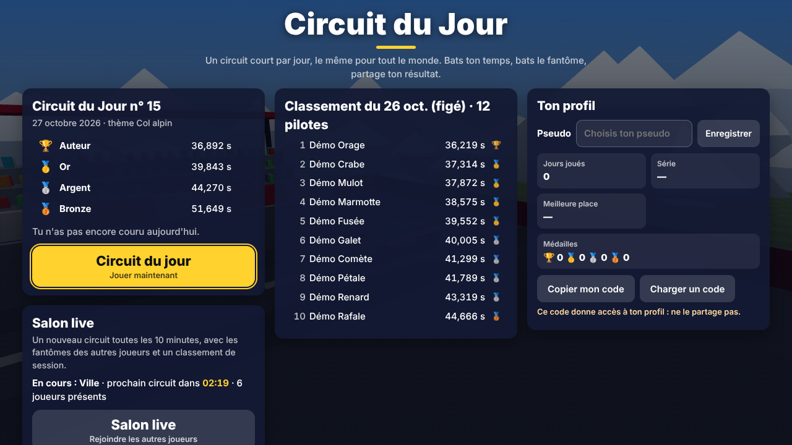
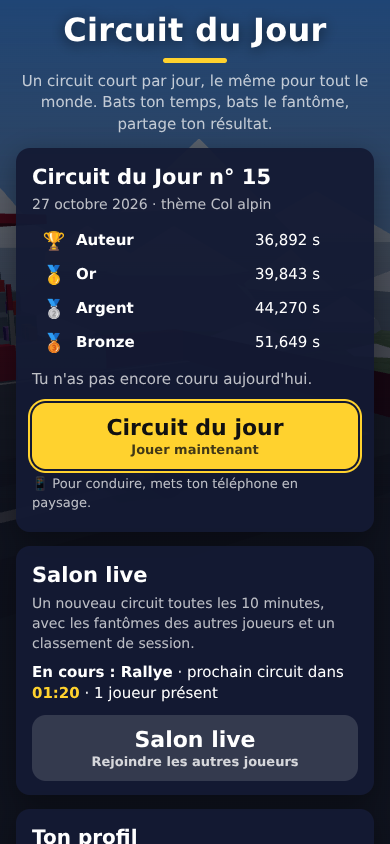
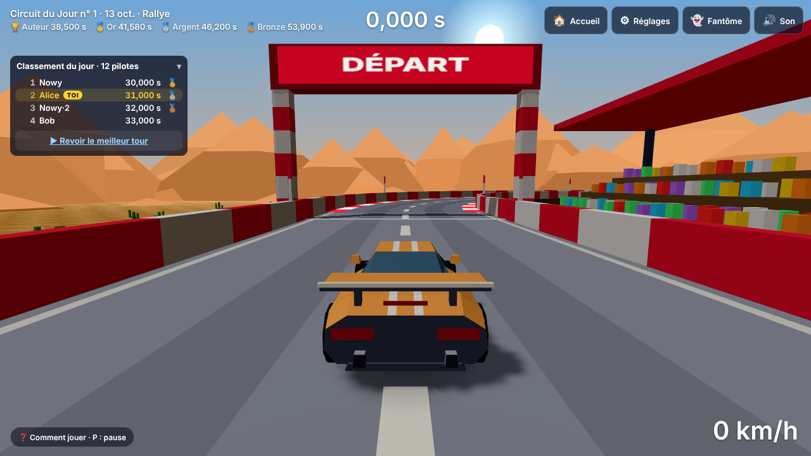
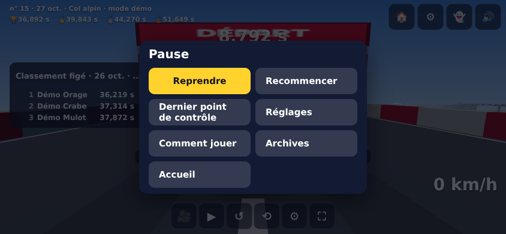
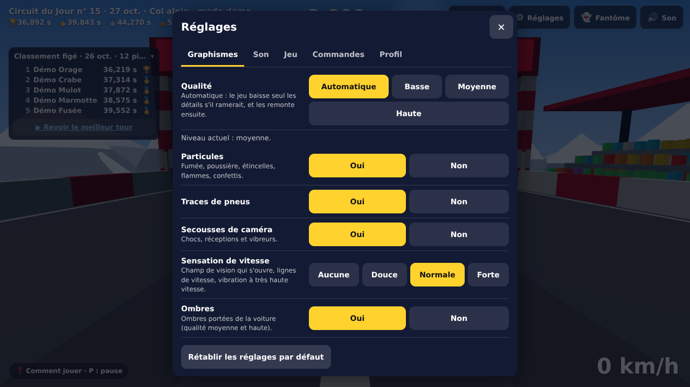
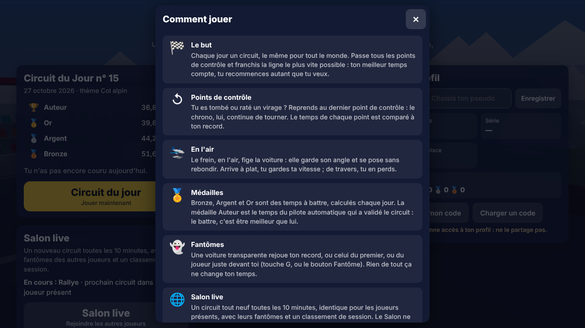

# Lot 29 — Accueil, réglages et compréhension

**À essayer** (aperçu de la branche `lot-29-accueil-ux`)

1. **L'accueil, en démo** — [`?api=demo`](https://nathan-te.github.io/DailyTrack/b/lot-29-accueil-ux/?api=demo) : titre, circuit du jour, classement (de démonstration : la veille, figée), Salon live, carte du profil. Touche **Circuit du jour** : l'aide « Comment jouer » s'ouvre à la première visite, puis le décompte.
2. **Sur le téléphone** — [`?api=demo&touch=1`](https://nathan-te.github.io/DailyTrack/b/lot-29-accueil-ux/?api=demo&touch=1) : l'accueil marche en portrait (défiler pour le profil), la course en paysage.
3. **Une fois fusionné** : le jeu en ligne, <https://nathan-te.github.io/DailyTrack/>.
4. Les outils de test gardent leurs liens directs : [`?debug&api=demo`](https://nathan-te.github.io/DailyTrack/b/lot-29-accueil-ux/?debug&api=demo) saute l'accueil, [`?home=1&debug&api=demo`](https://nathan-te.github.io/DailyTrack/b/lot-29-accueil-ux/?home=1&debug&api=demo) le force.

## Ce qui change

**Aucun changement de `packages/sim` ni de `apps/api`** : `SIM_VERSION` 14, `GENERATOR_VERSION` 15, golden inchangés, rediffusions identiques (le coût d'un rejeu ne peut pas bouger : le code qui le fait n'a pas été touché).

| Demande de Nathan | Ce qui a été fait |
|---|---|
| Écran d'accueil | `#home` : titre, carte du jour (numéro, date, thème, **médailles nommées avec leur temps**, ton meilleur temps, ta médaille et ton rang), classement du jour (10 premiers + ta ligne, « Revoir le meilleur tour »), **deux grands boutons** (*Circuit du jour*, *Salon live* avec circuit en cours, thème, temps restant, joueurs présents, et un état clair si le serveur ne répond pas), **carte du profil**, liens Archives · Réglages · Comment jouer. La scène du jour est survolée lentement derrière (coût mesuré plus bas). |
| Classement par défaut | Panneau compact dans un coin (3 lignes sur téléphone, 5 sinon), **replié par L ou par son en-tête**, état mémorisé, ta ligne marquée **« toi »**, deux joueurs au même pseudo → `Nowy`, `Nowy·2`. Même panneau dans le Salon. |
| Réglages, plus de bouton Salon | Barre du haut **Accueil · Réglages · Fantôme · Son** (icône muet). Le Salon s'ouvre depuis l'accueil, le retour à l'accueil se fait par la barre, la pause et l'arrivée. |
| Menu de pause | Reprendre · Recommencer · Dernier point de contrôle · Réglages · Comment jouer · Archives · Accueil (**confirmation si une course est en cours**). Échap, P, Start (manette), bouton ⏸. |
| Réglages complets | Panneau à onglets, appliqué tout de suite, mémorisé et versionné (`cdj:settings`, version 1) : **Graphismes** (qualité Automatique / Basse / Moyenne / Haute, particules, traces, secousses, sensation de vitesse, ombres), **Son** (général, moteur, effets, ambiance, muet : trois bus Web Audio), **Jeu** (caméra par défaut, fantôme affiché, classement, temps intermédiaires, km/h ou mph), **Commandes** (rappel clavier et manette, réglages tactiles existants), **Profil** (pseudo, code de transfert). |
| Compréhension | **« Comment jouer »** (conduire selon l'appareil, points de contrôle, frein en l'air, médailles, fantômes, Salon) montrée à la première visite, accessible partout ; arrivée revue : temps, médaille, rang, **Rejouer · Revoir le meilleur tour · Partager · Accueil** ; messages « Hors ligne : course non classée », « Temps enregistré · 4e sur 7 », « Envoi au classement… ». |

### Liens directs

L'accueil s'affiche sauf si l'adresse choisit un circuit ou un mode : `?seed=` `?day=` `?scenario=` `?mode=` `?watch=` `?demo` `?debug` `?theme=` `?variant=` `?spec=`. `?home=1` le force (même avec `?debug`), `?home=0` le coupe. Les liens de partage d'un jour passé (`?seed=`) et les archives n'ont donc pas changé ; le lien de partage d'aujourd'hui (l'adresse nue) ouvre l'accueil, un clic de plus. Depuis la course, « Accueil » revient **sur place** si le circuit d'aujourd'hui est joué, par la page (`?home=1`) depuis le Salon, une archive, un scénario ou une rediffusion.

### Le chrono de la capture (1:01,717 voiture arrêtée)

Ce n'est pas un défaut du chrono : il **part au « PARTEZ ! »**, voiture immobile ou non (comme Trackmania), et la capture a été prise ~1 minute après le départ sans que le joueur accélère. Le temps est un nombre de pas de simulation, on n'y touche pas (`sim` est intact). Vérifié par `accueil.spec.ts` : il vaut 0 au décompte, ne tourne ni à l'accueil, ni en pause, ni fenêtre ouverte (le jeu est gelé), et il part à GO. Ce qui change pour le joueur : le décompte ne commence plus qu'au clic sur « Circuit du jour » (plus de minute perdue à lire), et **si la voiture ne bouge pas 2,5 s après le départ, une aide le dit** (« Le chrono tourne : ↑ ou Z pour accélérer »).

## Décisions

- **Accueil = une couche au-dessus du jeu déjà chargé** (pas une page à part) : le circuit du jour doit être généré de toute façon pour la carte du jour, et la scène sert de fond. « Salon live » est un changement de page (le Salon se démarre au chargement, comme avant).
- **Profil sans serveur** : jours, médailles, série et meilleure place viennent des records locaux (`listPlayedDays` compte **toutes les versions de générateur**, les archives non) ; la place est retenue à chaque fois qu'on la voit (`cdj:rank:<date>`) et **voyage dans le code de transfert** (champ `ranks` facultatif : un code plus ancien se charge toujours).
- **Gamepad** : Start ouvre la pause (il recommençait avant) ; **X** recommence. C'est un changement de comportement à connaître.
- **Pseudos en double** : suffixe `·2` par ordre d'affichage, calculé à l'affichage ; le lot 30 (pseudos réservés) le rendra inutile.
- **Aide automatique** : après « Circuit du jour » / « Salon live » (la page d'accueil se comprend sans elle), ou avant le départ d'un lien direct ; jamais avec `?debug` (sauf `?howto=1`).

## Vérifications

- `npm run typecheck`, `npm test` : verts, golden inchangés ; tests purs ajoutés : `settings.test.ts`, `profile.test.ts`, `homeLogic.test.ts`, `admin.test.ts`.
- e2e `accueil.spec.ts` (Chromium) : accueil (titre, classement, deux boutons), « Circuit du jour » lance la course avec le classement, Accueil par la barre et la pause (avec / sans confirmation), « Salon live » ouvre le Salon de démo, les liens de test sautent l'accueil, sans serveur / serveur muet, qualité appliquée et conservée au rechargement (`?quality=` l'emporte), chaque onglet des réglages (cibles ≥ 44 px, choix appliqués, mémorisés, versionnés), aide à la première visite seulement, copier / charger un code entre deux contextes (pseudo, records, places), pseudos en double et « toi », chrono, Échap / P / Start, **mise en page portrait, paysage et petit portrait avec la police DejaVu Sans** (aucun débordement ni chevauchement, boutons ≥ 44 px).
- Captures (`img/lot-29-*.png`) : accueil ordinateur et téléphone, profil, charger un code, course avec classement (ordinateur et téléphone), pause, chaque onglet des réglages, « Comment jouer ».

## Coût de la scène derrière l'accueil

MESURE_ACCUEIL

## Non vérifié

- Sur un **vrai téléphone** : fluidité de l'accueil (scène en fond à 20 images/s), défilement de l'accueil au doigt, aide « Comment jouer » dans la page d'accueil de iOS, partage natif.
- Firefox et WebKit (la CI les lance).
- Manette réelle (simulée par un faux `getGamepads` dans le test).
