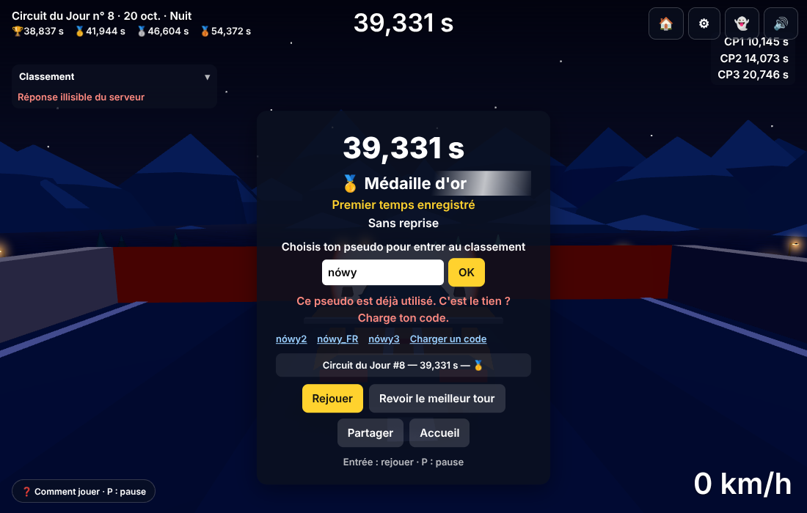
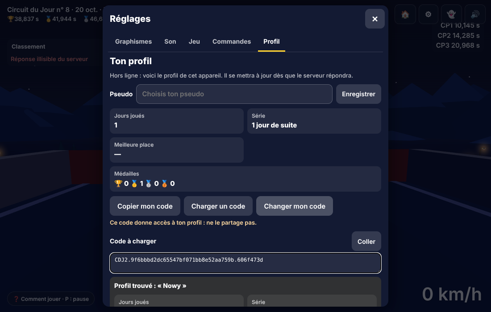

# Lot 30 — Pseudos réservés et profil synchronisé

**Aperçu (mode démonstration, sans serveur)** : <https://nathan-te.github.io/DailyTrack/b/lot-30-pseudos/?api=demo> — l'accueil et la carte du profil s'y ouvrent comme avant ; « Charger un code » y répond « Pas de serveur ici ». **Les pseudos réservés, la synchronisation et « Changer mon code » ne se voient qu'avec un serveur** : l'aperçu de branche n'a volontairement pas d'API (`VITE_API_URL` n'est injectée que pour `main`). Les scénarios à faire en ligne, après la fusion, sont plus bas ; en local : `npm run build:node -w @cdj/api && DB_PATH=:memory: npm start -w @cdj/api`, puis le jeu avec `?api=http://localhost:8787`.

 
 

## Livré
- **Un pseudo appartient à son premier propriétaire** (toute la base, Turso et SQLite) : clé d'unicité = minuscules, accents retirés, espaces réduits (`nameKey`) ; index unique `players_by_name_key` ; vérifié avant le rejeu **et** garanti à l'écriture (deux courses simultanées pour « Duel » : une réussit, l'autre reçoit un refus propre). Même règle pour la première course, `PUT /api/player` et le Salon. Refus : `409 name_taken` — « Ce pseudo est déjà utilisé. C'est le tien ? Charge ton code. » — avec des **suggestions libres** (« Nowy2 », « Nowy_FR »…) que le jeu propose à toucher, et le bouton **Charger un code** (arrivée, Salon, carte du profil). `GET /api/name?name=` répond seulement libre / pris (40 par adresse et par fenêtre) ; aucune liste de pseudos. Mots interdits et noms réservés : liste courte et modifiable (`pseudos.ts`), sans faux positif sur « Technique » ou « Computer ».
- **Migration des doublons** : au premier démarrage après le déploiement (le schéma change), le plus ancien (première course) garde le pseudo, les autres reçoivent « Nowy·2 » et un drapeau ; **aucun temps touché**. À leur prochaine visite la carte du profil leur dit : « Le pseudo « Nowy » était déjà utilisé… Choisis un nouveau pseudo — ou, si « Nowy » est bien toi, charge ton code » (avec « Garder « Nowy·2 » »). Le script `npm run pseudos:migrate` fait la même chose avec un rapport : essai à blanc par défaut, `-- --apply` pour appliquer.
- **`GET /api/me`** (identifiant dans l'en-tête `X-Player-Id`, jamais dans l'adresse) : pseudo, statistiques (jours joués, médailles par type, meilleure place, série), meilleur temps du jour **et sa rediffusion** (fantôme « ton record »), meilleurs temps des jours passés (médailles des archives).
- **Synchronisation** (au lancement et au retour à l'accueil, au plus une fois par 30 s) : le serveur et le cache se fusionnent, **le meilleur gagne** ; un record local meilleur (fait hors ligne) n'est jamais effacé : il est envoyé au serveur, qui le **rejoue** ; un pseudo changé sur un appareil se voit sur l'autre ; hors ligne le cache sert et la carte du profil le dit en une ligne discrète.
- **Code de transfert simplifié** : `CDJ2.<identifiant>.<somme de contrôle>` (46 caractères). « Charger un code » lit le profil sur le serveur (aperçu : pseudo et statistiques du serveur), puis remplace l'identité ; le record d'aujourd'hui pas encore classé suit le joueur. Les anciens codes `CDJ1` restent acceptés : leurs rediffusions d'hier et d'aujourd'hui sont envoyées au serveur pour validation, le reste est ignoré.
- **« Changer mon code »** (Réglages › Profil et carte du profil ; confirmation obligatoire ; 3 par fenêtre de débit) : le serveur associe le profil à un nouvel identifiant (une transaction), l'ancien est refusé partout en `410` — « Ce code n'est plus valide » — (il n'est gardé que sous forme d'empreinte SHA-256). Pseudo et temps conservés ; les courses du Salon en cours (dix minutes) sont oubliées. Rejouable si la réponse se perd. Les autres appareils voient « Ce code n'est plus valide » et chargent le nouveau code.
- Versions : **aucune** (`SIM_VERSION` 14, `GENERATOR_VERSION` 15 ; golden et `history:seed` inchangés — le script de démonstration donne maintenant un identifiant stable à chaque pilote fictif, puisqu'un pseudo n'appartient qu'à un joueur).

## À tester en ligne (après la fusion)
1. **Deux navigateurs, un pseudo** : sur le premier, joue et prends le pseudo de ton choix. Sur le second (ou une fenêtre privée), joue et tente le même pseudo — en changeant la casse ou un accent — : refusé avec le message, des suggestions et « Charger un code ». Sur le premier, Réglages › Profil › « Copier mon code » ; sur le second « Charger un code », colle : l'aperçu montre ton pseudo et tes statistiques, « Prendre ce profil » : le second est maintenant toi.
2. **Un temps, deux appareils** : bats ton record sur le téléphone ; sur le PC, ouvre l'accueil (ou recharge) : ton nouveau temps, ton rang, ta médaille — et, en lançant le circuit, le fantôme « ton record » — y sont. Un pseudo changé sur l'un se voit sur l'autre à la synchronisation suivante.
3. **Changer mon code** : sur le PC, Réglages › Profil › « Changer mon code » › confirmer (le nouveau code est copié). Sur le téléphone, ouvre l'accueil : « Ce code n'est plus valide… » ; « Charger un code », colle le nouveau code : tout est là. L'ancien code, collé nulle part, ne marche plus (message « Ce code n'est plus valide »).
4. **Migration** (avant ou après le déploiement ; le serveur la fait de toute façon tout seul au premier démarrage) :
   ```
   TURSO_DATABASE_URL=libsql://… TURSO_AUTH_TOKEN=… npm run pseudos:migrate            # essai à blanc : qui serait renommé
   TURSO_DATABASE_URL=libsql://… TURSO_AUTH_TOKEN=… npm run pseudos:migrate -- --apply  # applique et rapporte
   ```
   Rapport d'une **base d'essai que j'ai fabriquée** (dix joueurs dont des doublons, schéma d'avant ce lot ; **je n'ai pas accès à la vraie base**, donc pas de rapport réel : lance l'essai à blanc, il te dit qui a été renommé) :
   ```
   10 joueur(s) dans la base.   Essai à blanc : rien n'est écrit.
   « Nowy » reste au plus ancien — « Nowy » (joueur 030303…) devient « Nowy·2 »
   « Nowy » reste au plus ancien — « nowy » (joueur 040404…) devient « nowy·3 »
   « Nowy » reste au plus ancien — « Nowy » (joueur 060606…) devient « Nowy·4 »
   « Nathan » reste au plus ancien — « Nathan » (joueur 070707…) devient « Nathan·2 »
   « Éloïse » reste au plus ancien — « eloise » (joueur 0a0a0a…) devient « eloise·2 »
   ```
   Puis `--apply` : mêmes lignes, « 5 compte(s) attendent encore que leur propriétaire choisisse un nouveau pseudo » ; un deuxième passage ne fait rien. Les temps de ces joueurs sont intacts (vérifié par test).

## Mesures
**Coût par synchronisation** (`npm run measure:budget`, `sqld` local = ce que facture Turso : lignes lues et écrites ; 30 concurrents par jour) :

| Requête | instructions | lignes lues | lignes écrites | calcul |
|---|---|---|---|---|
| `GET /api/me`, 1 jour d'historique | 8 | 10 | 2 | 37 ms |
| `GET /api/me`, 14 jours | 8 | 36 | 2 | 18 ms |
| `GET /api/me`, 60 jours | 8 | 128 | 2 | 29 ms |
| `GET /api/me`, 120 jours | 8 | 248 | 2 | 27 ms |
| 1re lecture après la fermeture d'un jour (calcule et garde sa place) | 11 | 900 (14 j) · 8 108 (120 j) | 17 · 123 | 24–32 ms |
| vérifier un pseudo / changer de pseudo / changer mon code | 2 / 7 / 10 | 3 / 7 / 13 | 1 / 4 / 10 | 4 / 9 / 19 ms |

Les 2 lignes écrites sont les compteurs de débit. Une synchronisation de plus coûte donc ≈ **8 instructions (un aller-retour chacune), ≈ 10 + 2 × jours d'historique lignes lues** ; un joueur qui synchronise 4 fois par jour pendant 14 jours d'historique : ≈ 150 lignes lues, bien en dessous du Salon (≈ 12 000 par demi-heure). **Piège évité** : la première version calculait la place de chaque jour passé à chaque lecture (une lecture par concurrent et par jour : 844 lignes à 14 jours, 5 768 à 120 jours) ; la place d'un jour terminé est maintenant calculée une fois puis gardée (`results.final_rank`).
Coût d'un **rejeu** (la requête `submit`), `main` contre ce lot, même machine : voir « Vérifications ». Aucun changement dans `sim`.

## Garde-fous
- API (`apps/api/test/pseudos.test.ts`, 30 tests, **SQLite et libSQL**) : pseudo pris refusé (casse, accents, espaces), course refusée = aucun joueur créé, suggestions libres, libéré quand son propriétaire en change, première course avec un pseudo pris refusée proprement, course simultanée, le Salon applique la même règle, migration d'une base avec doublons (le plus ancien garde, les temps intacts, index posé, idempotente, essai à blanc sans écriture), `GET /api/me` (stats, médailles, série, meilleure place, rediffusion, jours passés, identifiant refusé dans l'adresse, débit), place gardée pour un jour terminé, révocation (l'ancien identifiant refusé partout, le nouveau garde tout, rejouable, identifiant déjà pris, débit, empreinte seulement, transaction : un échec au milieu ne laisse rien).
- Client : `profileSync.test.ts` (fusion : le meilleur gagne, rien n'est supprimé, hors ligne, révoqué, inconnu, débit de 30 s, réponse perdue d'un changement de code), `transfer.test.ts` (CDJ2, anciens CDJ1), `online.test.ts` (pseudo, changement de code), `api.test.ts` (en-tête, suggestions).
- Navigateur (`e2e/profil.spec.ts`, vrai serveur sur le port 8790, plusieurs appareils) : pseudo refusé puis code chargé (devient « Nowy »), record fait sur l'un vu sur l'autre (temps, rediffusion du fantôme, médaille), médailles des jours passés dans les archives, pseudo changé, record fait hors ligne envoyé et classé au retour du réseau, « Changer mon code » (confirmation, ancien code 410, autre appareil prévenu puis charge le nouveau).

## Vérifications
Voir la description de la PR (« Vérifications faites » / « Non vérifié »).

## Décisions pour Nathan
1. **Migration automatique au premier démarrage** (plutôt que d'attendre le script) : c'est le seul moyen de ne jamais servir une base sans l'index unique ; le script sert à voir le rapport avant, et à rattraper un joueur créé par l'ancienne révision pendant la bascule.
2. **« Garder « Nowy·2 » »** : un compte migré qui garde son pseudo provisoire n'est plus relancé sur cet appareil, mais le serveur garde `rename_required` jusqu'à un vrai changement de pseudo.
3. **Charger un code efface le cache de l'appareil** (records, places) — il appartenait à l'ancienne identité — **sauf le record d'aujourd'hui pas encore classé**, qui part au nom du profil chargé. Le profil abandonné reste sur le serveur sous son ancien code.
4. **Les courses du Salon en cours sont oubliées** quand on change son code (une session dure dix minutes, la référence publique dépend de l'identifiant).
5. **L'identifiant secret est encore dans l'adresse** des lectures du classement et des fantômes (`?player=`) — les journaux de requêtes de Cloud Run peuvent donc le contenir. Seules les nouvelles routes (`/api/me`, `/api/name`, `/api/me/code`) utilisent l'en-tête. Les passer à l'en-tête est facile mais ajoute une requête de pré-vérification CORS par lecture : à décider (« Changer mon code » existe justement pour réparer une fuite).
