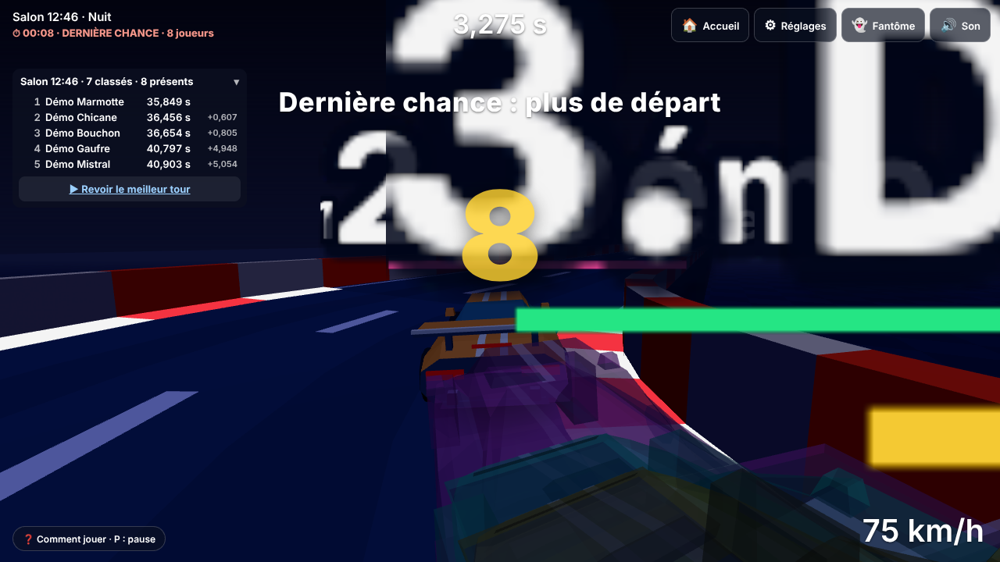
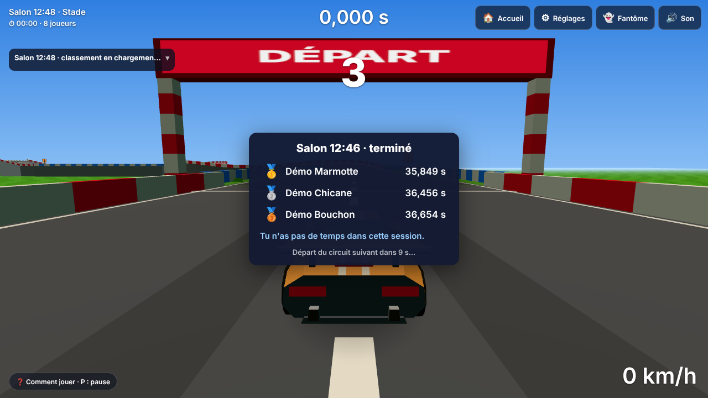
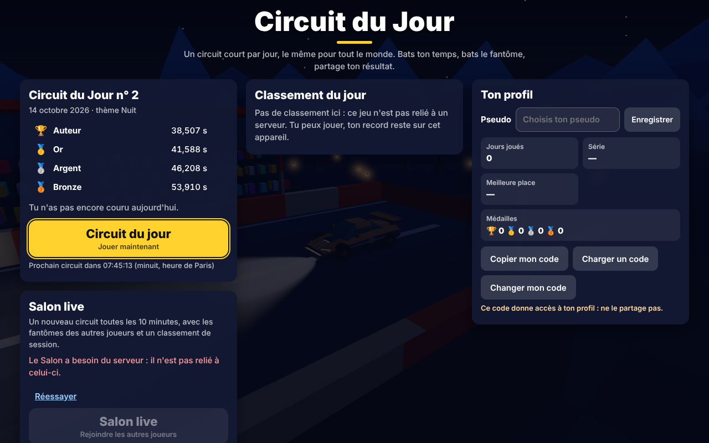

# Lot 31 — Jour de Paris, pas de circuit futur, finale du Salon

**Aperçu** (remplacer `<branche>` par le nom de la branche du lot, `lot-31-futur-finale`, tirets à la place des `/`) — base : `https://nathan-te.github.io/DailyTrack/b/<branche>/`

1. **Finale du Salon** : `…/?mode=salon&api=demo&salonMinutes=2` — attendre la fin d'une session (≤ 2 min) : à `fin − 15 s` « Dernière chance : plus de départ » et le grand compte à rebours, puis à l'heure pile le circuit change pour tout le monde et le podium s'affiche par-dessus.
2. **Un jour futur est refusé** (production simulée, l'aperçu garde les outils) : `…/?prod&day=2030-01-01` → circuit du jour + message « Ce circuit n'est pas encore disponible ».
3. **Un jour passé est accepté** : `…/?prod&day=2026-10-13`.
4. **L'accueil** : `…/` → « Prochain circuit dans HH:MM:SS (minuit, heure de Paris) » ; à zéro la page se recharge sur le nouveau circuit.

Aucun changement de `sim` : `SIM_VERSION` et `GENERATOR_VERSION` inchangées (14 et 15), golden et `history:seed` inchangés.

## 1. Jour de Paris (décision du 14/10/2026)

« Aujourd'hui » est la **date à Paris** (Europe/Paris, heure d'été comprise), la même pour tout le monde au même instant. Cela **remplace la règle « jour UTC »** de `CLAUDE.md`. Les circuits de chaque date ne changent pas (la graine est la date) : seul l'instant où « aujourd'hui » passe au jour suivant bouge.

- **Une seule fonction, hors de `sim`** : `packages/clock` (`@cdj/clock`, nouveau paquet de l'espace de travail, copié dans l'image Docker de l'API) : `parisDay(ms)`, `parisDayStart(jour)` (minuit de Paris, en ms UTC), `msUntilNextParisDay(ms)`. `sim` reçoit toujours une date.
- **Méthode** : `Intl.DateTimeFormat("en-US", { timeZone: "Europe/Paris" })` ; au chargement du module le résultat est **contrôlé** contre la règle de l'Union européenne (UTC+2 du dernier dimanche de mars 01 h UTC au dernier dimanche d'octobre 01 h UTC, UTC+1 sinon) sur neuf instants de contrôle (été, hiver, de part et d'autre des deux changements de 2026). Si l'environnement n'a pas les fuseaux, ou s'ils s'écartent, **la règle seule** sert (`parisClockSource` : `intl` ou `table`). `/api/health` rend `clock` : **à vérifier sur Cloud Run après le déploiement** (`curl <API>/api/health` doit dire `"clock":"intl"` ; `table` marcherait aussi, mais mérite un coup d'œil). Dans cet environnement et dans Chromium : `intl`. Firefox et WebKit : lancés par la CI (le contrôle d'`Intl` y est le même code).
- **API** (`apps/api/src/api.ts`) : `today = parisDay(now())` partout où `Math.floor(now() / DAY_MS)` servait (jour accepté pour un envoi, **grâce de 10 min après minuit de Paris**, classement, jours figés du planning, `GET /api/day`, `/api/me` et la place figée, admin, `/api/health`). Un jour dure 23 h, 24 h ou 25 h : on part de `parisDayStart`, jamais de `jour × 86 400 000`.
- **Jeu** : `todayParis` (main.ts) ; l'**accueil** affiche « Prochain circuit dans HH:MM:SS (minuit, heure de Paris) » ; à zéro la page se recharge sur le nouveau circuit (l'accueil est fermé pendant une course : elle n'est pas interrompue, et son temps compte s'il est envoyé pendant la grâce). Une page restée ouverte sur l'ancien jour se recharge à son retour sur l'accueil. Pas de décompte en démonstration ni avec `?today=` (« aujourd'hui » n'y est pas la vraie date). **Admin** : « Aujourd'hui (Paris) ».
- **Tests** : `packages/clock/test/clock.test.ts` (été, hiver, 25/10/2026 = 25 h, 28/03/2027 = 23 h, Delhi / New York, `Intl` = règle d'heure en heure de 2026 à 2030, minuit exact de 2026 et 2027) ; `apps/api/test/paris.test.ts` (envoi à 23 h 59 Paris compté pour le jour, à 0 h 05 compté pour la veille (grâce), à 0 h 15 refusé pour la veille ; 22 h 30 UTC = 0 h 30 Paris ; changement d'heure du 25/10/2026 et de mars 2027 ; deux joueurs de fuseaux différents) — sur SQLite **et** libSQL ; e2e `futur.spec.ts` (un joueur à Delhi et un à New York voient le même circuit au même instant ; l'accueil compte puis se recharge à minuit de Paris).

## 2. Pas de circuit futur en production

`apps/web/src/access.ts` (décision pure, testée) appliquée par `main.ts`. La production = la construction de `main` : `pages.yml` pose **`VITE_PRODUCTION=1`** (comme `VITE_API_URL`, seulement pour `main`). Les aperçus de branche et le serveur de développement ne l'ont pas.

| | production | aperçu de branche / `?debug` |
|---|---|---|
| touches **N** (circuit au hasard) et **T** (thème suivant) | ne font rien | marchent |
| `?seed=` / `?day=` d'un jour **après aujourd'hui** (Paris) | refusé : circuit du jour, message court, adresse nettoyée | marche |
| `?variant=` / `?theme=` pour aujourd'hui ou le futur | refusés (message) | marchent |
| `?variant=` / `?theme=` sur un jour **passé** | acceptés (jamais classés) | marchent |
| archives : 🎲 et thèmes forcés | absents | présents |
| `?today=` (avec `?debug`) | ignoré | marche |
| `?api=demo` | « aujourd'hui » = min(lendemain de l'historique, vraie date) | lendemain de l'historique |
| `/admin/` | planning des jours à venir (sous jeton, inchangé) | idem |

- **Garde-fou testé** : `isRestricted(search, "1")` est vrai pour **toute** adresse, `?debug` compris (`access.test.ts`) ; `?prod` ne sait que restreindre (il sert aux essais : `futur.spec.ts` simule la production sans construire une seconde version du jeu). L'aide « Comment jouer » ne citait pas N et T ; la table de touches de `/admin/` le dit.
- **Dit honnêtement** : le générateur tourne **dans le navigateur**. Quelqu'un de très motivé peut encore calculer le circuit de demain en lisant le code (ou un jeu de données, ou en copiant la fonction `dailyCircuit`). On supprime l'accès facile (adresse, touches, archives), pas la possibilité technique.
- **À proposer à Nathan, non appliqué** : une **graine secrète côté serveur** (le circuit du jour dépendrait de `hash(date, secret)` ; le serveur ne publierait le texte du circuit qu'à minuit de Paris, le jeu le téléchargerait au lieu de le générer). C'est un vrai changement d'architecture (le jeu ne marche plus hors ligne pour le circuit du jour, ou garde un circuit de secours public, les rediffusions de référence changent, `GENERATOR_VERSION` +1, planning de l'admin à repenser). Hors périmètre de ce lot.

## 3. Finale du Salon

Avant : « dernier essai » à 30 s, puis on attendait les joueurs encore en course (jusqu'à 60 s) avant le podium. Maintenant, l'horloge du serveur décide ; personne n'attend personne.

- **À `fin − 15 s`** (`FINALE_MS`) : le départ est fermé (`startOpen` ; touche, bouton, manette, « Rejouer » : refusés avec « Dernière chance : plus de départ », boutons grisés `body.start-locked`) ; ceux qui roulent continuent ; **grand compte à rebours 15 → 0** au centre (`#finale`) ; le classement de la session est **déplié d'office** et rafraîchi **toutes les 2 s** (`FINALE_POLL_MS`, 5 s ailleurs) ; à la fin de la finale (ou si l'horloge est recalée en arrière) tout est rendu au réglage du joueur.
- **À l'heure pile** : `abortRun` coupe la course en cours (**non comptée, rien n'est envoyé**), le **circuit suivant s'installe immédiatement** (il est généré par le fil de travail depuis les deux dernières minutes ; sa scène est construite d'avance si personne ne roule, sinon à l'heure pile) et le **podium final s'affiche par-dessus** pour 10 s. Le jeu est gelé sous le podium : le décompte de départ du nouveau circuit court à la fermeture du podium, pour ne rien faire perdre au joueur. À `fin + 3,5 s` le classement du podium est relu une fois (les envois sont clos) pour y mettre les derniers temps. Une course **finie avant** l'heure pile et envoyée juste avant arrive au plus tard `fin + 3 s` : elle compte.
- **Serveur** : un envoi n'est accepté que jusqu'à **`fin + 3 s`** (`SALON_GRACE_MS`, était 60 s). **Justification de la marge** : le jeu coupe la course à l'heure pile, donc seule une course terminée *avant* `fin` peut arriver après ; la marge couvre le trajet de la requête (10–300 ms sur une bonne ligne ; un réveil de Cloud Run ≈ 0,4 s, mesuré au lot 28 : processus prêt en 75–85 ms, première réponse 0,37–0,42 s ; un mobile lent 1–2 s) plus l'écart de l'horloge du joueur (recalée sur `now` à ± la moitié de l'aller-retour). **Non mesuré en ligne** (pas de Cloud Run ici) : 3 s est une estimation prudente, à confirmer sur de vrais réseaux mobiles ; les constantes sont à un seul endroit (`SALON_GRACE_MS`, miroir `SUBMIT_GRACE_MS`).
- **Lecture jusqu'à `fin + 20 s`** (`SALON_SERVE_MS`) : le podium a besoin du classement de la session finie pendant ses 10 s ; ensuite la session est **oubliée** (règle de la 27b, inchangée sur le fond : seul le délai passe de 60 s à 20 s). C'est un écart voulu avec « oubliée juste après les envois » : sans cette fenêtre le podium n'aurait rien à montrer.
- **Sessions** toujours alignées sur l'horloge (xx:00, xx:10…) ; `?salonMinutes=N` (démo et essais) suit la même règle (`floor(heure / durée)`), la finale reste de 15 s.
- **Démo** (`DemoSalonApi`) : mêmes constantes (`SUBMIT_GRACE_MS` 3 s, `SERVE_GRACE_MS` 20 s).
- **Tests** : unitaires (`salon.test.ts` : finale, `startOpen`, clôture à `fin + 3 s`) ; API : `salon.test.ts` (**envoi à `fin + 2 s` accepté, à `fin + 5 s` refusé**, lecture 20 s) ; e2e `salon.spec.ts` (sessions d'une minute : à `fin − 15 s` le départ est refusé ; une course en cours peut finir avant `fin` et compte ; une course non finie à `fin` est coupée, ne compte pas (`submits` = 0) ; **le circuit change au même instant pour deux contextes de navigateur** — mesuré sur l'horloge du Salon de chaque page ; podium sous lequel le circuit suivant est déjà installé) et `salon-serveur.spec.ts` (deux navigateurs contre le vrai serveur : écart de bascule < 1,5 s).

## Captures

Outil : `CAPTURES=1 npx playwright test captures-lot31` (dans `apps/web`).

## Vérifications

- `npm run typecheck` ; `npm test` en entier (SQLite puis libSQL) ; golden inchangés (aucun test de golden touché).
- e2e (Chromium) : `futur.spec.ts` (11), `salon.spec.ts`, `watch.spec.ts` (spectateur dans le Salon : podium puis retour au Salon normal), captures. Critère de choix : tout ce qui touche à l'horloge, au Salon et aux adresses ; les autres e2e ne lisent ni l'heure ni le Salon.
- **Résultats** (Chromium, rendu logiciel) : `npm test` = 934 tests (SQLite) puis 158 (libSQL) verts ; typecheck propre ; série e2e (accueil, mobile, planning, admin, classement, jour, démo, Salon, Salon serveur, spectateur serveur, spectateur, profil, `futur`) : 199 verts, 3 échecs d'une première passe — deux **erreurs de mes tests** corrigées (le décompte comparé à `FIXED_NOW` alors que l'horloge de la page avance pendant toute la série ; un nombre de finale lu après qu'il a décru) et `watch.spec.ts:16` (« depuis les archives », lecture temps réel de 40 s) **arrivé à 3 min dans une série de 34 min et vert seul en 20 s** : sensible à la charge (rendu logiciel), sans lien avec ce lot — à surveiller dans le résumé « instable » de la CI.
- **Coût d'un rejeu** : inchangé (aucune ligne de `sim`, `replayRace` non touché).
- **Mesure à noter** (rendu logiciel, CI) : à l'heure pile, la première image de la nouvelle scène coûte 0,5–0,8 s de fil principal **derrière le podium** (course coupée, jeu gelé) ; **aucune tâche longue** dans les 3 s qui suivent la fermeture du podium (là où le joueur repart). Avant ce lot cette image tombait à la fermeture du podium.

## Non vérifié / décisions pour Nathan

- **Non vérifié** : Firefox et WebKit (la CI les lance), un vrai téléphone, un Cloud Run réel (`clock` dans `/api/health`, latence réelle pour la marge de 3 s), le passage de minuit réel à Paris (vérifié par les tests à horloge simulée et par un contexte de navigateur à 23 h 59 min 52 s).
- **À confirmer** : (1) la marge de `3 s` après l'heure pile ; (2) lecture du podium jusqu'à `fin + 20 s` (au lieu de « oubliée juste après ») ; (3) décompte de départ du nouveau circuit **après** le podium (le podium dure 10 s, un départ pendant le podium ferait perdre le début du tour) ; (4) une page de **production** restée ouverte sur l'ancien jour se recharge seulement au retour sur l'accueil (pas pendant une course).
- **Proposé, non appliqué** : graine secrète côté serveur (voir plus haut).
- **Variable à poser** : rien à régler côté GitHub (`VITE_PRODUCTION` est posée par `pages.yml`) ; après la fusion, ouvrir le site publié et vérifier qu'`?day=2030-01-01` ramène au circuit du jour et que N / T ne font rien.
