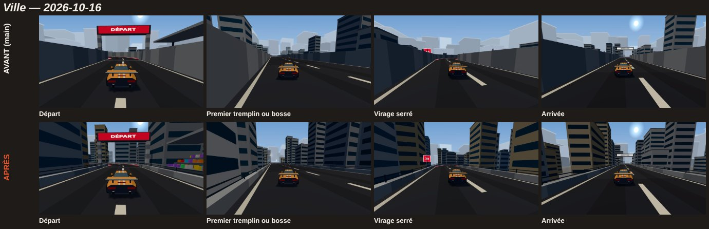
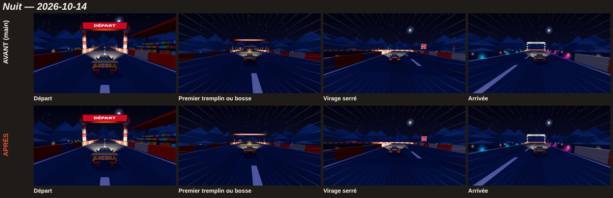
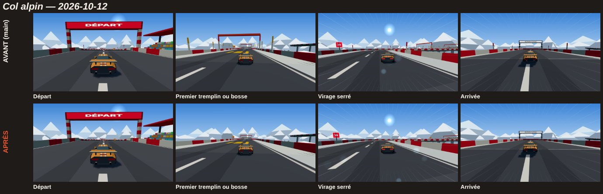
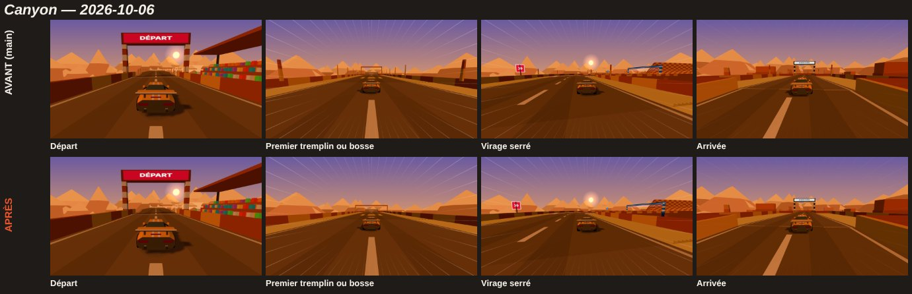
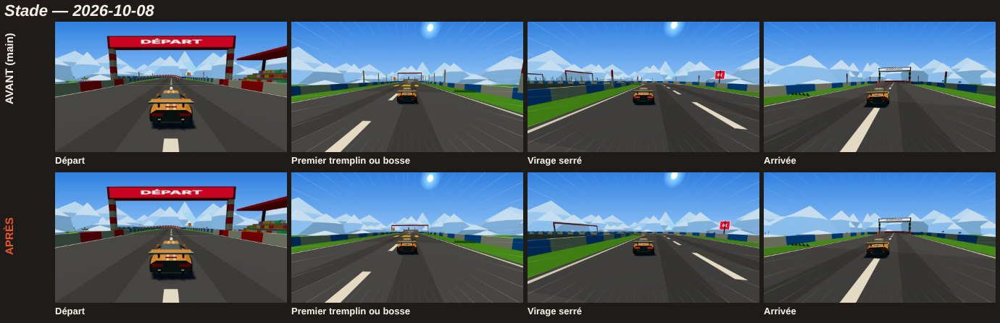
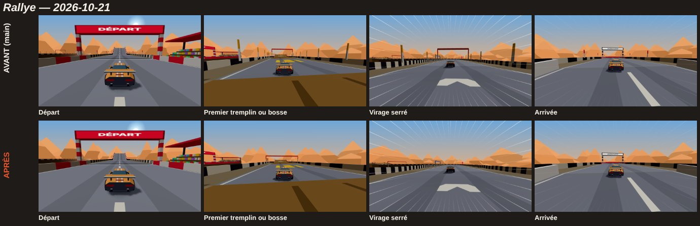
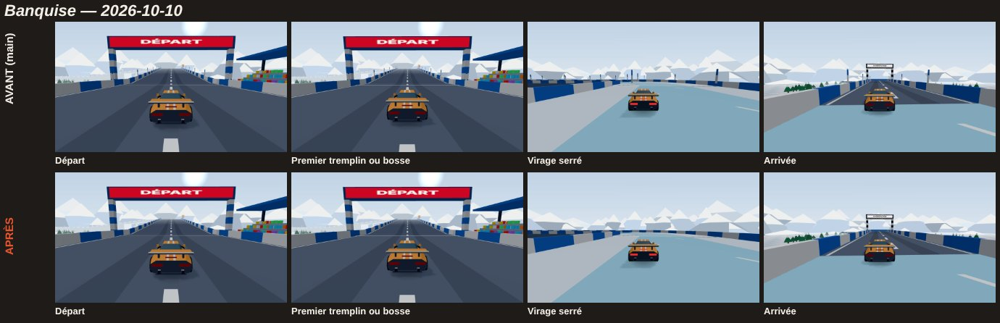
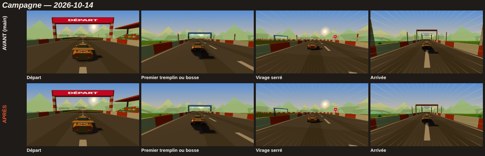

# Lot 37 — Track : décor propre (plus rien en l'air) et Ville dégagée

Branche `claude/zen-pascal-dmempr` (nom imposé par la session ; le lot prévoyait `lot-37-decor-propre`). Zones : `apps/web/**`, `packages/sim/CLAUDE.md` (une ligne), `docs/lots/**`, la ligne de Track de `docs/plateforme/budgets.md`. **Rien dans `sim`** : `SIM_VERSION`, `GENERATOR_VERSION`, golden, rediffusions, classements inchangés (aucun fichier de code de `packages/sim` n'a bougé ; la hauteur dessinée d'un mur de la Ville n'intervient nulle part dans la simulation, qui n'a jamais lu que `WALL_HEIGHT` = 1,4 m).

PR : à compléter à la création (lien et aperçu en tête de la PR). Vision et règles : `apps/web/CLAUDE.md`, rubrique « Décor : règles de pose (lot 37) ».

## En deux phrases

Sur `main`, **11 750 éléments de décor sur 66 465 sont mal posés** (64 circuits, 8 thèmes) : tous les panneaux, toutes les arches et toutes les portes, 10 644 bornes de rive sur 15 908, toutes les tribunes. Après le lot : **0**, avec moins de triangles à l'écran (−16 % en moyenne, −52 % en Ville), les mêmes maillages, et une Ville où l'on voit la ville.

## 1. Inventaire des éléments de décor

Mesuré par le relevé de pose (`PoseLog`) sur **64 circuits** : les jours du 13/10 au 15/12/2026, chaque thème imposé 8 fois (le test du point 2 ; moyennes par circuit). « Triangles » = ce que la pièce construit ; « maillage » = le maillage fusionné où elle va (un appel de rendu par maillage non vide, ombre en plus pour ceux qui en projettent).

| Type | Rôle | Où il est posé | Par circuit (avant → après) | Triangles (avant → après) | Maillage | Décision |
|---|---|---|---|---|---|---|
| **Panneau** (poteau + plaque) | *signaler* un virage, un saut ou une cuve | avant chaque danger, côté extérieur du virage | 5 → 5 | 133 → 133 | `solid` (ombres) + `glow` | **Gardé.** Le poteau descend jusqu'au sol (il flottait au-delà du rebord) et se plante à 1,6 m du bord (la plaque, large de 2,7 m, surplombait la route ou le bas-côté à 2,5 m) |
| **Borne de rive** | *signaler* une portion rapide (lot 15) | sur le chapeau du rebord, toutes les 16 m ou 8 m | **248,6 → 30,6** (−88 %) | 4 971 → 613 | `speed` | **Réduit.** 87 % n'avaient pas de rôle (hors portion rapide) ou pas d'appui (bas-côté, cuve, section sans rebords) ; il reste la borne sur le chapeau d'un rebord plein, **dans une portion rapide seulement**, tous les 16 m |
| **Arche de vitesse** | *signaler* une portion rapide | un bloc sur deux de la portion | 8,0 → 3,8 | 509 → 337 | `speed` | **Rendue plus rare** (un bloc sur quatre, jamais sur un virage relevé ni une cuve) ; pieds jusqu'au sol |
| **Arche de départ** | *marquer* le départ | q = 26 du premier bloc | 1 → 1 | 180 → 180 | `solid` + 2 bandeaux | **Gardée**, pieds jusqu'au sol |
| **Arche d'arrivée** | *marquer* l'arrivée | milieu du dernier bloc | 1 → 1 | 180 → 180 | `solid` + 2 bandeaux | **Gardée**, pieds jusqu'au sol |
| **Porte de contrôle** | *marquer* un point de contrôle | milieu du bloc | 3 → 3 | 505 → 576 | `solid`, `glow`, `curtain` | **Gardée.** Pieds jusqu'au sol (+71 triangles) ; le voile ne pend plus qu'à 4,8 m au-dessus de la route (il descendait à 4,0 m, dans la cheminée de la caméra) |
| **Tribune** | *habiller* le départ | à 3,5 m du bord, au premier bloc | 1 → 1 | 1 596 → 1 596 | `decor` | **Gardée**, sur un socle plein jusqu'au sol (elle flottait à la hauteur de la route) ; essaie l'autre côté si la route est trop près |
| **Décor de thème** (cactus, sapins, immeubles, mesas…) | *habiller* hors de la piste | cellules vides à ≤ 2 cellules de la piste | 771 → 745 | 62 240 → 50 974 | `decor`, `dense` (niveau 2), `glow` | **Gardé**, refusé s'il touche la route ou le bas-côté à moins d'1 m (sur `main`, 45 éléments sur 64 circuits la touchaient : falaises du Canyon surtout) ; la Ville est refaite (§ 3) |
| **Lampadaire de la Ville** | *habiller* la rue | sur le chapeau du rebord, un bloc sur deux | 0 → 2,9 | 0 → 104 | `speed` + `glow` | **Nouveau**, remplace les lampadaires et cubes posés au sol, huit mètres sous la route, où personne ne les voyait |

Triangles de la scène entière (toutes les pièces, route comprise) : **81 305 → 66 603 par circuit** (−18 %). **Maillages non vides : 7,38 → 7,38** (identiques sur les 64 circuits : le lot n'ajoute ni ne retire un appel de rendu par construction). Détail par thème et par pièce : `docs/lots/lot-37/mesure-triangles-avant.json` et `-apres.json`.

## 2. Tout est posé quelque part

**Règles** (aussi dans `apps/web/CLAUDE.md`) : un pied a un appui à sa position exacte (le sol lointain, le chapeau d'un rebord plein, ou une structure qui descend jusqu'au sol) à moins de 5 cm ; rien au-dessus du vide ; rien sur la surface roulante (route, bas-côté, paroi de cuve) ni à moins de 4,6 m au-dessus d'elle (la caméra « loin » est à 4,2 m) ; un élément a un rôle, un seul.

**Le test** (`apps/web/test/decorPose.test.ts`, sans rendu, ≈ 10 s) construit la géométrie des 64 circuits avec un relevé de pose : la boîte de chaque pièce est mesurée **sur ce qui a été réellement construit** (`Builder.mark` / `boxSince`), puis comparée à **la simulation** (`trackWorld(track).sample` : ce que la voiture roule, hauteur d'un virage relevé et d'une route bosselée comprises), pas au code qui l'a posée. Six essais sur l'outil lui-même (un élément qui flotte, une poutre trop basse, une poutre sans pied…). `DECOR_RAPPORT=1` imprime les comptes.

**Il échoue sur `main`** : le patch `docs/lots/lot-37/releve-sur-main.patch` ajoute à `main` (`2363986`) le seul relevé, sans rien changer à la pose ; avec les fichiers de test de la branche (`git apply`, puis copier `test/decorChecks.ts` et `test/decorPose.test.ts`), le test donne **11 750 éléments en faute sur 66 465** (12 783 fautes : une arche en a plusieurs).

| Type (faute) | Éléments en faute | Sur | Pourquoi |
|---|---|---|---|
| Borne de rive | **10 644** | 15 908 | sur un bas-côté (près de 7 400 : en l'air à 1,4 m au-dessus de l'herbe, dans le passage) ; section sans rebords (*vide*) ; dans la paroi d'une cuve ; à 10 cm au-dessus du chapeau d'un virage relevé ; dans un mur de Ville de 3,4 m (la borne était posée à 1,4 m dans le mur) ; ondulation de la tôle ignorée |
| Arche de vitesse | 359 | 509 | pieds au-delà du rebord, ou sur le bas-côté |
| Panneau | **320** | 320 | poteau au-delà du chapeau, sans sol dessous ; plaque à 2,5 m au-dessus du bas-côté |
| Porte de contrôle | **190** | 190 | pieds à 0,65 m au-delà du chapeau, dans le vide ; voile à 4,0 m |
| Arche de départ / d'arrivée | **64 + 64** | 64 + 64 | pieds posés au-delà du rebord, au-dessus du vide |
| Tribune | **64** | 64 | base à la hauteur de la route, 8 m au moins au-dessus du sol |
| Décor de thème | 45 | 49 346 | falaises du Canyon (30) et clôtures qui mordent la route |

Par thème (éléments en faute sur `main`, 8 circuits par thème) : Stade 1 755 · Rallye 1 671 · Banquise 1 357 · Nuit 631 · Campagne 1 336 · Canyon 1 590 · Col 1 124 · Ville 2 286. Les comptes par type et par thème sont dans la sortie du test (`DECOR_RAPPORT=1`) ; sur la branche : **0 faute** (`decorPose.test.ts` passe).

**Jours où `main` avait le plus d'éléments en l'air** (jours passés du 6 au 22/10, thème du jour ; ce sont les liens « À tester » et les jours des planches) : Nuit 14/10 (68), Col 12/10 (39), Canyon 6/10 (37), Stade 8/10 (9), Rallye 21/10 (7), Ville 16/10 (11 : le retour de Nathan) ; Banquise et Campagne n'ont pas eu leur thème ces jours-là, leur circuit est imposé (`?theme=`) : Banquise 10/10 (14), Campagne 14/10 (11).

## 3. Ville dégagée

- **Rebords bas** : le mur de 3,4 m (dessiné seulement) devient un **muret de béton de 0,8 m surmonté d'un garde-corps** (deux lisses et des montants en acier mince, jusqu'à 1,4 m, la hauteur de la simulation). Un joueur à hauteur de caméra voit la ville au-dessus et à travers ; le muret garde ses bandes gris clair / gris foncé, il se lit comme la limite de la piste. Proposition à valider par Nathan : glissière béton **et** garde-corps (la glissière seule est plus lourde à l'œil ; le garde-corps seul ne retient pas le regard comme une limite).
- **Le sol de la ville est 8 m au moins sous la route** (la piste est sur un remblai) : les immeubles tirés de 10 à 34 m depuis le sol ne laissaient voir que des toits. Ils sont maintenant **relevés au niveau de la route** (sommet 6 à 34 m au-dessus d'elle) et un **front de rue** s'y ajoute (`addCityFront`) : de chaque côté, des immeubles à 2–12 m du rebord, 8–38 m au-dessus de la route, de teintes variées (béton, beige, bleu-gris), jamais sur la route (marge 1,5 m) ni l'un dans l'autre. Fenêtres dessinées à plat (2 triangles au lieu de 12) : plus de bâtiments, moins de triangles.
- **Mobilier de rue** : un lampadaire sur le chapeau du rebord, un bloc sur deux, côtés alternés (potence à 5,9 m au-dessus de la route, halo). Les panneaux de virage et de saut existent déjà.
- **Seul le rendu change** : collisions, rebords, circuits, golden, rediffusions, classements, miniatures du jeu (hors décor) intacts. La vue aérienne (miniatures) garde une ville basse (sinon les immeubles relevés cacheraient la piste) ; `THUMB_VERSION` 3 invalide les anciennes images (le décor a changé).
- **Les autres thèmes** (planches) : aucun n'a de mur qui cache tout *en dehors des cuves* : les parois de cuve du Canyon, du Stade et de la Nuit (jusqu'à 12 m) cachent l'horizon, mais elles sont le jeu (la voiture roule dessus) ; la planche du Canyon montre une paroi de roche à droite à l'arrivée. Pas touché.

## 4. Captures avant / après

Un circuit de chaque thème (le jour où `main` avait le plus d'éléments en l'air) : le départ, le premier tremplin ou la première bosse, un virage serré, l'arrivée, avant (`main`) en haut, après en bas. Outil : `CAPTURES=1 LABEL=avant|apres npx playwright test captures-lot37 --project=chromium`, puis `PLANCHES=1` (hors CI, `apps/web/e2e/captures-lot37.spec.ts`) ; images de 960 × 540 dans `docs/lots/lot-37/avant/` et `apres/`.

| Thème | Planche |
|---|---|
| Ville (16/10) |  |
| Nuit (14/10) |  |
| Col alpin (12/10) |  |
| Canyon (6/10) |  |
| Stade (8/10) |  |
| Rallye (21/10) |  |
| Banquise (10/10, imposée) |  |
| Campagne (14/10, imposée) |  |

Le relevé de pose seul (avant toute correction) rend exactement la même image que `main` : départ, tremplin et virage de la Ville identiques à l'octet près (le plan d'arrivée varie un peu d'un lancement à l'autre, même sur `main`).

## 5. Budget et performance

**Premier chargement : +2 192 o** (JS + CSS 254 798 → 256 990 o ; `main` à `2363986`, mesure unique `scripts/budgets.mjs`) — **c'est plus que le ko toléré par l'énoncé** ; les plafonds de `budgets.md` ne sont pas dépassés (marge 19 610 o) et rien n'est remis dans le premier chargement qui en soit sorti (générateur, Salon). **Décision pour Nathan** : accepter, ou faire sauter une pièce (mesuré en la retirant) : front de rue de la Ville 385 o, lampadaires 266 o, garde-corps 145 o, arches de vitesse ≈ 200 o, test de non-contact avec la route ≈ 155 o, relevé de pose 179 o. Le reste est réparti (pieds jusqu'au sol, bornes sur le chapeau, tribune qui essaie l'autre côté). Fils de travail, catalogue anglais, polices : inchangés. Ligne de Track de `budgets.md` remesurée.

**Appels de rendu et triangles par image** (`MESURE=1 … mesure-lot37`, `__cdj.render`, profil téléphone 844 × 390, qualité 2, départ d'un circuit de chaque thème, `main` servi à côté) :

| Thème | Appels | Triangles | |
|---|---|---|---|
| Stade | 128 → 128 | 50 376 → 45 128 | −10 % |
| Rallye | 128 → 128 | 62 416 → 58 216 | −7 % |
| Banquise | 125 → 127 | 136 868 → 133 424 | −3 % |
| Nuit | 131 → 131 | 101 638 → 96 654 | −5 % |
| Campagne | 125 → 125 | 83 136 → 78 868 | −5 % |
| Canyon | 127 → 127 | 69 206 → 63 820 | −8 % |
| Col | 129 → 129 | 83 558 → 79 578 | −5 % |
| Ville | 128 → 129 | 173 146 → 83 726 | **−52 %** |

Moyenne : 95 043 → 79 927 triangles (−16 %). Les ±1 ou 2 appels viennent de la vue du moment (ce qui est dans le champ de la caméra à l'instant de la lecture) : par construction les maillages sont les mêmes (7,38 non vides par circuit avant et après). **Temps de construction de la scène** (Node, 64 circuits, moyenne) : 62 → 54,6 ms (Ville 112 → 58 ms) : le test de non-contact avec la route est plus que compensé par ce qui n'est plus construit. **Fil principal par image** (CDP, ×4) : mesuré aussi (`docs/lots/lot-37/mesure-perf-*.json`) mais **inexploitable** : en rendu logiciel (SwiftShader) 5 à 12 images en 4,5 s, de 15 à 860 ms par image selon la charge de la machine, avant comme après ; les triangles et les appels sont la mesure fiable ici. `perf.spec.ts` (poids, chargement à ×4) vert. **Non mesuré sur un vrai téléphone.**

**Miniatures** : la vue aérienne montre le décor proche de la portion (tribune, immeubles, arbres) : même code, mêmes tirages ; la tribune repose sur son socle, les éléments qui touchaient la route ne sont plus dessinés, la Ville reste basse. `thumbnails.spec` (contenu des pixels) vert, `THUMB_VERSION` 3.

## 6. Ce qui a bougé dans le code

- `src/decorPose.ts` (nouveau, pur) : `PoseLog`, `placed(log, meta, builders, run, accepter?)`, `ROLES`, les constantes (`PASSAGE_HAUT` 4,6 m, `TOLERANCE_APPUI` 5 cm, `MARGE_DECOR` 1 m, `CHAPEAU` 0,6 m). `src/meshKit.ts` : `Builder.mark` / `boxSince` / `rollback`.
- `src/trackMesh.ts` : `trackGeometry` (les formes d'un circuit, sans scène ni DOM, que `buildTrackScene` pose ensuite : même ordre de tirage, même rendu) ; `onRim` (le chapeau du rebord) ; bornes et arches de vitesse en portion rapide seulement ; tribune sur socle ; `planLibre` (un élément au sol refusé est retiré après coup, **ses tirages au sort consommés** : le reste du décor ne bouge pas) ; Ville : `barrier: "garde-corps"` (`addGuardRail`), `addCityFront`, `addStreetLamps`, `addBuilding`.
- `src/trackProps.ts` : pieds des panneaux, arches et portes jusqu'au sol (`Props.floorY`), voile des portes raccourci ; `src/signage.ts` : recul des panneaux (`SIGN_SETBACK` 1,6 m) ; `src/scene/origine.ts` : suit (`commeProps(c, floorY)`).
- Tests : `decorPose.test.ts`, `decorChecks.ts` ; outils hors CI : `e2e/captures-lot37.spec.ts`, `e2e/mesure-lot37.spec.ts` (deux lignes de `durees.json`).

## 7. Ce que le lot 39 (socle de la scène par paliers) doit savoir

- **Le décor d'aujourd'hui = celui-ci** : le palier « existant » reproduit la scène telle que ce lot la laisse. Le lot 37 est maintenant fusionnable avant lui ; ses règles sont celles de `direction.md` § 5, **à aligner** : (1) appui = sol, chapeau d'un rebord plein ou structure jusqu'au sol (le § 5 disait « sol ou socle plein » : ajouter le chapeau) ; (2) rien dans le passage = rien sur la surface roulante ni sous 4,6 m au-dessus (pas seulement « jamais une cellule de piste ») ; (3) un rôle, un seul (ajouter *signaler* / *marquer* / *habiller* aux cinq rôles du § 5 ou les faire correspondre) ; (5) un tirage refusé consomme ses nombres : c'est ce que fait `rollback`.
- **À porter dans `src/scene/route.ts`** : le garde-corps de la Ville (la route paramétrable ne connaît que `wallHeight` : avec 0,8 elle dessine un muret nu) et le rebord à `barrier` ; `scene/origine.ts` garde ses bornes d'avant (`rythme`) et `scene/palier1.ts` / les directions lisent `pal.wallHeight` : la Ville y est maintenant basse.
- Ce que le socle appelle (`trackGeometry`, `placed`) existe : le test de pose peut tourner sur n'importe quelle construction qui passe par `placed`.

## Vérifié / non vérifié

**Vérifié** : le test de pose (0 faute sur la branche, 11 750 sur `main`) ; `npx tsc -b` ; `npx vitest run --project sqlite` (194 fichiers, 2 530 tests, golden compris) ; `perf.spec` ; les planches des huit thèmes (§ 4) ; les triangles, les appels et la construction avant / après (§ 5) ; le relevé de pose ne change pas l'image (Ville, trois plans identiques à l'octet).
**Non vérifié** : le ressenti sur un vrai téléphone (lisibilité de la Ville au doigt, garde-corps à 1,4 m) ; Firefox et WebKit (la CI) ; le fil principal par image (mesure inexploitable en rendu logiciel) ; la CI de la PR (à lire sur la PR).

## Décisions pour Nathan

1. **Budget : +2 192 o au lieu de 1 ko** (§ 5) : accepter, ou retirer une pièce (le front de rue, les lampadaires, les arches de vitesse).
2. **Rebord de la Ville** : béton bas + garde-corps (proposé) ; autres pistes : glissière béton plus haute (≈ 1,1 m), grillage.
3. **Bornes et arches de vitesse** : gardées *seulement en portion rapide* ; les retirer toutes (−250 o, −950 triangles par circuit) ? Elles font lire la vitesse, mais les chevrons peints le font aussi.
4. **Les parois de cuve** (Canyon, Stade, Nuit) cachent l'horizon : intentionnel, non traité.

## À tester (2 clics, sur l'aperçu de la PR, au téléphone)

Adresses relatives à la racine de l'aperçu (`/track/` en recette et en production) ; `&home=0` va directement au jeu :
- **Ville du 16/10** (le retour de Nathan) : `/track/?seed=2026-10-16&home=0`
- Nuit 14/10 : `/track/?seed=2026-10-14&home=0` — Col 12/10 : `/track/?seed=2026-10-12&home=0` — Canyon 6/10 : `/track/?seed=2026-10-06&home=0`
- Stade 8/10 : `/track/?seed=2026-10-08&home=0` — Rallye 21/10 : `/track/?seed=2026-10-21&home=0`
- Banquise (imposée) : `/track/?seed=2026-10-10&theme=banquise&home=0` — Campagne (imposée) : `/track/?seed=2026-10-14&theme=campagne&home=0`
