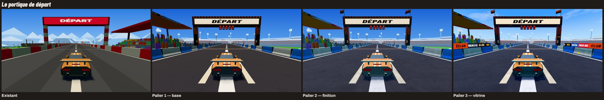
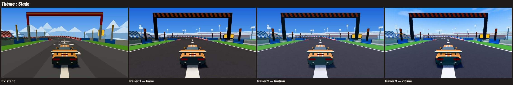
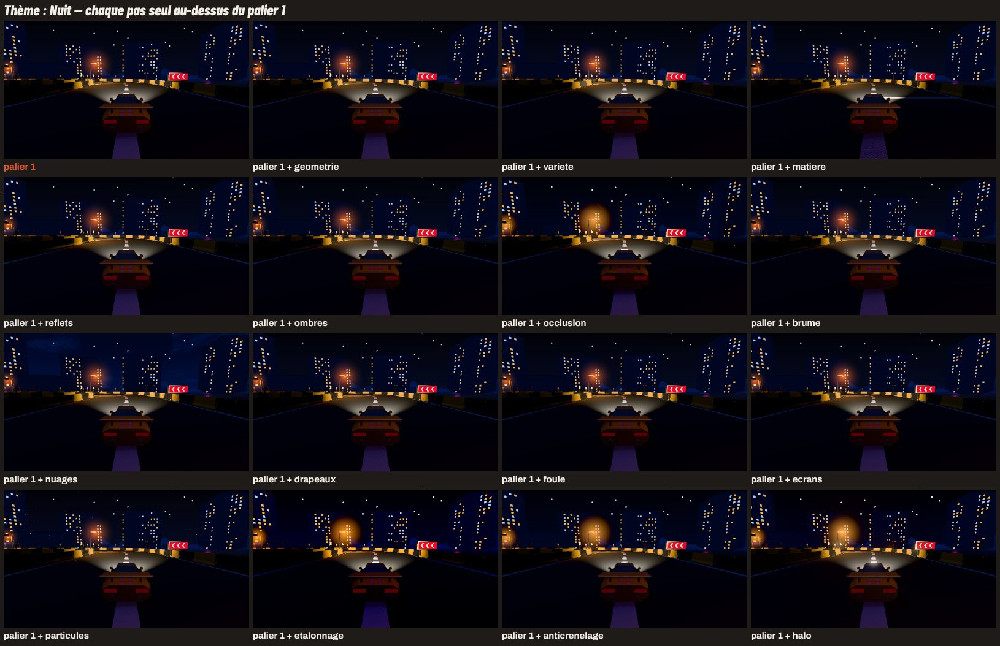

# Retouche 38b — Track : paliers de qualité visuelle à partir du mélange recommandé

Objet : **montrer, côte à côte et chiffrés, ce que rapportent des pas de qualité au-dessus du mélange recommandé du lot 38**, élément par élément et
thème par thème, avec leur coût sur téléphone, pour que Nathan choisisse le palier visé par appareil. **Rien ne change dans le jeu.**

Zones : `apps/web/**` (la vitrine, le code des paliers, leurs tests), `docs/lots/**`, `docs/orchestration.md`, l'entrée de `apps/web/e2e/durees.json`
(exception tolérée). Aucune zone partagée. Lot 38 fusionné au départ (PR #117) ; **lot 37 pas encore fusionné** (ses règles de pose exactes restent à
aligner, comme au lot 38).

**En bref**
- **La vitrine** `/track/vitrine/` montre, à côté de l'existant, les **paliers 1, 2 et 3** de chaque élément et de chaque thème, **chaque pas
  commutable seul**, une **vue en mouvement** par thème (la voiture actuelle sur le vrai circuit, caméra de poursuite, **images par seconde**) et
  le coût de chaque palier et de chaque pas.
- **Palier 1** (le mélange du lot 38, nettoyé) : il coûte l'existant — mêmes appels de rendu, moins de triangles au pire thème, construction
  plus courte ; ≈ +9 ko net au premier chargement (§ 3).
- **Palier 2** (finition) : **aucun appel de plus**, +5,2 ko chargés à la demande, mais plus de travail par pixel (×2,3 en rendu logiciel),
  surtout à cause des **reflets** : à **cibler** sur la voiture et le métal.
- **Palier 3** : **la vie et le ciel pour presque rien** (6,8 ko, un appel chacun) ; **l'occlusion et le post-traitement coûtent cher**
  (l'occlusion redessine la scène : +128 appels ; la chaîne de passes : ≈ 200 Mo de cibles à la taille d'un écran de téléphone).
- **Recommandation** (§ 4, à confirmer par les images par seconde lues sur ton téléphone) : entrée de gamme → palier 1 ; téléphone récent →
  palier 2 avec reflets ciblés, plus la vie et le ciel, sans passe plein écran ; ordinateur → palier 3 sans l'occlusion, FXAA au lieu de SMAA.
- **Le pas le plus rentable est hors des paliers** : la voiture en 6 maillages au lieu de 53 (lot du véhicule, à placer en deuxième : § 6, § 7).
- **Rien ne change dans le jeu** : fichiers construits identiques à `main` octet pour octet, `sim` et golden inchangés.

## À tester (sur l'aperçu de la PR)

Aperçu de la PR [#118](https://github.com/Nathan-Te/DailyTrack/pull/118) : **<https://playdujour-recette--pr-118-9f838yi4.web.app/track/vitrine/>** (7 jours après la dernière poussée ; le lien
à jour est commenté sur la PR). La vitrine est à **`/track/vitrine/`** (le prompt proposait `/track/?vitrine=scene` : voir § 1).

1. Sur **ordinateur**, puis sur **ton téléphone** (en paysage, comme en course) : ouvre la vitrine, puis **« Vue en mouvement »** dans chaque
   section de thème (ou « Ouvrir la vue en mouvement » en tête, puis le sélecteur de thème).
2. Pour chaque thème : passe du **palier 1 au palier 3**, puis coupe les pas **un par un** (cases sous l'image) ; compare avec **« Existant (le
   jeu) »**. Le bout « En course » montre le premier virage, « Départ » le portique et la tribune.
3. Note **le palier qui te plaît** (et les pas que tu gardes ou refuses : halo, brume, particules touchent à la charte) et **les images par
   seconde affichées sur ton téléphone** (en haut à gauche de l'image) au palier 1, 2 et 3 — au moins pour le Stade, la Nuit et le Rallye.
4. Les planches fixes (sections) se comparent d'un coup d'œil ; « Agrandir et mesurer » donne le temps d'image d'une vue sur ton appareil.

## 1. La vitrine des paliers

- **Accès** : toujours **`/track/vitrine/`** (recette et aperçus seulement ; jamais construite en production), qui s'ouvre maintenant sur **la
  planche des paliers** ; la planche du lot 38 (directions A, B, C, mélange) reste à **`/track/vitrine/?planche=directions`** (un lien en tête de
  page). Pas de `?vitrine=scene` dans le jeu, pour la raison du lot 38 : il aurait fallu que `main.ts` reconnaisse le paramètre et charge la vitrine,
  donc toucher au premier chargement du jeu ; la vitrine est une construction à part, son code ne passe jamais dans le jeu.
- **Les colonnes** de chaque section (six éléments, huit thèmes) : **existant** (la vraie scène du jeu) | **palier 1** | **palier 2** | **palier 3** |
  **à la carte**. Même scène, même cadrage, même voiture ; on tourne autour de chaque vue (la caméra ne bouge pas quand on change de palier : la vue
  se reconstruit au même endroit) ; « Agrandir et mesurer » mesure le temps d'image **sur l'appareil qui regarde**.
- **Le sélecteur de palier et les cases** (« Réglages de la colonne « à la carte » et de la vue en mouvement ») : trois boutons Palier 1 | 2 | 3 et
  une case par pas, groupées par famille, chacune avec ce qu'elle fait (et, pour le halo, la brume et les particules, la règle de la charte qu'elle
  touche : à Nathan de décider pour la scène 3D). Les réglages sont dans l'adresse (`?reglages=2+halo`, `3-occlusion`) : on peut envoyer une
  configuration.
- **La vue en mouvement** (un bouton par thème, et « Ouvrir la vue en mouvement » en tête) : **la voiture actuelle parcourt en boucle un bout du vrai
  circuit du jour** du thème, **conduite par le pilote automatique** (`bestPilotRun`, dans un fil de travail chargé à la demande : `piloteWorker.ts`),
  la course rejouée pas à pas avec ses commandes (`parcours.ts`), **vue depuis la caméra de poursuite du jeu** (mêmes réglages : retard du cap et de
  la position, recul, hauteur et champ de vision qui grandissent avec la vitesse — à 88 m/s la caméra traîne d'une dizaine de mètres, comme dans le
  jeu). Deux bouts : « en course » (2 s avant le premier virage, 12 s) et « départ ». On y change de thème, de palier, de pas, ou on passe à
  **l'existant (le jeu)** sans arrêter la voiture : la scène se reconstruit au même instant du tour. Un **compteur d'images par seconde** en
  surimpression (et la durée moyenne et la pire d'une image sur la dernière seconde, les appels, les triangles, la construction, la mémoire) :
  **c'est le chiffre à lire sur ton téléphone.**
- **Les coûts** en tête de page : pour chaque colonne, le poids ajouté au jeu (`poids-parties.json`, écrit à la construction), les appels et les
  triangles par image, la construction de la scène (sur l'appareil qui regarde), la mémoire des textures dessinées et des cibles de rendu, et les
  mesures de référence au profil téléphone (§ 3) ; puis **le coût de chaque pas seul** au-dessus du palier 1.

**Captures** (`CAPTURES=1 npx playwright test captures-lot38b`, dans `lot-38b-paliers-scene/`) : une planche par élément
(`depart`, `arrivee`, `controle`, `plaques`, `panneaux`, `rebords`) et par thème (`theme-<thème>.jpg` en poursuite, `theme-<thème>-ensemble.jpg`
vue d'ensemble), **existant | palier 1 | palier 2 | palier 3** ; **chaque pas seul** au-dessus du palier 1 (`pas-stade`, `pas-nuit`,
`pas-canyon`) ; la **vue en mouvement** aux trois paliers (`mouvement-stade`, `mouvement-nuit`, `mouvement-col` : prises en roulant, chacune à
son instant du tour, compteur d'images du rendu logiciel en haut à gauche).

## 2. Les paliers et leurs pas (le code, prêt à reprendre)

Tout est dans `apps/web/src/scene/`, écrit pour être repris tel quel : **des fonctions de construction par élément, paramétrées par thème et par
palier** (elles lisent `x.reglages`, `Contexte`) et **un module par famille de pas**, qu'un lot de mise en œuvre chargera à la demande.

- `paliers.ts` — les réglages : `PAS` (quinze pas : palier, famille, passe plein écran ou non), `reglagesDuPalier`, `palierDe`, `avecPas`,
  `avecPost`, `texteReglages` / `lireReglages`. Pur, testé.
- `composerPalier.ts` — **la scène d'un circuit à un palier** : même interface que `buildTrackScene` (`TrackScene`), plus `preparer(renderer)` (la
  carte d'environnement), `animer(t, caméra, hauteur)` (la vie, les nuages, les particules), `post()` (la chaîne de passes voulue) et `memoire()`.
- `palier1.ts` — la direction des paliers (`DIRECTION_P`) et ses fonctions par élément : `portiqueDepartP`, `arriveeP`, `panneauP`, `rythmeP`,
  `tribuneP`, `decorP`, `routeP`.
- `finition.ts` (géométrie, variété), `matiere.ts` + `bruit.ts` (matière), `reflets.ts` (reflets), `lumiere3.ts` (brume, nuages, réglages par thème
  du palier 3 : `THEMES_3`), `vie.ts` (drapeaux, foule, écrans, particules), `post.ts` (`ChainePost` : occlusion, halo, sortie, étalonnage,
  anticrénelage), `memoire.ts` (mémoire d'une scène). Les directions du lot 38 (`directionA.ts`, `directionB.ts`, `directionC.ts`) ont gagné
  quelques paramètres de palier (piliers chanfreinés, arche plus ronde, mur de pneus léger), sans changer ce qu'elles dessinent par défaut.
- **Un palier ne change jamais la simulation** : la route qui porte la voiture suit les mêmes points que `sim` à tous les paliers (le « lissage »
  des virages du palier 2 ajoute des tranches **sur le même arc**) ; aucun pas ne lit ni n'écrit l'état de la course (la vie est animée par un
  temps d'affichage). `sim` n'est pas touché ; golden inchangés.

### Palier 1 — base : le mélange recommandé, nettoyé

Ce que le lot 38 avait noté comme imparfait, ou que les captures montraient, corrigé :

| Défaut du mélange (lot 38) | Correction (palier 1) |
|---|---|
| La lumière de C était **repassée** sur une scène construite (`appliquerC` : ciel dessiné puis jeté, brume remplacée, silhouettes recolorées sommet par sommet) | construite directement dans le compositeur (`composerPalier.ts`) : moins de travail à la construction |
| **Ombres de contact** : toute la route (surface, jupe, piliers) était redessinée dans la carte d'ombres (« C coûte surtout à l'image ») | les rebords ont leur calque (`Calques.rebords`) : eux seuls et les éléments projettent sur la piste |
| **Mur de pneus** du Rallye : le thème le plus chargé (×2,3 les triangles de l'existant) | deux pans par pile et un dessus commun (`rebordB(…, { leger: true })`) : ≈ 8 triangles par pile au lieu de 15 (testé) |
| **Rien en l'air** (règle du lot 37) : les socles des portiques et les pieds des panneaux, posés au-delà du bord de la route, flottaient au-dessus de la jupe | ils descendent jusqu'au sol lointain (testé) |
| **La route brune** sous les lumières chaudes de C (Rallye, Campagne, Canyon), contraire à la règle « la route est un gris » | un gris légèrement bleuté sous lumière chaude (`ROUTE_SOUS_LUMIERE_CHAUDE`, testé). Le Rallye et la Campagne redeviennent gris ; **le Canyon reste rouge-brun** sous son soleil rasant orangé (plus sombre et plus froid que le sable : on ne les confond pas) — question 6 |
| **Le soleil dessiné à l'opposé de la lumière** (dans le jeu comme au lot 38 : le disque est vers −x, +z, la lumière vient de +x, −z) | le disque (ou la lune) est posé d'où vient la lumière ; la lueur des nuages, la brume et les reflets suivent la même direction |
| Les lampes de la Nuit retrouvées en **lisant les couleurs des halos** | elles suivent l'éclairage de piste qu'on pose (plus robuste) |
| Option morte (`OptionsC.melange`) | retirée |

### Palier 2 — finition : même chemin de rendu, plus de soin

**Aucun appel de rendu de plus que le palier 1** (testé sur chaque section de la vitrine) et aucune passe : le coût est en triangles, en mémoire de
textures et un peu de lecture de texture par pixel.

- **Géométrie** : piliers des portiques aux arêtes verticales chanfreinées (`colonneChanfreinee`) et socles chanfreinés ; virages (route et
  rebords) deux fois plus de tranches ; arche gonflable plus ronde (28 boudins à 12 pans au lieu de 16 à 8) tenue par quatre cordes d'ancrage ;
  socles prolongés et protégés par des piles de pneus, boulons, câble d'alimentation, banderoles de sponsor, drapeaux en haut des piliers et sur la
  tribune (figés : versés dans le calque des éléments) ; panneaux sur semelles boulonnées avec jambe de force ; catadioptres sur les repères ; mur de
  pneus complet (trois pans).
- **Variété** : chaque instance de décor tourne d'un quart de tour au plus, change de taille (0,88 à 1,12, depuis son pied), de teinte (± 8 %), une
  sur quatre s'use (`varierInstance`, **une autre suite que celle du décor** : il reste à sa place, testé) ; bandes de rebord et pièces des éléments
  inégales (`varierParPosition` : une teinte par morceau de 3 à 4 m, une sur sept salie).
- **Matière** : textures **calculées au chargement** (bruit périodique, sans couture ; aucun fichier) : asphalte 512 px (granulats, rapiéçages,
  fissures, taches d'huile), béton peint des rebords, métal brossé des portiques, grain du décor (256 px) ; chacune avec **sa carte de normales**
  (tirée d'un champ de hauteurs) et **sa carte de rugosité** ; **traces de pneus** dans chaque virage sur route (la trajectoire extérieur – corde –
  extérieur, usée) et **traces de freinage et barres de repère** avant les virages serrés (en géométrie dans le calque de la route).
- **Reflets** : une **carte d'environnement calculée à partir du ciel du thème** (dégradé, soleil, sol, bande d'horizon), préfiltrée une fois
  (PMREM 64 px : ≈ 0,7 Mo), posée sur `scene.environment` : les portiques en métal, les panneaux et **la voiture** (sans toucher à son modèle) la
  reflètent ; la lumière d'hémisphère baisse d'autant.

### Palier 3 — vitrine : le plafond

- **Lumière** — *ombres* : carte 2048 (au lieu de 1024) sur 120 m (au lieu de 84) **posée devant la voiture** (là où regarde la caméra), plus
  fine (17 px/m au lieu de 12) et plus loin ; le décor projette aussi. *Occlusion* : GTAO (à l'écran, passe plein écran). *Brume de profondeur* :
  la brume du thème plus une brume de hauteur (dense au ras du sol lointain, presque nulle à hauteur de piste) qui prend la couleur du soleil quand
  on le regarde (`brumeDeProfondeur` : un remplacement du morceau de brume de three.js, testé). *Ciel et nuages* : un dôme dessiné (dégradé à quatre
  arrêts, lueur du soleil, nuages par thème qui dérivent).
- **Vie** — *drapeaux* qui ondulent (déformés sur la carte graphique, un appel) ; *foule* : les spectateurs de la tribune en instances qui
  sautillent (un appel) ; *panneaux lumineux* : écrans à diodes sur la tribune et les rebords du départ qui font défiler les sponsors, chronomètre
  qui tourne sur le portique ; *particules* par thème (poussière, neige, lucioles, pollen, confettis, poussière de ville : une boîte de 70 m qui suit
  la caméra, animée par la carte graphique, un appel).
- **Post-traitement**, chacun commutable : *étalonnage* par thème (contraste, saturation, teinte des ombres et des lumières, après la tonalité),
  *anticrénelage* (SMAA en plus du MSAA du jeu), *halo* des lumières fortes (fort la Nuit, discret le jour). La scène est alors dessinée dans une
  cible multi-échantillonnée (MSAA ×4, comme l'écran du jeu) : allumer l'étalonnage seul ne perd pas l'anticrénelage du jeu.

### D'autres pas, plus rentables (proposition)

Mesurés ou constatés en faisant ce lot :

1. **La voiture en 6 maillages au lieu de 53** (lot du véhicule, § 6) : c'est **le pas le plus rentable de tous**. Ombres comprises, la voiture
   actuelle fait l'essentiel des ≈ 120 appels de rendu par image de toutes les colonnes ; la scène elle-même, fusionnée par calques, en fait une
   vingtaine.
2. **Les ombres posées devant la voiture**, sans changer la taille de la carte : gratuit, à prendre dès le palier 1 (la moitié de la carte d'ombres
   sert aujourd'hui derrière la caméra).
3. **FXAA plutôt que SMAA** si un anticrénelage d'après-coup est gardé : 2,3 ko contre 37,7 ko (SMAA embarque deux textures), une passe au lieu de
   trois.
4. **La vie sans post-traitement** (drapeaux, foule, écrans, particules, nuages) : peu de poids, un appel chacun, aucune cible plein écran ; c'est ce
   qui fait le plus « vivant » pour le moins cher (§ 3).
5. **Les reflets ciblés** : la carte d'environnement posée sur la voiture et le métal des portiques seulement (`envMap` par matériau), pas sur
   `scene.environment` (la route et le décor la lisent aujourd'hui à chaque pixel) : le pas « reflets » coûte le plus par pixel du palier 2
   (§ 3), et c'est sur la voiture qu'il se voit.
6. **Pas d'occlusion GTAO** : elle redessine toute la scène (+128 appels, § 3) ; l'occlusion par sommets de C (déjà au palier 1) en donne
   l'essentiel. À garder, au plus, pour l'ordinateur.
7. Hors périmètre, à décider (question 4 du lot 38) : **relever le sol près de la piste** (talus) pour que le décor se voie depuis la voiture.

## 3. Ce que coûte chaque palier (mesuré)

**Profil** (`MESURE=1 npx playwright test mesure-lot38b`, 22/10/2026) : Chromium en **rendu logiciel** (SwiftShader), paysage 844 × 390,
densité 1, **processeur ×4** (CDP), caméra de poursuite ; colonnes : moyenne des huit thèmes, 30 images par vue ; pas : écart au palier 1 sur le
Stade, le Rallye, la Nuit et le Col, 20 images. Les mêmes chiffres sont en tête de la vitrine (`src/vitrine/mesuresPaliers.ts`, écrit par la
mesure), à côté de ceux de l'appareil qui regarde.

### Les paliers

| | Existant (le jeu) | Palier 1 | Palier 2 | Palier 3 |
|---|---|---|---|---|
| **Poids ajouté au jeu** (JS compressé) | aujourd'hui 14,4 ko (`trackMesh.ts`, `trackProps.ts`) | 33,4 ko en tout, dont décor 6,2 ko et matière de C ≈ 4,3 ko à la demande (plan du lot 38) : **≈ +9 ko net** au premier chargement | **+5,2 ko** à la demande (finition 2,0, matière 2,4, reflets 0,8) | **+56,6 ko** à la demande (lumière 3,2, vie 3,6, post 49,8) ; **≈ 21 ko** avec FXAA au lieu de SMAA ; **6,8 ko** sans post-traitement |
| Temps d'image (ms, moyenne ; pire thème) | 174 (265, Ville) | 202 (267, Rallye) | 462 (569, Rallye) | 925 (1 021, Rallye) |
| dont envoi (fil principal, ms) | 4,5 | 4,1 | 4,3 | 8,2 |
| Construction de la scène (ms ; pire) | 343 (658, Ville) | **276** (372) | 394 (597) | 416 (517) |
| Appels de rendu par image | 123 | 123 | **123** | 275 |
| Triangles par image (moyenne ; pire) | 90 600 (168 300) | 87 200 (122 100) | 109 300 (150 000) | 252 800 (339 500) |
| Textures dessinées | 0,8 Mo | 3,9 Mo | 10,8 Mo | 12,6 Mo |
| Cibles de rendu (à 844 × 390) | 4,0 Mo | 4,0 Mo | 4,7 Mo | **49,2 Mo** |

Ce qu'il faut en lire :
- **Le palier 1 coûte à peu près l'existant** : moins de triangles en moyenne et surtout au pire thème (122 000 au lieu de 168 000 : la Ville, avec ses murs
  hauts et son décor dense, est le thème le plus lourd du jeu ; au palier 1 c'est le Col), une construction plus courte (la lumière de C n'est plus repassée), le même nombre d'appels ; l'image est 16 %
  plus longue en rendu logiciel (le grain de C est une texture lue à chaque pixel). Le plan du lot 38 demandait « existant + 10 % » : **à
  remesurer sur un vrai téléphone** (§ « ce que le rendu logiciel ne mesure pas »).
- **Le palier 2 n'ajoute aucun appel** (vérifié aussi par `vitrine.spec.ts` sur chaque section) ni aucune passe ; il coûte en triangles (+25 %),
  en textures (+7 Mo) et **en travail par pixel** : ×2,3 le temps d'image en rendu logiciel, dont la plus grande part vient des **reflets**
  (tableau suivant) — la carte d'environnement (`scene.environment`) est lue par chaque pixel de matériau physique, la route et le décor compris.
- **Le palier 3 double les appels** (l'occlusion redessine la scène pour ses normales) et **multiplie par douze la mémoire des cibles** (la scène
  dans une cible demi-flottante multi-échantillonnée, plus deux cibles de passes, plus celles du halo et de l'occlusion) : 49 Mo à 844 × 390,
  donc **≈ 200 Mo à la taille réelle d'un écran de téléphone** (densité 2, ≈ 4 fois plus de pixels). C'est le chiffre qui exclut le
  post-traitement sur téléphone, avant même le temps d'image.

### Chaque pas seul, au-dessus du palier 1

| Pas (palier) | Image | Construction | Triangles | Appels | Mémoire | Poids (module à la demande) |
|---|---|---|---|---|---|---|
| géométrie (2) | ≈ 0 | +56 ms | **+28 000** | 0 | 0 | finition.ts : 2,0 ko (avec la variété) |
| variété (2) | ≈ 0 | ≈ 0 | 0 | 0 | 0 | (dans finition.ts) |
| matière (2) | +35 ms | ≈ 0 (textures dessinées une fois) | +260 | 0 | +6,9 Mo | matiere.ts + bruit.ts : 2,4 ko |
| reflets (2) | **+140 ms** | ≈ 0 | 0 | 0 | +0,7 Mo | reflets.ts : 0,8 ko |
| ombres (3) | ≈ 0 | ≈ 0 | +17 200 | +1 | +12 Mo (carte 2048) | aucun (réglage du compositeur) |
| occlusion (3, passe) | **+274 ms** | ≈ 0 | **+89 900** | **+128** | +27,6 Mo | GTAOPass : 8,1 ko |
| brume (3) | ≈ 0 | ≈ 0 | 0 | 0 | 0 | lumiere3.ts : 3,2 ko (avec les nuages) |
| nuages (3) | ≈ 0 | ≈ 0 | +2 200 | +1 | +1,3 Mo | (dans lumiere3.ts) |
| drapeaux (3) | ≈ 0 | ≈ 0 | +370 | +1 à 2 | 0 | vie.ts : 3,6 ko (avec la foule, les écrans, les particules) |
| foule (3) | ≈ 0 | ≈ 0 | −1 400 (instances) | 0 à 1 | 0 | (dans vie.ts) |
| écrans (3) | ≈ 0 | ≈ 0 | +50 | 0 | +0,5 Mo | (dans vie.ts) |
| particules (3) | ≈ 0 | ≈ 0 | 0 | +1 | 0 | (dans vie.ts) |
| étalonnage (3, passe) | +38 ms | ≈ 0 | — | +2 | **+22,6 Mo** | sortie et étalonnage : 1,4 ko |
| anticrénelage (3, passe) | +97 ms | ≈ 0 | — | +4 | +25,1 Mo | SMAA : **37,7 ko** (FXAA : 2,3 ko) |
| halo (3, passe) | **+140 ms** | ≈ 0 | — | +14 | +25,0 Mo | UnrealBloomPass : 2,8 ko |

« ≈ 0 » : dans le bruit de la mesure. Les écarts d'image de moins de ±25 ms (20 images en rendu logiciel) et de construction de moins de ±60 ms
n'ont pas de sens : les pas sont mesurés après les colonnes, programmes compilés et textures déjà dessinées, si bien que plusieurs écarts de
construction sortent négatifs. La mémoire d'un pas de post-traitement compte toute la chaîne (la cible de la scène et ses deux cibles de passes),
qu'on paie une fois quel que soit le nombre de passes.

En clair :
- **Pour presque rien** : la variété, la brume, les nuages, les drapeaux, la foule, les écrans, les particules (un appel au plus chacun, rien de
  mesurable au processeur, quelques ko). Leur coût réel est sur la carte graphique (sommets animés, points translucides) : à lire sur ton téléphone.
- **Cher en triangles** : la géométrie (+28 000 : pneus empilés, mur de pneus complet, virages deux fois plus fins) et les ombres (le décor
  projette).
- **Cher par pixel** : les reflets et la matière. Les reflets peuvent devenir presque gratuits en les **ciblant** (la voiture et le métal des
  portiques seulement, pas la route ni le décor : § 2, « d'autres pas »).
- **Cher en tout** : l'occlusion (elle redessine la scène : +128 appels, +90 000 triangles) et chaque passe plein écran (mémoire des cibles).

### Ce que le rendu logiciel ne mesure pas

Toutes ces mesures sont faites **sans carte graphique** (SwiftShader exécute les nuanceurs sur le processeur). Elles comparent bien les paliers
entre eux pour **le travail du fil principal** (envoi, construction, appels, triangles, mémoire), pas pour la carte graphique d'un téléphone :
- **Le remplissage à la densité réelle** : un téléphone dessine 2 à 3 fois plus de pixels par côté (densité 2 à 3), soit 4 à 9 fois plus de
  pixels qu'ici ; c'est le coût principal des paliers 2 et 3 (textures, reflets, passes plein écran). Le rendu logiciel, lui, **exagère** le coût
  par pixel des textures et des reflets par rapport à une carte graphique : les deux erreurs ne se compensent pas, il faut **le vrai chiffre**.
- **La bande passante des cibles demi-flottantes** du post-traitement et la résolution du multi-échantillonnage sur les cartes graphiques « à
  tuiles » des téléphones (chaque passe relit et réécrit tout l'écran).
- **La compilation des programmes par le pilote** (matériaux physiques avec cartes de normales, brume, foule, drapeaux) : une première image qui
  saute si on ne précompile pas (`compileAsync`, comme le prévoit le document de direction).
- **La chauffe** : un téléphone tient 60 images par seconde une minute, puis baisse sa fréquence ; il faudrait jouer plusieurs courses d'affilée.
- **Les demi-flottants rendables** (`EXT_color_buffer_half_float`) et la mémoire de la carte graphique : un téléphone ancien peut refuser la
  chaîne de post-traitement ou perdre le contexte WebGL.
- **Les écrans à 90 ou 120 Hz** et la régularité des images (le compteur de la vue en mouvement donne la moyenne et la pire image de la dernière
  seconde).

**C'est pour cela que la vue en mouvement a un compteur** : les images par seconde lues sur ton téléphone, aux paliers 1, 2 et 3, sont la mesure
qui manque à ce tableau (« À tester »).

## 4. Recommandation par appareil (proposition, à confirmer par les images par seconde de ton téléphone)

| Appareil | Palier visé | Pas gardés | Pourquoi |
|---|---|---|---|
| **Téléphone d'entrée de gamme** (ou mesure ≥ 22 ms au palier 1) | **1** | — (et la qualité 0–2 du lot 9 en dessous) | le palier 1 coûte l'existant ; rien de plus par pixel |
| **Téléphone récent** | **2**, reflets **ciblés** (voiture et métal seulement) | + **la vie** (drapeaux, foule, écrans), les **nuages** et la **brume** ; pas les particules sans essai | même chemin de rendu, mêmes appels ; la vie et le ciel ne coûtent qu'un appel chacun ; **aucune passe plein écran** (≈ 200 Mo de cibles à la taille de l'écran) |
| **Ordinateur** | **3 sans l'occlusion** | ombres, brume, nuages, vie ; post-traitement : **étalonnage**, **halo** (fort la Nuit, discret le jour) et **FXAA** au lieu de SMAA | l'occlusion redessine toute la scène (+128 appels) pour un gain que l'occlusion par sommets de C donne déjà en grande partie ; FXAA pèse 2,3 ko contre 37,7 |

Le palier se choisit **en mesurant les premières images** (§ 5), jamais en devinant l'appareil ; les trois lignes ci-dessus sont les points de
départ de cette mesure. Si le compteur de ton téléphone tient 60 images par seconde au palier 2 dans la vue en mouvement (Stade, Nuit, Rallye),
le palier 2 devient le défaut des téléphones ; s'il tombe sous 45, le défaut est le palier 1 et le palier 2 reste un choix (« Équilibrée »).

## 5. Qualité selon l'appareil : une règle automatique (proposition, **non appliquée au jeu**)

**Le palier choisi ne change jamais la simulation** : seul le rendu varie (même circuit, même route sous la voiture, mêmes rebords physiques,
même chrono, mêmes rediffusions). Le palier est une affaire de scène, comme la qualité automatique du lot 9 (`QualityGovernor`), qui reste en
place **dans** un palier (elle coupe ombres, halos et décor si une course ralentit).

1. **Mesurer, pas deviner l'appareil.** Le nom d'un téléphone ne dit pas sa carte graphique (ni sa chaleur, ni son économie d'énergie). La règle
   lit **les premières images** : à l'accueil, la scène du jour est déjà dessinée (survol lent) ; on écarte les 30 premières (compilation des
   programmes) puis on prend **la médiane de 90 intervalles d'image**, au palier visé, à la densité d'écran du jeu (plafonnée à 2).
2. **Le seuil** (à 60 Hz) : médiane ≤ 13 ms → on peut monter d'un palier (et on remesure) ; médiane ≥ 22 ms → on descend d'un palier ; entre les
   deux, on reste. On part du **palier 2** sur un téléphone, du **palier 3 sans les passes plein écran** sur un ordinateur (pointeur fin, écran large).
3. **Jamais en course.** Un changement de palier reconstruit la scène (§ 3 : ≈ 0,3 à 0,6 s au profil téléphone) : il n'a lieu qu'à l'accueil, à la
   pause, à l'arrivée ou pendant le podium du Salon (comme la préparation du circuit suivant). Pendant une course, seule la qualité 0–2 du lot 9
   bouge.
4. **Garde-fous** : sans demi-flottants rendables (`EXT_color_buffer_half_float`) ou avec peu de mémoire annoncée (`navigator.deviceMemory` < 4),
   aucune passe plein écran ; au-dessus du palier 1, une mesure qui échoue deux fois de suite redescend et s'en souvient.
5. **Mémorisé** dans le navigateur (`cdj:qualite` : palier, date, médiane mesurée) ; remesuré si l'écran change de taille d'un facteur 1,5 ou après
   une semaine.
6. **Un réglage « Qualité graphique » dans les Réglages**, oui : **Auto** (par défaut, la règle ci-dessus) · **Économie** (palier 1) · **Équilibrée**
   (palier 2) · **Maximale** (palier 3, et ce que l'appareil supporte). Textes à mettre aux catalogues au lot de mise en œuvre (fr + en) :
   « Qualité graphique » / « Graphics quality », « Auto » / « Auto », « Économie » / « Battery saver », « Équilibrée » / « Balanced »,
   « Maximale » / « Maximum », et une ligne d'aide : « Ne change rien à la course : seulement l'image. » / « Never changes the race: only the
   picture. ». Les pas un à un restent un outil de la vitrine (et de `?debug`), pas un réglage de joueur.

## 6. Ce que le palier choisi implique pour la voiture (préparer le lot du véhicule)

La voiture n'est pas touchée par ce lot ; elle est dans chaque vue (fixe et en mouvement) pour qu'on mesure l'écart entre elle et le décor.

- **Ce qu'elle coûte aujourd'hui** (mesuré : `createCarMesh`) : **1 918 triangles, 53 maillages**, des matériaux physiques et de base. Les
  triangles sont peu ; **les maillages, beaucoup** : chacun est un appel de rendu, deux avec son ombre. La scène des paliers est fusionnée par calques
  (≈ 20 appels) : **la voiture fait à elle seule l'essentiel des ≈ 120 appels par image** (estimation : 53 maillages, ombre comprise). Le premier
  objectif du lot du véhicule : **6 maillages** (caisse, vitres, feux, et une roue complète par roue, qui tourne et braque), soit ≈ 12 appels.
- **Niveau de détail visé** : **4 000 à 6 000 triangles** au palier 2 (2 à 3 fois l'actuelle : des passages de roue, un bas de caisse, un aileron,
  des rétroviseurs, des jantes à branches qu'on voit tourner), **≈ 2 000** au palier 1 (la silhouette d'aujourd'hui) ; les **fantômes du Salon**
  gardent une version simple (≈ 400 triangles, un maillage : c'est déjà le cas) car il peut y en avoir une dizaine.
- **Matériaux** : *peinture* physique à deux couches (`clearcoat`) au palier 2 et au-dessus — c'est là que la carte d'environnement du thème
  (pas « reflets ») se voit le plus ; *vitres* sombres réfléchissantes, opaques (ni transparence ni intérieur à modéliser : la caméra est derrière) ;
  *jantes* métal clair (métal 0,6, rugosité 0,3) ; *pneus* mats ; *feux* sans éclairage (lisibles de nuit). Au palier 1, une seule peinture
  standard et les couleurs par sommet, comme le décor.
- **La livrée orange de Track** : la couleur de la marque (`--track-livree`, `0xe8552d`) en aplat franc, **les rayures à 115°** de la charte
  (crème et asphalte) sur le capot et le toit, le numéro du jour sur les portières (Barlow Condensed 800 italique, la police du chrono) ; une
  livrée qui reste lisible sous chaque lumière de thème (la nuit, sous le sodium, l'orange vire : à vérifier dans la vue en mouvement).
- **Lisible depuis la caméra de poursuite** : la voiture est vue de dos et de trois quarts, à 6–17 m (plus loin à grande vitesse) : **l'arrière
  compte le plus** (feux stop larges, aileron, diffuseur, numéro), puis le toit ; le braquage des roues avant doit se voir ; rien de fin qui
  scintille (antennes, grilles fines) ; une silhouette qui ne se confond pas avec le décor de piste (portiques aux couleurs de la marque : la
  voiture doit garder l'orange pour elle seule au centre de l'image).
- **Dans le Salon** : les fantômes sont les voitures des autres, teintées (`tintedGhostLook`) ; la version simple doit garder la silhouette (le
  joueur reconnaît « une voiture » à 50 m), et l'étiquette du pseudo reste au-dessus.
- **Le tactile** : la voiture est **au centre de l'écran**, et le centre reste libre (lot I4 : les commandes sont aux bords) ; rien de la voiture ne
  doit déborder vers les bords en vue de poursuite (aileron, rétroviseurs : dans la silhouette), et la vue capot (`HOOD_MOUNT`) reste vérifiée par
  `test/hoodView.test.ts` (tout nouvel élément posé sur la voiture s'y vérifie).
- **Budget du lot du véhicule** : poids ≈ +3 à +5 ko au premier chargement (géométrie construite par le code, comme aujourd'hui) ; **appels de
  rendu : −40 au moins** par image ; triangles : +4 000 au plus par voiture au palier 2 ; aucun fichier de modèle (ou, s'il en faut un, < 30 ko
  compressé, justifié).

## 7. Plan des lots de mise en œuvre (proposition)

| Ordre | Lot | Contenu | Budget du premier chargement | À la demande | Critère |
|---|---|---|---|---|---|
| 1 | **Socle de la scène** (celui du lot 38) | `route.ts` et `composerPalier.ts` deviennent la scène du jeu ; l'existant reproduit à l'identique ; miniatures comprises ; mécanisme « modules des pas à la demande » | ≈ +2 ko | — | captures avant / après identiques, golden et miniatures inchangés |
| 2 | **Véhicule** (placé ici : c'est le pas le plus rentable) | la voiture en 6 maillages, puis le modèle des paliers 1 et 2 (§ 6) | +3 à +5 ko | — | −40 appels par image au moins ; vue capot vérifiée ; Salon inchangé |
| 3 | **Palier 1 — éléments et lumière** | éléments de course, rebords par thème, lumière de C, horizons, ombres devant la voiture (gratuit), corrections du § 2 | ≈ +7 ko | — | Stade et Nuit séparés ; temps d'image ≤ existant + 10 % |
| 4 | **Palier 1 — décor**, thème par thème (deux lots : Stade, Rallye, Campagne, Canyon ; puis Banquise, Col, Ville, Nuit) | décor allégé, matière de C | ≈ +0,3 ko de chargeur | ≤ 16 ko (ligne « décor 3D à la demande ») | jamais pendant une course ; aucune image qui saute |
| 5 | **Palier 2 — finition** | géométrie, variété, matière, reflets ciblés ; règle de qualité automatique et réglage « Qualité graphique » (fr + en) | ≈ +1 ko (règle, réglage) | ≈ 5,2 ko (modules des pas) | mêmes appels que le palier 1 ; téléphone récent ≥ 55 images/s mesurées |
| 6 | **Palier 3 — vie et ciel** (sans passe plein écran) | drapeaux, foule, écrans, particules, nuages, brume, ombres devant la voiture en 2048 | 0 | ≈ 6,8 ko | ordinateur à 60 images/s ; un appel par famille |
| 7 | **Palier 3 — post-traitement** (si Nathan le veut, ordinateur seulement) | étalonnage, halo (fort la Nuit), FXAA plutôt que SMAA ; l'occlusion seulement si elle se justifie (§ 3 : +128 appels) | 0 | ≈ 6,5 ko (sortie, étalonnage, halo, FXAA) ; +8,1 ko avec l'occlusion | ordinateur seulement ; jamais sans demi-flottants |

Chaque lot remesure avec la vitrine (qui reste le banc d'essai : elle montre l'existant tel qu'il devient), met à jour la ligne de Track dans
`docs/plateforme/budgets.md`, et **ne touche ni à `sim` ni aux golden**.

## 8. Questions pour Nathan

1. **Le palier visé par appareil** (après « À tester », avec les images par seconde lues sur ton téléphone) : entrée de gamme → palier 1, récent →
   palier 2 (+ la vie et le ciel ?), ordinateur → palier 3 sans les passes plein écran (§ 4) ?
2. **La charte en 3D, effet par effet** : le **halo** (un flou lumineux), la **brume de profondeur** (un dégradé), les **particules** (des points
   translucides) — oui ou non pour la scène ? Chaque effet se coupe seul dans la vitrine.
3. **Le post-traitement** (étalonnage, halo, occlusion) : le garder pour l'ordinateur seulement, ou y renoncer (il coûte surtout de la mémoire de
   cible et de la bande passante, que nos mesures logicielles ne voient qu'en partie) ?
4. **L'anticrénelage du palier 3** : SMAA (37,7 ko, trois passes), FXAA (2,3 ko, une passe, un peu plus flou) ou le MSAA du jeu seul ?
5. **Le réglage « Qualité graphique »** (Auto · Économie · Équilibrée · Maximale) dans les Réglages : oui ?
6. **Canyon** : sous son soleil rasant orangé, la route reste rouge-brun (plus sombre et plus froide que le sable : on ne les confond pas). La
   garder ainsi, ou adoucir la lumière du Canyon pour que la route redevienne grise ?
7. **Le soleil du bon côté** : le disque est maintenant posé d'où vient la lumière (il était à l'opposé, dans le jeu aussi) ; d'accord pour
   corriger le jeu au lot de la lumière ?
8. **Le lot du véhicule en deuxième** (§ 7) : d'accord pour le placer avant la mise en jeu des paliers (c'est lui qui rend le plus d'images par
   seconde) ?
9. **La vie** : confettis au Stade (la fête) ou rien ; la foule seulement dans la tribune du départ, ou aussi les spectateurs du décor (plus de
   triangles, toujours un appel) ?
10. Les questions du lot 38 encore ouvertes : sponsors fictifs dans le jeu (8), panneaux de distance (5), feux allumés au décompte (6), sol relevé
    près de la piste (4), budget du premier chargement ≈ +9 ko et ligne « décor 3D à la demande » à 16 ko (9), palette `neon` (10).

## 9. Vérifié, non vérifié

**Vérifié**
- **Le jeu n'a pas changé** : `npm run build` puis empreinte de chaque fichier de `apps/web/dist` (hors `vitrine/`) comparée à celle de `main` :
  identiques octet pour octet. `packages/sim` n'est pas touché ; golden inchangés (`npm test`).
- `npm test` (Vitest, sqlite et libsql), `npm run typecheck`, `npm run build` : verts en local. **CI de la PR verte** au premier commit
  (unitaires, zones, e2e : 293 réussis, 0 échec, 0 instable ; `vitrine.spec.ts` : 293 s, reporté dans `durees.json`) ; le dernier commit :
  voir la PR.
- `e2e/vitrine.spec.ts` (Chromium, en local) : la planche des directions et celle des paliers s'ouvrent sans erreur sur ordinateur et téléphone ;
  **chaque palier** (1, 2, 3) et l'existant dans la vue en mouvement (la voiture avance, caméra de poursuite à bonne distance, compteur d'images
  affiché) ; le palier 2 n'ajoute **aucun appel** au palier 1 sur aucune section, le palier 3 en ajoute ; la colonne « à la carte » suit les
  cases et l'adresse (`reglages=3-halo`) ; axe sans violation grave sur les deux planches et la vue en mouvement.
- `test/paliers.test.ts` : réglages et textes d'adresse, route grise sous lumière chaude, rien en l'air, mur de pneus allégé, variété sans
  déplacer le décor, drapeaux figés, normales et rugosité de l'asphalte, traces et marquages, brume (le remplacement du morceau de three.js
  existe et s'applique), halos linéarisés dans le post-traitement, trajet du pilote.
- Captures de chaque élément et de chaque thème aux paliers 1, 2, 3 (et l'existant), chaque pas seul sur trois thèmes, la vue en mouvement sur
  trois thèmes : `docs/lots/lot-38b-paliers-scene/` ; regardées une à une : elles ont fait corriger le texte des écrans à l'envers, le halo de
  jour qui faisait briller la peinture blanche, les halos de nuit démesurés dans le post-traitement (ceux des lampadaires de la Nuit, construits à part, l'étaient encore : corrigé et testé),
  une tache d'huile trop brillante. Les trois images d'une vue en mouvement sont prises en roulant, chacune à son instant du tour.
- Mesures au profil téléphone (§ 3) et poids par partie (`poids-parties.mjs`).

**Non vérifié**
- **Aucun vrai téléphone ni vraie carte graphique** : tout est mesuré en rendu logiciel (§ 3, « Ce que le rendu logiciel ne mesure pas »). Les
  images par seconde de la vue en mouvement sur ton téléphone sont **la** mesure qui manque.
- WebKit et Firefox n'ouvrent pas la vitrine dans la CI (outil interne : Chromium seulement, comme au lot 38) ; le post-traitement demande des
  cibles en demi-flottants, que Safari sur iPhone ancien peut refuser.
- Les règles de pose exactes du lot 37 (non fusionné) : reprises du lot 38, à réaligner.
- La règle de qualité automatique (§ 5) et le plan (§ 7) sont des propositions : rien n'est appliqué au jeu.

**Décisions laissées à Nathan** : § 8.

## 10. Fichiers

- Code des paliers (prêt à reprendre) : `apps/web/src/scene/paliers.ts`, `composerPalier.ts`, `palier1.ts`, `finition.ts`, `bruit.ts`,
  `matiere.ts`, `reflets.ts`, `lumiere3.ts`, `vie.ts`, `post.ts`, `memoire.ts` ; retouchés (paramètres de palier, rien de changé par défaut) :
  `route.ts`, `types.ts`, `composer.ts`, `directionA.ts`, `directionB.ts`, `directionC.ts`.
- Vitrine : `apps/web/src/vitrine/vitrine.ts`, `variantes.ts`, `vues.ts`, `scenesPaliers.ts`, `reglagesUi.ts`, `textesPaliers.ts`,
  `mouvement.ts`, `parcours.ts`, `piloteWorker.ts`, `mesuresPaliers.ts` (écrit par la mesure) ; `apps/web/vitrine/index.html`, `vitrine.css`,
  `construire.mjs` (écrit `poids-parties.json`), `poids-parties.mjs` ; `apps/web/vite.vitrine.config.ts` (un morceau par famille de pas).
- Tests et outils : `apps/web/test/paliers.test.ts`, `apps/web/e2e/vitrine.spec.ts`, `captures-lot38b.spec.ts`, `mesure-lot38b.spec.ts`,
  `globals.d.ts`, `durees.json` ; `captures-lot38.spec.ts` et `mesure-lot38.spec.ts` ouvrent la planche des directions.
- Documents : ce README et ses captures (`docs/lots/lot-38b-paliers-scene/`), `docs/lots/lot-38-direction-scene/direction.md` (§ 8, toujours un
  projet), `apps/web/CLAUDE.md` (« Vitrine de la scène »), `docs/orchestration.md` (ligne 38b).
