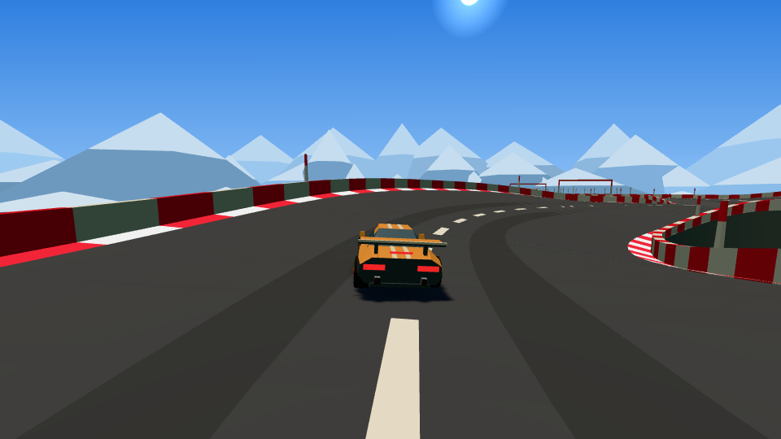
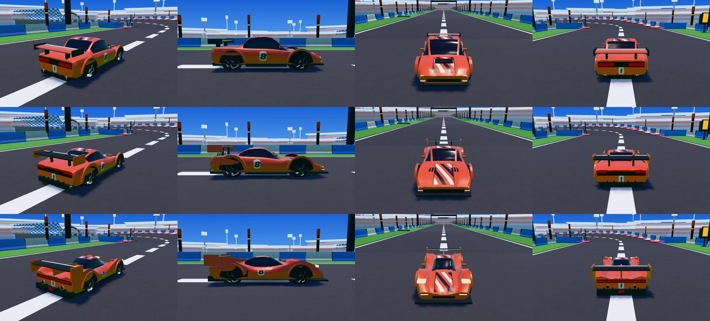
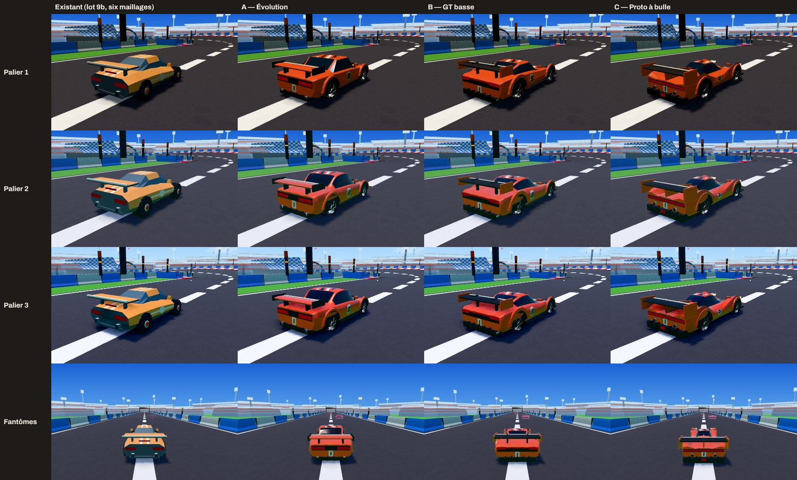
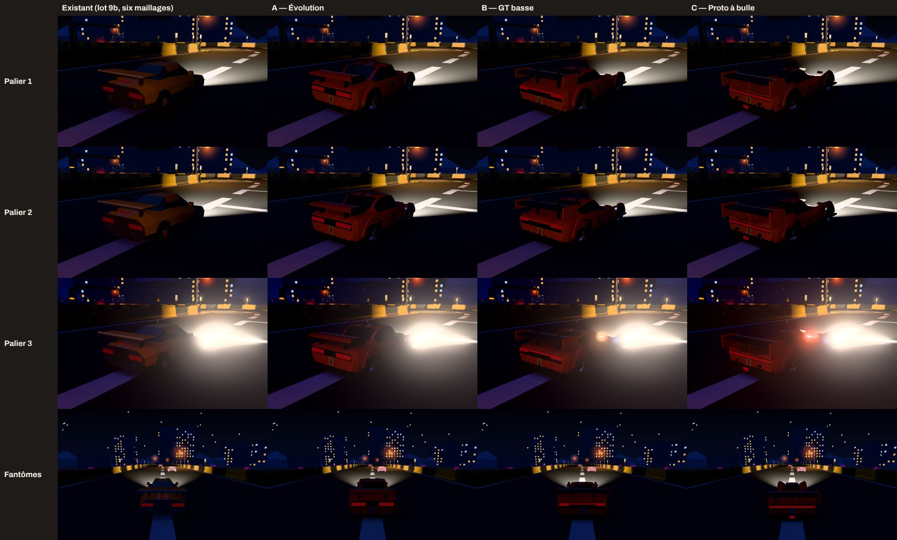
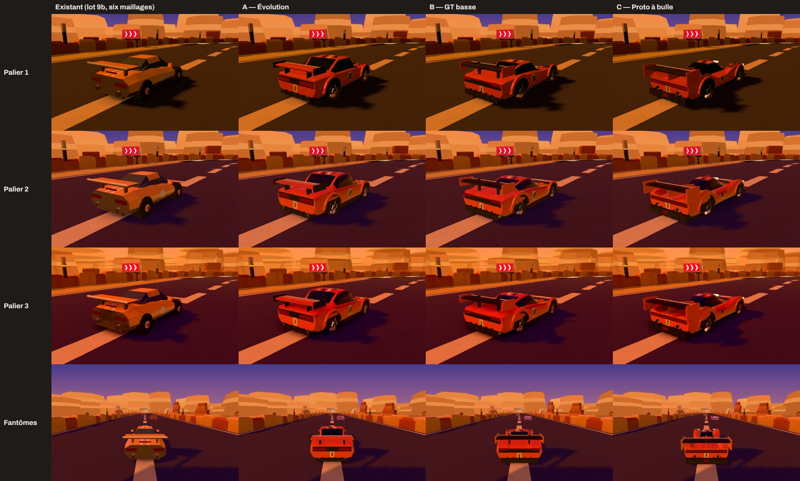
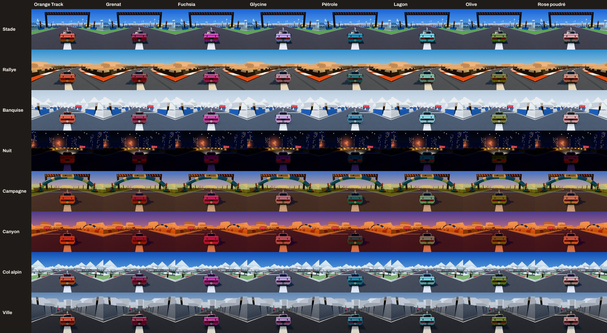

# Lot 40 — Track : le véhicule (6 maillages en jeu, puis trois modèles à choisir)

Deux temps, une PR : **(1) en jeu, tout de suite**, la voiture d'aujourd'hui en **six maillages** (au lieu de 53), à l'image identique ;
**(2) dans la vitrine**, `/track/vitrine/?planche=voiture`, **trois modèles** proposés (A, B, C) aux paliers 1, 2 et 3, à l'arrêt, en fantôme du
Salon et en mouvement, avec une **palette de 8 couleurs**. Nathan choisit le modèle ; la retouche 40b le mettra en jeu.

**Aucune modification de la simulation** : boîte de collision, points de contact, centre de gravité, `CarParams`, golden et rediffusions
intacts (`packages/sim` n'a pas bougé). La voiture dessinée suit la simulation (roues aux points de contact `HALF_TRACK`, `AXLE_FRONT`,
`AXLE_REAR`), elle ne la change jamais.

## À tester (aperçu de la PR, au téléphone)

- `/track/?home=0` : la voiture a **la même allure qu'avant**, et le jeu est un peu plus fluide (≈ 94 appels de rendu de moins par image).
- `/track/vitrine/?planche=voiture` (lien « Voiture (lot 40) » en tête de la vitrine) : compare **A, B et C** aux paliers 1 à 3, à l'arrêt (on
  tourne autour en glissant), puis **en mouvement** (bouton « Vue en mouvement » sous chaque colonne : Stade, Nuit, Canyon ; modèle et palier
  se changent dans la vue). Change de **couleur** avec les pastilles (elles repeignent les trois modèles, à l'arrêt et en mouvement). Note ton
  **modèle préféré**, les **couleurs à garder ou à écarter**, et les **images par seconde** du compteur de la vue en mouvement (A, B, C ; palier
  1 puis 2).

## 1. Partie 1 : la voiture d'aujourd'hui en six maillages

`apps/web/src/carMesh.ts`, `apps/web/src/voiture/pieces.ts`. La voiture avait **53 maillages** (caisse, phares, trois feux stop, et douze pièces par
roue : pneu, sculptures, jante, fond, cinq branches, moyeu, disque, étrier) : chacun un appel de rendu, deux avec son ombre. Elle en a **six** :

| Maillage | Contenu | Comment |
|---|---|---|
| Caisse | inchangée (déjà une seule géométrie à couleurs par sommet) | — |
| Feux | phares (sans éclairage, visibles des deux côtés) et feux stop | les feux stop sont des sommets du même maillage, leur couleur réécrite **quand le frein change** (pas à chaque image) ; l'envers des feux stop est écarté dans le shader (`gl_FrontFacing`), comme le faisait leur matériau à face simple, et leur ombre ne dessine que leur envers (comme three.js le fait de lui-même) |
| Une roue par roue (×4) | pneu, sculptures, jante, fond, branches, moyeu, disque, étrier | fondus en une géométrie ; la rugosité et le métal passent **par sommet** (un matériau pour toutes les pièces) ; ce qui tourne (pneu, jante, branches, moyeu) est marqué et **tourné dans le shader** autour de l'axe de la roue, un angle commun aux quatre (un uniforme), le disque et l'étrier restent fixes ; un matériau d'ombre tourne de même. Braquage et débattement : la position et la rotation du maillage, comme avant |

Le **fantôme simple du Salon** (`createCarMesh(true, teinte, true)`) n'a pas changé : un maillage. Le fantôme de ton meilleur temps (pleine voiture
translucide) passe aussi à six maillages (même construction ; l'opacité de chaque pièce passe par sommet).

### Captures avant / après (identiques)

`CAPTURES=1 npx playwright test captures-lot40 -g "partie 1"` : le jeu de `main` et celui de la branche, servis côte à côte, mêmes gestes **pas
à pas** (`__cdj.manual` + `advance`), effets coupés, qualité figée à 2 (ombres comprises), puis pause pour dessiner ; pixels comparés dans le
navigateur (`docs/lots/lot-40-vehicule/comparaison.json`). La procédure est elle-même vérifiée : `main` contre `main` donne 0 pixel d'écart sur
les quatre premières vues.

| Vue | Pixels différents (sur 518 400) | Où |
|---|---|---|
| Poursuite, Stade, au freinage, roues braquées (`jeu-poursuite-*.png`) | **0** | — |
| Poursuite, Nuit (phares allumés, feux stop) (`jeu-poursuite-nuit-*.png`) | 2 (écart 10/255) | bord d'une roue |
| Vue capot (`jeu-capot-*.png`) | 59 (0,011 %, écart ≤ 53/255) | bords des roues avant, dans les coins bas |
| Fantôme de ton meilleur temps (`jeu-fantome-*.png`) | 28 | les roues du fantôme, à 30 m |
| Fantômes du Salon (`jeu-fantomes-salon-*.png`) | 2 591 | les **étiquettes de pseudo** ; `main` contre `main` en donne autant (2 910) : bruit de la vue, pas de la voiture |

Les quelques pixels aux bords des roues viennent de **l'arrondi** : la rotation des roues est calculée dans le shader au lieu de la matrice de
l'objet (les sommets diffèrent au dix-millionième). Pour le fantôme translucide, l'ordre de mélange des pièces d'une roue peut aussi différer
d'un rien. Rien d'autre ne bouge.

### Mesures (profil téléphone)

`MESURE=1 npx playwright test mesure-lot40 -g "partie 1"` : 844 × 390 @2, processeur ×4, pilote automatique (`?demo`), caméra de poursuite, un
circuit de chaque thème (`?theme=`), qualité figée ; **Chromium en rendu logiciel** (SwiftShader : la carte graphique d'un téléphone n'y est pas).
Relevés de 15 s à la qualité 1 (et de 6 s à la qualité 2 pour les appels et le temps de rendu).

| Thème | Appels par image, q1 | `renderer.render` (ms, q1) | Fil principal (ms par image, q1) | Intervalle entre images (ms, q1) | Appels, q2 | `renderer.render` (ms, q2) |
|---|---|---|---|---|---|---|
| Stade | 106 → 30 | 5,00 → 4,22 | 21,26 → 20,03 | 315 → 313 | 128 → 34 | 4,14 → 3,08 |
| Rallye | 102 → 29 | 19,20 → 18,42 | 33,48 → 30,84 | 284 → 275 | 125 → 31 | 5,19 → 3,55 |
| Banquise | 102 → 29 | 4,11 → 3,27 | 19,27 → 19,17 | 334 → 328 | 125 → 31 | 4,87 → 3,23 |
| Nuit | 109 → 32 | 4,67 → 3,67 | 18,95 → 19,08 | 317 → 354 | 130 → 36 | 5,15 → 4,85 |
| Campagne | 100 → 28 | 5,10 → 3,55 | 21,59 → 19,22 | 302 → 295 | 124 → 30 | 4,40 → 3,33 |
| Canyon | 105 → 29 | 3,94 → 3,01 | 19,45 → 18,87 | 310 → 325 | 126 → 32 | 4,63 → 3,59 |
| Col alpin | 99 → 29 | 11,52 → 23,66 | 27,95 → 37,63 | 340 → 336 | 126 → 33 | 65,74 → 64,99 |
| Ville | 108 → 29 | 49,21 → 56,41 | 66,90 → 73,17 | 509 → 512 | 128 → 34 | 147,53 → 153,35 |

- **Appels : −70 à −94 par image sur chaque thème** (critère : −40 au moins). Le nombre varie avec ce que la caméra voit (la démo change de caméra).
- **Temps d'image** : le temps du fil principal passé dans `renderer.render` (le coût que chaque appel fait payer au processeur et au pilote
  graphique) **baisse de 0,8 à 1,6 ms (−15 à −30 %) sur six thèmes**. Sur Col alpin et Ville, ce temps est dominé par des attentes du rendu
  logiciel (de 11 à 150 ms selon le relevé, sans lien avec la voiture) : **non concluant**. L'intervalle entre deux images (≈ 300 ms) est celui
  de la rastérisation logicielle, il ne bouge pas au-delà du bruit. **À vérifier sur un vrai téléphone** (l'aperçu de la PR) : c'est là que le
  nombre d'appels coûte (pilote graphique).

### Poids (premier chargement)

`npm run build && node scripts/budgets.mjs`, `main` puis la branche. Sur `main` à `2363986` : JS + CSS 254 798 → 256 516 o (+1 718 o). **Après la
fusion des lots 37 et 39** (`main` à `d721fe7`, 257 634 o) : JS + CSS **257 634 → 259 323 o (+1 689 o)** ; JS 246 222 → 247 911 o ; hors three.js
113 456 → 115 137 o (+1 681 o) ; three.js +8 o ; CSS, catalogue anglais, fils de travail, polices inchangés. Marge 18 966 → **17 277 o**
(`docs/plateforme/budgets.md`). **Justification** (> 1 ko) : `voiture/pieces.ts` (2,1 ko seul) fusionne des pièces en une géométrie, porte la
rugosité et le métal par sommet, tourne les roues dans le shader et prépare ce que les modèles de la partie 2 réutilisent (livrée, lissage) ;
c'est le socle de la retouche 40b, compté une seule fois dans le budget du lot (voir § 5).

## 2. Partie 2 : trois modèles à choisir (vitrine)

`/track/vitrine/?planche=voiture` : quatre colonnes — **existant** (la voiture d'aujourd'hui, six maillages), **A**, **B**, **C** — et une rangée par
palier (1, 2, 3 : la voiture posée dans la scène du palier, sur le vrai circuit du jour du thème choisi), puis une rangée **fantômes du Salon** (à
50 m et 20 m devant ta voiture, sur une ligne droite). Chaque vue se tourne au doigt. Sous les vues : **le coût de chaque modèle** ; en bas, **la
planche des couleurs**. La **vue en mouvement** (bouton sous chaque colonne) est celle de la retouche 38b (vrai circuit, pilote automatique,
caméra de poursuite du jeu, compteur d'images par seconde de l'appareil qui regarde), avec le choix du modèle, du palier et du thème.

### Les trois directions

| | A — Évolution | B — GT basse | C — Proto à bulle (proposition libre) |
|---|---|---|---|
| Idée | la voiture d'aujourd'hui affinée, mêmes proportions | large et posée | un prototype d'endurance fermé |
| Silhouette | coupé trapu, bulle au milieu ; passages de roue marqués (lèvres débordantes, fond sombre), bas de caisse, aileron sur deux jambes au bord d'attaque crème, diffuseur à ailettes | capot long, habitacle reculé et bas (1,18 m), pavillon fuyant, hanches arrière larges, **grand aileron sur cols de cygne** aux dérives peintes, diffuseur profond, quatre sorties | ailes détachées au-dessus de chaque roue, centre plongeant entre elles, bulle étroite au centre, **dérive** sur le dos jusqu'à l'aileron, lame de feux d'une aile à l'autre |
| De dos (poursuite) | deux feux larges sous un bandeau sombre, aileron, numéro | une lame de feux d'un bord à l'autre, l'aileron le plus marqué | la poupe la plus lisible : lame de feux, aileron large et bas, dérive, numéro |

**Pourquoi C** (proposition libre) : (1) les ailes détachées laissent voir **le braquage des roues avant** depuis la caméra de poursuite ; (2) la
bulle étroite et basse laisse **la poupe** prendre toute la place de dos (feux, aileron, dérive, numéro), ce qui compte le plus en poursuite ;
(3) la silhouette se lit « voiture de course » à 50 m, en fantôme, à ses deux bosses et à sa dérive ; (4) elle reste dans le gabarit (la
simulation ne change pas).

Les trois sont des **créations originales** (formes construites par sections, par le code : aucun fichier de modèle), sans reprise d'une voiture
réelle, d'une marque ni d'un jeu.

*De haut en bas : A, B, C (palier 2, Stade) — trois quarts arrière, profil, avant, dos à 7 m (la caméra de poursuite).*

*Existant, A, B, C × paliers 1, 2, 3, puis les fantômes du Salon (20 m à droite, 50 m à gauche) ; Stade, Nuit, Canyon.*

### Cahier des charges (README 38b, § 6) — tenu

- **Six maillages** pour chacun (caisse avec peinture, vitres et garnitures ; feux ; une roue complète par roue, qui tourne et braque) : 12 appels
  avec les ombres (mesuré dans la vitrine : 15 appels sans voiture, 28 avec, la tache d'ombre comprise).
- **Triangles** : palier 1 ≈ 2 100 à 2 500 ; paliers 2 et 3 ≈ 4 300 à 4 700 (sections plus fines, profil arrondi, roues à 26 segments).
- **Matériaux** : palier 1, une peinture standard et des couleurs par sommet (facettes, comme le décor) ; paliers 2 et 3, une **peinture à deux
  couches** (`MeshPhysicalMaterial`, `clearcoat`) lissée qui reflète la carte d'environnement du thème (pas « reflets »), **vitres sombres
  réfléchissantes et opaques** (aucun intérieur), **jantes en métal clair**, **pneus mats**, **feux sans éclairage** (lisibles de nuit :
  planche Nuit). Le palier 3 reprend la voiture du palier 2 : c'est la scène qui change (ombres nettes, post-traitement).
- **Livrée** : la caisse en aplat franc de la couleur choisie (orange `#E8552D` par défaut) ; une **bande centrale de rayures à 115°** (crème et
  asphalte) sur le capot et le toit ; le **numéro du jour sur les portières**, en Barlow Condensed 800 italique, et **en grand à l'arrière** (« l'arrière
  compte le plus ») ; tout est une **texture dessinée au chargement** (`voiture/livree.ts`), changer de couleur la redessine sans toucher à la
  géométrie.
- **Lisibilité en poursuite** : feux stop larges, aileron, numéro à l'arrière ; rien de fin qui scintille (pas d'antenne, pas de grille fine ; la
  livrée est une texture avec ses niveaux de détail).
- **Tactile et vue capot** : rien ne déborde de la silhouette (|x| ≤ 1,06 m, rétroviseurs et ailerons compris : test) ; la vue capot (`HOOD_MOUNT`)
  est vérifiée pour les trois modèles par le même lancer de rayons que `hoodView.test.ts` (`voitureModeles.test.ts`) : le capot de A a été
  abaissé de 3 cm pour passer.
- **Longueur** : A 4,3 m (comme aujourd'hui), B 4,6 m, C 4,7 m (porte-à-faux plus longs ; la boîte de la simulation ne change pas).

### Les fantômes du Salon : comment ils se distinguent toujours de ta voiture

Version simple de chaque modèle (`construireFantome`) : **≈ 400 triangles, un maillage, un appel** (les fantômes ne projettent pas d'ombre).
Proposition, quelle que soit leur couleur :

1. **translucides** (opacité 0,42 : on voit la route à travers) ;
2. **sans livrée** : ni bandes ni numéro (ta voiture seule les porte) ;
3. **une teinte unie** éclaircie (la couleur du joueur, du Salon) ;
4. **un liseré lumineux** : les faces vues de biais s'allument (une lumière de contour calculée dans le shader) — on lit encore la silhouette à
   50 m sur un fond de même couleur.

Les couleurs des fantômes du Salon (`GHOST_COLORS` : rose, vert, jaune, violet, cyan, orange) recoupent la palette des joueurs (fuchsia, orange) :
c'est la translucidité, l'absence de livrée et le liseré qui font la différence, pas la teinte. L'étiquette du pseudo reste au-dessus (inchangée).

## 3. Ce que coûte chaque modèle

Poids : `node apps/web/vitrine/poids-parties.mjs` (esbuild, minifié, gzip ; chaque partie seule, ce qui est déjà dans le jeu laissé dehors).
Image : `MESURE=1 npx playwright test mesure-lot40 -g "partie 2"` (vue à l'arrêt, Stade, 844 × 390, processeur ×4, **rendu logiciel**, voiture **de
près** : elle couvre ≈ 40 % de l'image ; avec la voiture puis sans elle, 30 images).

| | Existant (6 maillages) | A — Évolution | B — GT basse | C — Proto à bulle |
|---|---|---|---|---|
| Poids JS compressé | 4,6 ko (aujourd'hui, `carMesh.ts` + `pieces.ts`) | socle commun 4,6 ko + plan 1,5 ko | socle + 1,5 ko | socle + 1,4 ko |
| Matériaux des paliers 2 et 3 (à la demande) | — | 0,5 ko | 0,5 ko | 0,5 ko |
| Triangles, palier 1 / paliers 2 et 3 | 1 918 | 2 148 / 4 364 | 2 480 / 4 728 | 2 144 / 4 360 |
| Maillages (appels, ombre comprise) | 6 (12) | 6 (12) | 6 (12) | 6 (12) |
| Fantôme simple (triangles, maillages) | 402, 1 | 404, 1 | 404, 1 | 392, 1 |
| Ce que la voiture ajoute à une image, palier 1 (rendu logiciel, de près) | +8 ms | +30 ms | +25 ms | +25 ms |
| Idem, palier 2 | +18 ms | +107 ms | +112 ms | +113 ms |
| Images par seconde sur ton téléphone | vue en mouvement | vue en mouvement | vue en mouvement | vue en mouvement |

**Lecture** : les trois modèles coûtent la même chose (même nombre d'appels, triangles proches, même poids). Au palier 2, la **peinture à deux
couches** se paie à chaque pixel de la voiture : en rendu logiciel, de près, ≈ +110 ms contre +18 ms pour l'existant ; sur une vraie carte
graphique l'écart est bien moindre (une couche spéculaire de plus sur les seuls pixels de la voiture, ≈ 10 % de l'écran en poursuite) — **le
compteur de la vue en mouvement, sur ton téléphone, tranche** (A, B, C au palier 1 puis 2).

## 4. Recommandation

**C — Proto à bulle**, pour la lisibilité en jeu : c'est la poupe la plus lisible en poursuite (lame de feux, aileron, dérive, numéro), le
braquage se voit, et sa silhouette reste reconnaissable en fantôme. Même coût que A et B. Si tu préfères la continuité, **A** garde l'esprit
d'aujourd'hui avec ce qui manquait (passages de roue, aileron, diffuseur). **B** est la plus « voiture de série » des trois.

Par appareil (décisions du 22/10) : palier 1 de la voiture (peinture standard) sur entrée de gamme, palier 2 (deux couches) sur téléphone
récent si le compteur le permet, palier 2 sur ordinateur (la scène y est au palier 3).

## 5. Budget de la retouche 40b (estimation)

Mettre en jeu un modèle **au palier 1** (premier chargement) : il remplace `createCarMesh` ; l'ombre portée et les constantes des roues restent.
Mesuré en paquetant les deux hypothèses d'un seul tenant (esbuild + gzip) : **+3,7 à +3,9 ko** au-dessus de la partie 1 (A +3 807 o, B +3 870 o,
C +3 714 o). Les matériaux des paliers 2 et 3 (0,5 ko, plus `MeshPhysicalMaterial` dans three.js) se chargent **à la demande** quand le palier 2
est choisi ; les modèles non choisis ne sont jamais chargés ; le fantôme simple va dans le morceau du Salon (1,1 ko, déjà à la demande).
**Total du lot (partie 1 mesurée + 40b estimée) : ≈ +5,5 ko**, un peu au-dessus de la fourchette « +3 à +5 ko » ; le chiffre réel (morceau
unique, mieux compressé) se mesurera en 40b, et la marge de Track (≈ 20 ko) le permet — **décision à Nathan** (question 7).

## 6. La palette de 8 couleurs (paramètre du modèle)

La couleur de la caisse est un paramètre (`couleur` de `construireVoiture`, et `peindre(couleur)` pour la changer). Les **bandes**, la **plaque du
numéro** et ses chiffres s'adaptent à la clarté de la caisse (`livreeDe`) : caisse sombre → bandes crème ; claire → bandes asphalte ; moyenne
(l'orange) → crème et asphalte ; plaque crème et chiffres asphalte, sauf sur une caisse claire (plaque asphalte, chiffres crème). Les feux sont
posés sur un bandeau asphalte : lisibles sur toute couleur.

| Couleur | Valeur | Clarté | Bandes |
|---|---|---|---|
| **Orange Track** (par défaut) | `#E8552D` | moyenne | crème et asphalte |
| Grenat | `#A3264F` | moyenne | crème et asphalte |
| Fuchsia | `#D63AA6` | moyenne | crème et asphalte |
| Glycine | `#C9A0DC` | claire | asphalte |
| Pétrole | `#2E86A6` | moyenne | crème et asphalte |
| Lagon | `#7FD6E0` | claire | asphalte |
| Olive | `#7D8A2E` | moyenne | crème et asphalte |
| Rose poudré | `#E0A3A0` | claire | asphalte |

**Choisies par le calcul, puis vérifiées en image.** Chaque couleur s'écarte de chaque élément de piste de chaque thème — route, rebords, vibreurs,
plaques d'accélération (jaune), super turbo (rouge), portes, sol — d'un ΔE 2000 > 12 (test `voitureModeles.test.ts`, sur les palettes de la scène des
paliers), et reste assez claire pour la Nuit (luminance ≥ 0,08). **Écartées** : crème et blanc (rebords et neige), asphalte et noir (rebords noirs,
Nuit), bleu (rebords du Stade, portes), jaune (boosts), rouge (vibreurs, turbo), vert vif (pelouse), turquoise (portes, accent du Canyon), argent et
gris (route, Ville), et — après la première planche — **bordeaux, sapin, pétrole foncé** : invisibles la nuit et sur la route du Canyon.

*Chaque couleur sur chaque thème (modèle A, palier 2, poursuite avant le premier virage). Les planches de B et C : `couleurs-B.jpg`, `couleurs-C.jpg`.*

**Ce que montre la planche** :
- **Nuit** : toutes les couleurs s'assombrissent (la lumière du thème est faible) ; les claires (glycine, lagon, rose poudré) se lisent le
  mieux ; les feux restent lisibles. Piste pour la 40b : une lumière de la voiture la nuit, ou des bandes légèrement lumineuses (question 5).
- **Canyon** : pétrole et olive se détachent moins de la route sombre sous la lumière orangée ; l'orange se détache de la route mais **voisine les
  falaises orange**.
- **L'orange de Track et la scène** : dans la scène des paliers, les **vibreurs du Rallye sont orange `#E8552D`** (la couleur même de la voiture)
  et ceux de la Campagne rouge-orangé (ΔE 6,5) ; ceux du Stade sont rouges (ΔE 11). Pour que l'orange reste à la voiture seule au centre de l'image,
  c'est **la scène** qui doit changer (lot 39 et suivants : vibreurs rouge et blanc partout, ou une autre teinte au Rallye) — question 6. Les
  portiques de la marque (bandeaux) restent loin de la voiture en poursuite.

## 7. Questions pour Nathan

1. **Le modèle** : A, B ou C (ma recommandation : C) ?
2. **Les fantômes** : translucides, sans livrée, teinte unie, avec un liseré lumineux — ça te va ? (autres pistes : un contour plus épais, une
   trame de points, une teinte froide commune à tous).
3. **Le numéro** : le numéro du circuit du jour (Track #8 → « 8 ») sur les portières et à l'arrière ? En 40b, quel numéro au Salon (session,
   rang) et sur les archives ?
4. **Les rayures** : une bande centrale de rayures obliques sur le capot et le toit — ou un pavé de rayures sur un côté, comme le bord de
   l'étiquette Track ?
5. **La Nuit** : accepter que la voiture soit sombre (comme le décor) ou ajouter en 40b une lumière de la voiture, ou des bandes légèrement
   lumineuses ?
6. **L'orange dans la scène** : changer les vibreurs orange du Rallye et rouge-orangé de la Campagne (lot de la scène) pour garder l'orange à la
   voiture ?
7. **Le budget** : ≈ +5,5 ko pour le tout (partie 1 : +1,7 ko mesurés ; 40b : +3,7 à +3,9 ko estimés), un peu au-delà de « +3 à +5 ko » — accepter,
   ou demander à la 40b de rogner (par exemple des roues plus simples au palier 1) ?
8. **La palette** : les 8 couleurs te vont ? Des couleurs à écarter après l'essai sur téléphone ?
9. **Le palier 2 de la voiture sur téléphone** : à décider sur le compteur de la vue en mouvement (A, B ou C au palier 2 contre palier 1).

## 8. Vérifié, non vérifié

**Vérifié** :
- `npm test` (Vitest, en entier) et `npm run typecheck` verts ; golden et rediffusions inchangés (`packages/sim` n'a pas bougé) ;
  `test/hoodView.test.ts` vert ; nouveaux tests : `test/voiture.test.ts` (six maillages, roues, feux stop, fantôme simple d'un maillage),
  `test/voitureModeles.test.ts` (les trois modèles : maillages, triangles, fantôme, roues aux points de contact, silhouette, **vue capot**, feux ;
  la palette). Deux tests existants comptaient l'ancienne structure (`salon.test.ts` : « plus de quarante maillages » ; `watch.test.ts` : « plus
  de dix matériaux standard ») : ils comptent maintenant **six** maillages et **cinq** matériaux standard (caisse et quatre roues), même intention
  (la voiture complète est plus lourde que le fantôme ; la voiture regardée est pleine).
- Captures avant / après (§ 1) ; mesures au profil téléphone (§ 1, § 3) ; poids (§ 1, § 5).
- e2e : `e2e/vitrine-voiture.spec.ts` (ordinateur : 16 vues dessinées, maillages et triangles, coûts, couleur, vue en mouvement avec changement de
  modèle, de palier et de thème ; téléphone : la page tient dans l'écran, pastilles à 44 px, **axe** sans violation grave) ; `vitrine.spec.ts`,
  `ghost.spec.ts`, `salon.spec.ts`, `watch.spec.ts`, `cameras.spec.ts`, `perf.spec.ts` relancés.

**Non vérifié** :
- Les **images par seconde sur un vrai téléphone** (gain de la partie 1, coût des modèles au palier 2) : le conteneur rend en logiciel. C'est le
  « À tester » de l'aperçu.
- Firefox et WebKit pour la vitrine (Chromium seulement, comme le reste de la vitrine).

## 9. Fichiers

- Jeu (partie 1) : `apps/web/src/carMesh.ts` (six maillages), `apps/web/src/voiture/pieces.ts` (fusion des pièces, matériaux par sommet,
  rotation des roues dans le shader, livrée et lissage pour les modèles).
- Modèles (vitrine ; la 40b en reprendra un) : `apps/web/src/voiture/` — `forme.ts` (caisse par sections, roues, passages, ailerons), `livree.ts`
  (palette, adaptation, texture de livrée, ΔE 2000), `modele.ts` (constructeur commun, fantôme), `modeleA.ts`, `modeleB.ts`, `modeleC.ts` (les plans),
  `materiaux2.ts` (paliers 2 et 3, à la demande), `modeles.ts` (chargement à la demande).
- Vitrine : `apps/web/src/vitrine/voiture.ts` (la planche), `mesuresVoiture.ts` ; `vitrine.ts`, `mouvement.ts` (changer de voiture), `index.html`,
  `vitrine.css`, `poids-parties.mjs` (lignes « Voiture »).
- Tests : `apps/web/test/voiture.test.ts`, `apps/web/test/voitureModeles.test.ts` ; e2e `vitrine-voiture.spec.ts` ; outils `captures-lot40.spec.ts`,
  `mesure-lot40.spec.ts` (`durees.json` à jour).
- Captures : `docs/lots/lot-40-vehicule/`.
