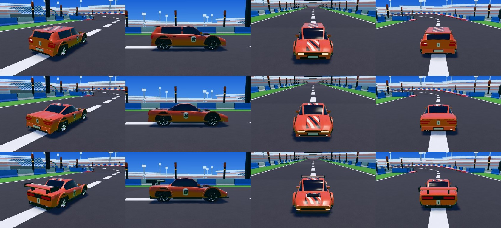
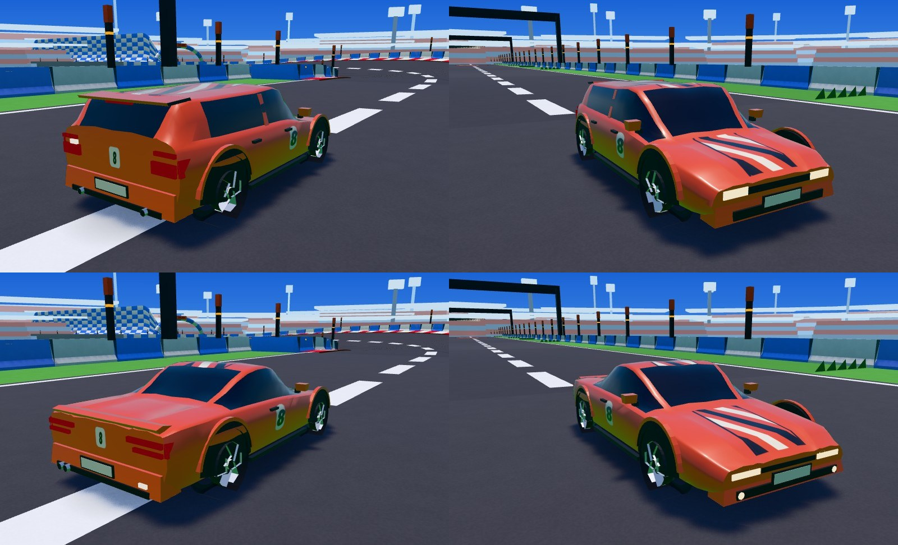

# Retouche 40b — Track : la voiture civile par défaut, et les modèles en jeu

> **En cours — étape 1 : la civile, dans la vitrine.** Nathan choisit sa civile dans `/track/vitrine/?planche=voiture` (lien de l'aperçu sur la
> PR). Le reste du lot (petit niveau de détail des quatre modèles, les modèles en jeu) suit son choix.

Décision de Nathan (23/10/2026) : la voiture par défaut est une voiture plus « civile », une voiture de série sportive ; A (Évolution), B (GT
basse) et C (Proto à bulle) du lot 40 deviennent des voitures à débloquer (Garage : lot 41).

## 1. La civile : deux propositions (vitrine)

`/track/vitrine/?planche=voiture` : deux colonnes de plus, **Civile 1** et **Civile 2**, à côté de l'existant et de A, B, C — aux paliers 1, 2 et 3,
en fantôme du Salon, en mouvement (bouton « Vue en mouvement » sous chaque colonne, ou « Civile 1 » / « Civile 2 » dans la vue), avec la palette
de 8 couleurs.

| | Civile 1 — Compacte sportive | Civile 2 — Coupé de série |
|---|---|---|
| Idée | une compacte de série, cinq portes, haute et ramassée | un coupé de série deux portes, plus bas et plus sage que A |
| Silhouette | capot court, pavillon long jusqu'à un hayon presque droit, lunette inclinée, **petit becquet de toit** (le seul appendice) ; 4,0 m, toit à 1,35 m | capot long, pavillon qui file vers une malle courte, **becquet en lèvre** sur la malle ; 4,3 m, toit à 1,26 m |
| De série | pare-chocs peints (grille et entrée d'air sombres), **plaques** avant et arrière (sans inscription), rétroviseurs sur les portières, **deux poignées par côté** et un montant central peint (cinq portes), passages de roue affleurants, deux sorties d'échappement discrètes | pare-chocs peints, plaques, rétroviseurs, **une poignée par côté** (deux portes), passages de roue affleurants, antibrouillards ronds, une sortie d'échappement double |
| Feux | phares en trapèze au coin du capot, un trait de jour au-dessus, clignotant au bout ; feux d'angle hauts qui tournent sur l'aile, troisième feu sous le becquet, un feu de recul | phares fins étirés vers l'aile, deux points de jour ; feux en double trait d'un coin vers le centre de la malle, un feu de recul |
| Livrée | bande centrale de rayures (capot et toit), numéro sur la portière avant et sur le hayon | bande centrale (capot et toit), numéro sur la portière et sur la malle |

**On les distingue de A, B et C d'un coup d'œil** : ni aileron, ni diffuseur, ni lèvres débordantes ; des pare-chocs, des plaques, des poignées.
Elles gardent la livrée de Track (bandes, numéro, palette) : elles ne sont pas tristes, et les modèles à débloquer restent plus « course ».

**Créations originales** : un type de voiture (la compacte sportive, le coupé de série), construit par sections par le code, sans la silhouette, la
calandre ni les phares d'un modèle réel, sans marque ni logo (les plaques sont vierges).

**Ma recommandation : Civile 1, la compacte.** Elle se distingue le mieux des trois autres (haute, hayon, cinq portes : A, B et C sont tous des
coupés bas), elle se lit de dos en poursuite (feux d'angle hauts, becquet, numéro sur le hayon), et elle donne envie d'une voiture plus basse et
plus « course ». Le coupé est plus proche de A et de B de profil.

Mêmes règles que les modèles du lot 40 (tests `voitureModeles.test.ts`) : six maillages, ≈ 2 000 triangles au palier 1, 4 000 à 6 000 aux paliers
2 et 3, fantôme simple d'un maillage (≈ 400 triangles), roues aux points de contact, rien hors de la silhouette (|x| ≤ 1,06 m, hauteur ≤ 1,4 m),
**vue capot** dégagée.

*De haut en bas : Civile 1 (compacte), Civile 2 (coupé), A pour comparer (palier 2, Stade) — trois quarts arrière, profil, avant, dos à 7 m (la
caméra de poursuite). Palier 1 : `civiles-p1.jpg`. De près : `civiles-proches.jpg`.*

## Captures « avant » (pour le petit niveau de détail)

A, B et C tels que le lot 40 les a laissés, sous les quatre angles, aux paliers 1 et 2 : `modeles-avant-p1.jpg`, `modeles-avant-p2.jpg`.
