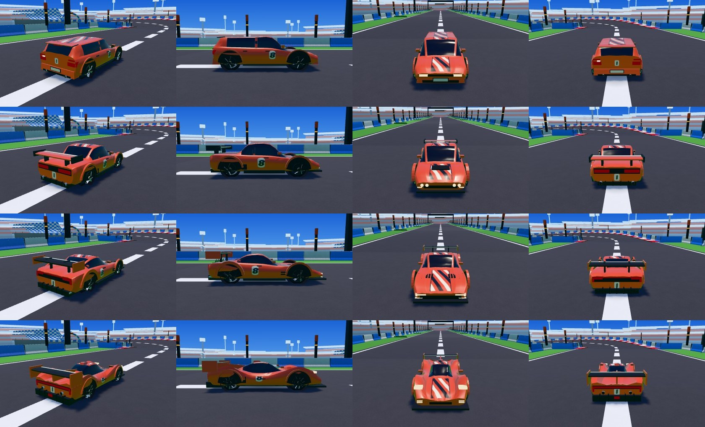
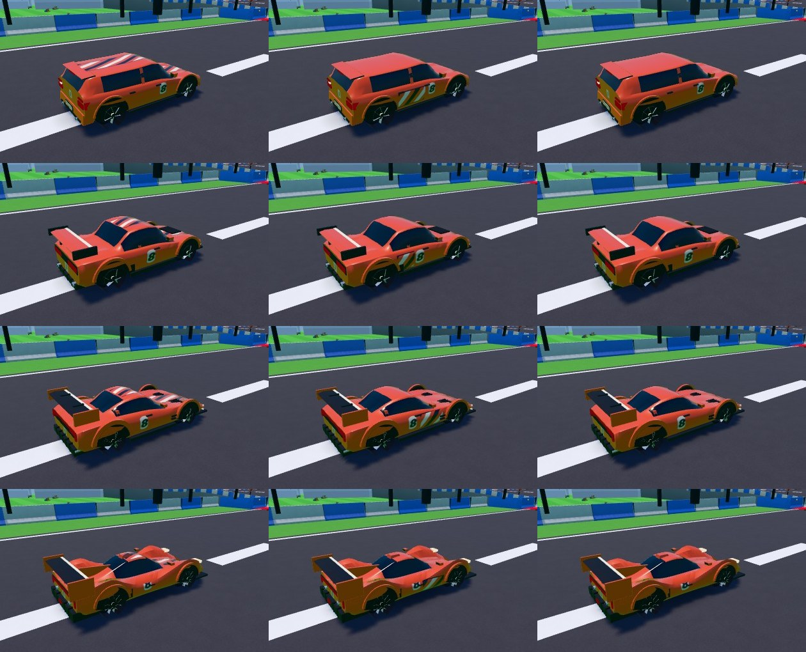
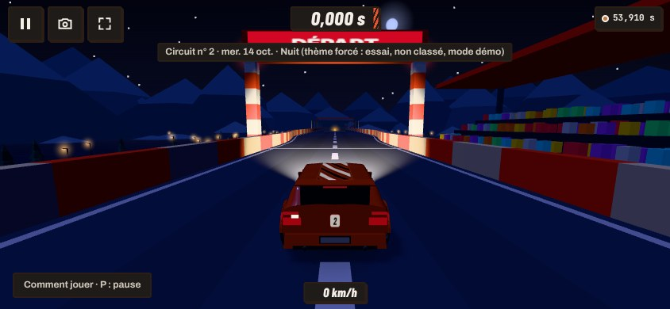
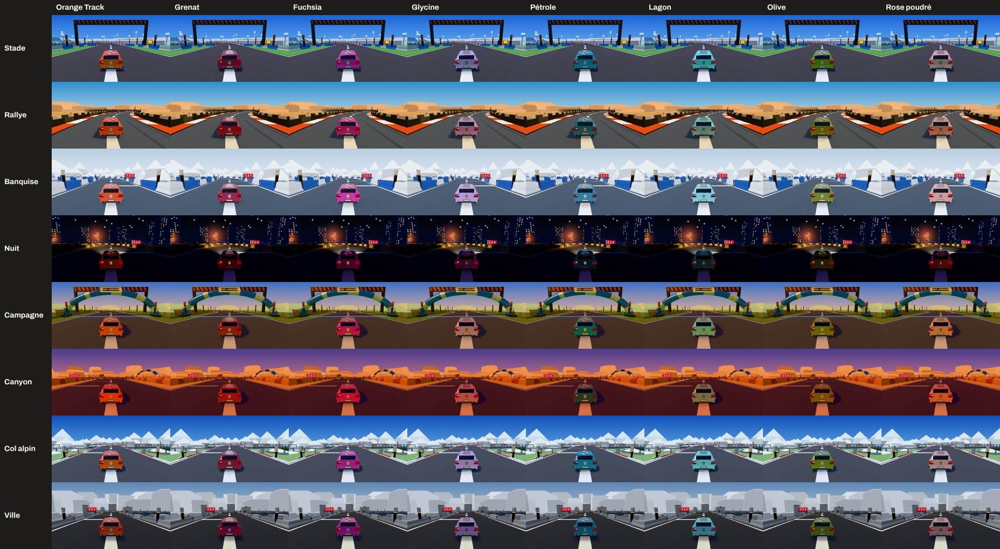
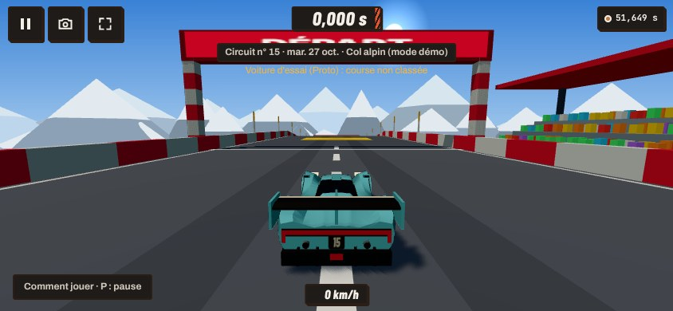
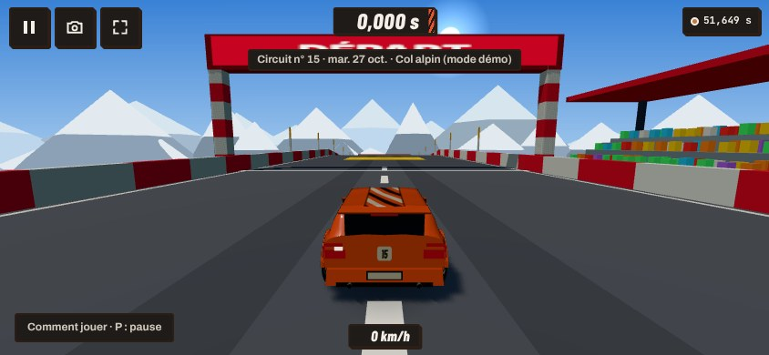

# Retouche 40b — Track : la voiture civile par défaut, et les modèles en jeu

Décision de Nathan (23/10/2026) : la voiture par défaut est une voiture plus « civile », une voiture de série sportive ; A (Évolution), B (GT
basse) et C (Proto à bulle) du lot 40 deviennent des voitures à débloquer (le Garage du lot 41 les montrera, les fera choisir et personnaliser).
Réponses aux questions du lot 40 validées en lançant ce lot (fantômes, numéro, Nuit, budget, palette, palier 2 sur téléphone).

**Aucune modification de la simulation** : `packages/sim` n'a pas bougé (golden et rediffusions inchangés). Toutes les voitures ont la même
simulation : mêmes `CarParams`, même boîte de collision, mêmes points de contact. Le classement du jour reste équitable.

## À tester (aperçu de la PR, au téléphone)

- `/track/?home=0` : **la civile** (compacte orange, numéro du jour sur le hayon).
- `/track/?home=0&voiture=proto&couleur=5&motif=flancs` : **le Proto, lagon, rayures sur les flancs** ; bandeau « Voiture d'essai (Proto) :
  course non classée », rien n'est envoyé ni enregistré.
- La Nuit : `/track/?seed=2026-10-19&home=0` (jour de Nuit passé) : rayures, numéro et feux légèrement lumineux. Avec une autre voiture :
  `/track/?seed=2026-10-19&home=0&voiture=gt&couleur=3`.
- La vitrine : `/track/vitrine/?planche=voiture` — la civile, A, B, C aux paliers 1, 2, 3, le **motif** (bande, flancs, unie), la couleur, la vue
  en mouvement.
- Page d'admin : l'option « Voiture d'essai » (voiture, couleur, motif).

## 1. La civile (choisie dans la vitrine)

Deux propositions ont été montrées dans la vitrine (aperçu de la PR, étape 1) : **Civile 1, la compacte sportive** (cinq portes, haute,
ramassée) et Civile 2, un coupé de série. **Nathan a choisi la Civile 1** (23/10/2026). Le coupé a été retiré du code (captures gardées :
`civiles-p1.jpg`, `civiles-p2.jpg`, `civiles-proches.jpg` : compacte, coupé, A).

La civile (`apps/web/src/voiture/modeleCivile.ts`) : capot court, pavillon long jusqu'à un hayon presque droit, lunette inclinée, **petit
becquet de toit** (le seul appendice) ; 4,0 m, toit à 1,35 m. **De série** : pare-chocs peints (grille et entrée d'air sombres), plaques avant et
arrière **vierges**, rétroviseurs sur les portières (avec leur glace), **deux poignées par côté** et un montant central peint (cinq portes),
passages de roue affleurants, deux sorties d'échappement discrètes. On la distingue d'un coup d'œil de A, B et C (ni aileron, ni diffuseur, ni
lèvres débordantes). Création originale : un type de voiture, aucune silhouette, calandre ni phare d'un modèle réel, ni marque ni logo.

## 2. Un petit niveau de détail (les quatre modèles)

| | Civile | A — Évolution | B — GT | C — Proto |
|---|---|---|---|---|
| Phares (signature) | trapèze au coin du capot, trait de jour au-dessus, clignotant au bout | **quatre yeux ronds** sur le nez, trait de jour dessous | **amande** fermée d'un **crochet** de jour au bout de l'aile, trait sous la bouche | **trois traits superposés** sur le nez de chaque aile, phares sur les ailes |
| Feux arrière | feux d'angle hauts qui tournent sur l'aile, troisième feu sous le becquet, feu de recul | deux feux larges marqués de **deux ronds** chacun | lame d'un bord à l'autre, les bouts **en équerre** sur les hanches | lame d'une aile à l'autre, les bouts **retournés vers le bas**, feu de pluie |
| Jantes (`dessin`) | 6 branches **larges** (jante de série) | 5 **lames** | 5 branches **doubles** | 5 branches **en Y** |
| Rétroviseurs | sur les portières, glace vue de dos | glace ajoutée | glace ajoutée | glace ajoutée |
| Poignées | deux par côté | une, affleurante | une, affleurante | une, sur le flanc de la bulle |
| Prises d'air | grille et entrée d'air du pare-chocs | prise d'air devant la roue arrière, écope du capot | **ouïes** derrière la roue avant, ouïes du capot | **prise d'air de toit** sur la bulle, écopes latérales |
| Échappements | deux, discrets | deux | quatre | deux hauts |
| Ligne de vitrage | montant central peint (cinq portes) | montant de custode peint (deux glaces par côté) | coude peint de la glace longue | la bulle |

Rien de fin qui scintille : les pièces font au moins 3 cm, les traits de jour 2 cm (lumineux, sans éclairage). Les bouts des branches des
jantes (cachés sous le moyeu et la lèvre) ne sont plus dessinés : c'est ce qui a payé le dessin en Y.

| Triangles | Civile | A | B | C | Plafond |
|---|---|---|---|---|---|
| Palier 1 (avant → après) | — → 2 184 | 2 148 → 2 384 | 2 480 → 2 476 | 2 144 → 2 408 | ≤ 2 600 |
| Paliers 2 et 3 | — → 4 264 | 4 364 → 4 728 | 4 728 → 4 724 | 4 360 → 4 624 | ≤ 6 000 |
| Fantôme simple (un maillage) | 368 | 404 | 404 | 392 | ≈ 400 |

Six maillages chacun (caisse, feux, quatre roues). **Vue capot vérifiée pour chaque modèle aux paliers 1 et 2** (`test/hoodView.test.ts` : le
capot de la civile a été abaissé de 2 cm pour passer en roulis).

*Après : civile, A, B, C (palier 2, Stade) — trois quarts arrière, profil, avant, dos à 7 m (la caméra de poursuite). Palier 1 :
`modeles-p1.jpg`. Avant (A, B, C tels que le lot 40 les a laissés) : `modeles-avant-p1.jpg`, `modeles-avant-p2.jpg`.*

## 3. Les modèles en jeu

### Le contrat (lots 40b, 41, 42)

- `apps/web/src/voiture/catalogue.ts` : `VOITURES: FicheVoiture[]` — `civile` (`defaut`), `evolution` (A), `gt` (B), `proto` (C) ; `nom` et
  `description` = clés `voiture.<id>.nom` / `.description` (fr + en, `catalogue.base.*`) ; `charger()` = un `import()` du plan (la civile :
  son plan, déjà dans le premier chargement). `abonnement` est dans le type, aucune voiture ne l'utilise, rien ne l'affiche.
- `apps/web/src/voiture/choix.ts` : `voitureChoisie()` → `{ id, couleur, motif }` (couleur = rang dans la palette, 0 = orange de Track) ;
  `choisirVoiture(…)` ; clé **`cdj:track:garage`**, relue à chaque construction de la voiture (au chargement, à l'accueil). Un choix illisible
  ou une voiture non débloquée → **la civile en orange de Track**.
- **Déblocages (proposition, le lot 41 les montre et les fait vérifier par le serveur)** : Évolution = 7 jours joués ; GT = 5 médailles d'or
  (ou mieux) ; Proto = 3 médailles d'auteur. En 40b ils se lisent dans les records de ce navigateur (`progresLocal`, `records.ts`).

### La voiture du jeu (`voiture/enJeu.ts`)

- **Le départ n'attend jamais la voiture** : la civile (premier chargement) est construite tout de suite, dans la couleur et le motif choisis ;
  le modèle choisi et les matériaux des paliers 2 et 3 se chargent à la demande pendant l'accueil ; la voiture n'est remplacée **qu'hors course**
  (accueil, pause, décompte, arrivée). Pas prête au départ : on court avec la civile, elle sera remplacée à la prochaine pause ou arrivée.
- **Palier de la voiture = règle de qualité automatique** (lot 9) : peinture à deux couches (palier 2) quand la qualité 2 est figée (réglage
  « haute », `?quality=2`) ou **tenue 5 s en course** ; sinon palier 1. Le réglage automatique part de la qualité 2 sans rien avoir mesuré : sans
  ces 5 s, un téléphone lent chargeait le palier 2 au démarrage pour rien (vu en e2e : en rendu logiciel, la peinture à deux couches ralentissait
  chaque image et `watch.spec.ts` échouait). Un changement de palier en course attend lui aussi un moment hors course.
- **Numéro** : celui du circuit du jour ; au Salon, celui de la session dans la journée (1 à 144).
- **Où** : course, accueil, Salon (ta voiture), **revoir le meilleur tour** (ta voiture, repeinte à la couleur du joueur regardé, son pseudo
  au-dessus), **fantôme de ton meilleur temps** (la version simple de ta voiture : translucide, sans livrée, teinte unie, liseré lumineux),
  **fantômes du Salon** (la version simple de la civile, à la couleur de chaque joueur : montrer sa voiture aux autres viendra plus tard).

### Motifs de livrée (`livree.ts`)

`bande` (la bande centrale d'aujourd'hui), `flancs` (un pavé de rayures plus serrées sur chaque flanc, comme le bord de l'étiquette Track),
`unie` (sans rayures). Le numéro reste dans les trois cas.

*Bande, flancs, unie (palier 2) — civile, A, B, C.*

### La Nuit

Les rayures, la plaque et le numéro sont marqués dans l'alpha de la texture de livrée (0,5) ; la Nuit (thème à phares), le matériau les rend
légèrement lumineux de leur propre couleur (`uNuit`), et les feux passent un peu au-dessus du blanc. Vérifié sur la planche des couleurs de la
civile (rangée Nuit) et en jeu :

*En jeu, la Nuit ; puis chaque couleur sur chaque thème (civile, palier 2, poursuite).*

### `?voiture=<id>&couleur=<n>&motif=<m>` (recette et aperçus)

Montre une voiture **sans rien enregistrer ni vérifier les déblocages** (ignoré en production, `isRestricted`). La course n'est **ni classée ni
enregistrée** (comme `?tune`) : bandeau « Voiture d'essai (…) : course non classée », arrivée « Voiture d'essai : course non classée ni
enregistrée », pas de formulaire d'envoi ; au Salon, rien d'envoyé non plus. Option de la page d'admin. Test : `e2e/voiture.spec.ts`.

## 4. Budget et performance

`npm run build && node scripts/budgets.mjs` (`main` à `f15d31d`, puis la branche) :

| | `main` | 40b | écart | plafond (marge) |
|---|---|---|---|---|
| JS + CSS du premier chargement | 259 323 | 266 848 | **+7 525** | 276 600 (9 752) |
| JS | 247 911 | 255 436 | +7 525 | 265 200 (9 764) |
| hors three.js | 115 137 | 121 968 | +6 831 | 132 500 (10 532) |
| three.js | 132 774 | 133 468 | +694 | — |
| catalogue anglais (à la demande) | 7 297 | 7 567 | +270 | 8 000 (433) |
| admin (à la demande) | 10 885 | 11 055 | +170 | 12 500 (1 445) |

**À la demande** (gzip) : modèle A 1,6 ko, B 1,7 ko, C 1,6 ko, matériaux des paliers 2 et 3 0,5 ko ; fils de travail inchangés.

**Justification (> 1 ko, au-delà des ≈ +3,8 ko estimés au lot 40)** — mesuré module par module (cartes de source, non compressé) : la voiture du
premier chargement remplace `carMesh` (−7,1 ko) par le socle commun et la civile (`forme` 5,4 ko, `modele` 4,0, `livree` 3,7, `modeleCivile` 3,4,
`pieces` +1,1 : motifs, masque de nuit) ; s'y ajoutent ce que l'estimation du lot 40 ne comptait pas : **la voiture du jeu** (`enJeu` 2,4 ko :
chargement à la demande, remplacement hors course, palier, Nuit), **le contrat** (`choix` 1,0 ko, `catalogue` 0,9 ko), les textes (noms et
descriptions des voitures, voiture d'essai : 0,8 ko) et `main.ts` (+0,7 ko). Deux surprises : (1) **`MeshPhysicalMaterial` reste dans le fichier
de three.js (+0,7 ko)** : three.js est un seul module, l'empaqueteur ne peut pas en sortir une classe vers le morceau à la demande ; (2)
l'empaqueteur coupait la voiture en trois petits fichiers (la compression par fichier se perd) : `vite.config.ts` la regroupe (`voiture`), −1,2 ko.
Reste sous tous les plafonds ; c'est au-dessus des +5,5 ko acceptés pour 40 + 40b (+1,7 + 7,5 = +9,2 ko) — **décision de Nathan** (voir § 6).

**Le départ n'attend pas la voiture** — `MESURE=1 npx playwright test mesure-lot40b` (844 × 390 @2, processeur ×4, rendu logiciel, cinq
chargements, médiane ; `mesures.json`) :

| | navigation → décompte | civile construite au démarrage | voiture choisie en place |
|---|---|---|---|
| `main`, qualité 1 / 2 | 3 410 / 3 319 ms | — | — |
| civile, qualité 1 | 3 284 ms | 88 ms | (rien à charger) |
| civile, qualité 2 | 3 494 ms | 77 ms | 3 623 ms (palier 2) |
| Proto, qualité 1 | 3 411 ms | 72 ms | 3 511 ms |
| Proto, qualité 2 | 3 442 ms | 76 ms | 3 609 ms |

Le décompte part au même moment qu'avant (écart dans le bruit) ; la voiture choisie remplace la civile 0,1 à 0,2 s après le début du décompte
(3 s) : prête bien avant le départ. La construction de la civile (≈ 80 ms à ×4, la texture de livrée surtout) est dans le chargement.

## 5. Vérifié, non vérifié

**Vérifié** :
- `npm test` en entier et `npm run typecheck` verts ; golden et rediffusions inchangés (`packages/sim` n'a pas bougé).
- Nouveaux tests : `test/voitureJeu.test.ts` (**chaque fiche du catalogue se construit**, 6 maillages au plus, ≤ 2 600 / ≤ 6 000 triangles,
  fantôme simple d'un maillage ≈ 400 triangles, roues aux points de contact, motifs et Nuit sans toucher la géométrie ; **une voiture non
  débloquée retombe sur la civile en orange** ; choix illisibles ; `choisirVoiture` ; `?voiture=` ; la voiture du jeu : civile tout de suite,
  remplacée seulement quand le jeu le permet) ; `test/hoodView.test.ts` pour **chaque modèle aux paliers 1 et 2** ; `e2e/voiture.spec.ts`
  (sans choix : la civile ; non débloquée : la civile en orange ; `?voiture=proto&couleur=5&motif=flancs` : seul le morceau du Proto est
  téléchargé, **la course finie n'envoie rien** au classement et n'enregistre aucun record). Tests adaptés : `salon.test.ts` et
  `watch.test.ts` (la civile et sa version simple au lieu de l'ancienne voiture), `voitureModeles.test.ts` (la civile, plafond 2 600),
  `vitrine-voiture.spec.ts` (cinq colonnes).
- e2e relancés en local, un test à la fois comme en CI : `voiture`, `vitrine-voiture`, `perf`, `admin`, `ghost`, `cameras`, `socle`, `watch`,
  `watch-serveur`, `salon` — **49 réussis**. En CI (run [39936294123](https://github.com/Nathan-Te/DailyTrack/actions/runs/39936294123)) : 294 réussis, 0 échec,
  0 instable ; une part WebKit annulée pendant l'installation de ses dépendances système, avant tout test (relancée par le commit suivant). Un premier passage avait fait échouer deux tests de `watch.spec.ts` : la voiture passait au palier 2
  dès le démarrage (voir § 3, la règle des 5 s) ; corrigé, ils passent (et passent sur `main` dans le même conteneur).
- Captures (`CAPTURES=1 npx playwright test captures-lot40b`) et mesure ci-dessus.

**Non vérifié** :
- Les images par seconde sur un vrai téléphone (palier 2 de la voiture) : le conteneur rend en logiciel ; c'est l'« À tester » de l'aperçu.
- Firefox et WebKit pour la vitrine (Chromium seulement, comme le reste de la vitrine).

## 6. Décisions pour Nathan

1. **Budget** : +7,5 ko au premier chargement (au lieu de ≈ +3,8 ko estimés), marge restante 9,75 ko. Accepter, ou demander de rogner (pistes :
   sortir `enJeu` et `choix` du premier chargement en ne lisant le choix qu'après le premier écran ; moins de détail à la civile au palier 1).
2. **Les seuils de déblocage** proposés (Évolution 7 jours, GT 5 or, Proto 3 auteur) : à confirmer avec le lot 41.
3. **Mentions légales** : `cdj:track:garage` est une nouvelle donnée gardée dans le navigateur, **écrite seulement par le Garage (lot 41)** — en
   40b rien ne l'écrit (`?voiture=` n'enregistre rien). Les pages des mentions (zone partagée) disent déjà « tes réglages » sous `cdj:…` ; le lot
   41 (ou un lot de plateforme) devra le préciser (« ta voiture : modèle, couleur, motif ») dans les deux pages.
4. **Le spectateur** montre ta voiture repeinte à la couleur du joueur regardé (les autres joueurs ne montrent pas encore la leur) ; les
   **fantômes du Salon** sont la civile en version simple. À revoir quand on montrera sa voiture aux autres.
5. La planche « paliers » de la vitrine et sa vue en mouvement gardent l'ancienne voiture (`createCarMesh`, pour comparer les scènes au
   pixel avec les lots 38 et 39) ; la planche « Voiture » garde aussi une colonne « Existant ».

## 7. Fichiers

- Voitures : `apps/web/src/voiture/` — `catalogue.ts`, `choix.ts`, `enJeu.ts` (nouveaux), `modeleCivile.ts` (nouveau), `forme.ts` (dessins de
  jante), `livree.ts` (motifs, masque de nuit), `pieces.ts` (`uNuit`), `modele.ts` (motif, `nuit()`), `materiaux2.ts`, `modeleA/B/C.ts` (détails),
  `modeles.ts`.
- Jeu : `main.ts` (la voiture choisie, `?voiture=`, voiture d'essai jamais classée, `__cdj.voiture`), `salonGhosts.ts`, `adminLogic.ts`,
  `admin.ts`, `admin/index.html`, catalogues (`voiture.*`, `course.notice.voitureEssai`, `arrivee.voitureEssai`), `vite.config.ts` (morceau
  `voiture`).
- Vitrine : `src/vitrine/voiture.ts` (la civile, le motif, la Nuit), `mouvement.ts`, `vitrine/index.html`, `vitrine.css`, `poids-parties.mjs`.
- Tests : `test/voitureJeu.test.ts`, `test/hoodView.test.ts`, `test/voitureModeles.test.ts`, `test/salon.test.ts`, `test/watch.test.ts` ;
  e2e `voiture.spec.ts`, `vitrine-voiture.spec.ts` ; outils `captures-lot40b.spec.ts`, `mesure-lot40b.spec.ts` (`durees.json` à jour).
- Captures : `docs/lots/lot-40b-voitures-en-jeu/`.
