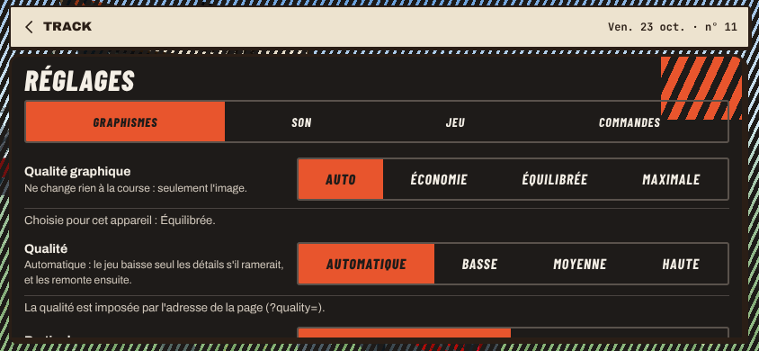
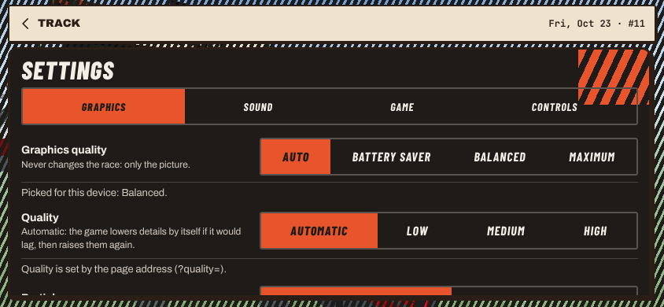

# Lot 45 — Track : le palier 2, la règle de qualité automatique et le réglage « Qualité graphique »

Branche `claude/lot-45-palier2-qualite-azmkbs` (nom imposé par la session ; le lot prévoyait `lot-45-palier2-qualite`, d'où l'étiquette `jeu:track` sur la
PR pour le job `zones`), partie de `main` à `aa478d4` (**lots 44, 46 et 41 fusionnés** ; le lot 47 ne l'est pas). Zones : `apps/web/**`, `docs/lots/**`, les
lignes de Track de `docs/plateforme/budgets.md`, ses entrées de `durees.json`, ses clés de catalogue (`reglages.graphismes.*`, fr + en) et
`docs/plateforme/traductions.md` régénéré. **Rien dans `sim`** : golden, `SIM_VERSION`, `GENERATOR_VERSION`, rediffusions, classements, identifiants de
circuit inchangés. PR : ⟨PR⟩ (brouillon ; l'aperçu est commenté par la CI). C'est le n° 5 du plan du 38b (§ 7).

## En deux phrases

**Chaque joueur a la scène que son appareil tient** : une règle automatique mesure, à l'accueil, la médiane de 90 intervalles d'image et choisit le palier
(téléphone : palier 2 avec la vie et le ciel ; ordinateur : palier 3 ; trop lent : un palier plus bas), le mémorise sous `cdj:qualite` et ne change jamais la
scène en course ; un réglage **« Qualité graphique »** (Auto · Économie · Équilibrée · Maximale) le remplace si le joueur le veut. Le **palier 2** est en jeu
(géométrie, variété, matière sobre, traces, **reflets ciblés** sur le métal et la voiture), **chargé à la demande, sans aucun appel de rendu de plus que le
palier 1** (testé sur chaque thème) ; la « matière détaillée (ancienne) » a disparu de la vitrine et du code.

## À tester (aperçu de la PR, sur ton Pixel 7 ; le lien de l'aperçu est commenté sur la PR)

| Quoi | Lien (à ajouter à l'adresse de l'aperçu) |
|---|---|
| **La règle** : ouvre l'accueil et attends quelques secondes ; le compteur (en bas à gauche) dit le palier choisi — ce devrait être `P2+vie+ciel · auto` (« · mesure » le temps de la mesure, ≈ 2 s) | `/track/?debug&home=1` |
| Lance la course du jour et lis les images par seconde **en plein écran** | « Courir », puis le bouton plein écran |
| **Économie** : Réglages › Graphismes › « Qualité graphique » › Économie, reviens à l'accueil : `P1 · economie` ; puis repasse en **Auto** (le palier mémorisé revient sans remesurer) | idem |
| Recommencer la mesure (oublier `cdj:qualite`) | page d'admin › « Effacer les données locales », ou `localStorage.removeItem("cdj:qualite")` |
| Le palier 2 seul (la finition, sans la vie et le ciel) | `/track/?home=0&palier=2&debug` |
| Le palier 1, pour comparer | `/track/?home=0&palier=1&debug` |
| Une partie du palier 2 coupée, pour lire son coût au compteur | `…&reglages=2-reflets` · `-matiere` · `-geometrie` · `-traces` · `-variete` |
| Essayer la règle comme un autre appareil (page d'admin › « Règle de qualité (essai) ») | `/track/?debug&home=1&appareil=ordinateur&intervalles=30,25,40` (un ordinateur lent descend jusqu'au palier 1) |

Le compteur de `?debug` affiche maintenant, après les images par seconde, **le palier de la scène, ses pas en plus et le réglage** (`P2+vie+ciel · auto`) ;
`__cdj.qualite` (console) donne l'appareil vu, la mémoire, la dernière mesure (médiane, fréquence de l'écran estimée).

## 1. Le palier 2 en jeu

- **Le pas « finition »** (`apps/web/src/scene/finitionJeu.ts`, `PAS_DU_JEU.finition`, un `import()`) branche **le code de la vitrine, sans le réécrire**
  (`finition.ts`, `matiere.ts`, `reflets.ts`, les rebords complets) sur la scène du palier 1 (`composerP1.ts`), par de nouveaux crochets des pas
  (`scene/types.ts`) :
  - `PasScene.avant` (avant la piste) : le contexte des éléments (`x.finition` = `FINITION_ELEMENTS` : piliers chanfreinés, socles prolongés et leurs pneus,
    boulons, câbles, banderoles ; semelles et jambes de force des panneaux ; catadioptres ; arche gonflable plus ronde), la variété (`x.varie`,
    `x.varierDecor` : chaque instance du décor tourne, grandit, change de teinte, une sur quatre s'use — une autre suite que celle du décor), et **la route** :
    les rebords complets de chaque thème et des virages deux fois plus fins (`lissage: 2`, sur le même arc que la simulation) ;
  - `PasScene.apres` (après les éléments) : traces de pneus et de freinage, variété par morceau des rebords et des pièces ; **les rebords, construits à part le
    temps de les varier, sont versés dans le calque de la route** (même appel de rendu) ;
  - `AnimationPas.habiller` : la **matière sobre** (38c : asphalte, métal, décor — une texture presque blanche de 256 px multipliée aux couleurs, la variation
    de teinte à 48 m) sur un maillage éclairé — la route et le solide à la construction, **le décor quand il se pose** (lot 44 : il arrive à la demande) ;
  - `AnimationPas.environnement` : la carte d'environnement du thème (les **reflets ciblés**, ci-dessous).
- **Aucun appel de rendu de plus que le palier 1** : la finition ne pose aucun maillage ; la route et le solide ont maintenant chacun leur matériau (même
  programme, mêmes appels). Testé : `test/finitionJeu.test.ts` (les mêmes calques sur les huit thèmes, rien de posé, avec et sans la vie et le ciel) et
  `e2e/qualite.spec.ts` (`__cdj.render.calls` du palier 2 = palier 1 **sur chaque thème**, et avec la vie et le ciel au Stade et à la Nuit).
- **Reflets ciblés** (38b, « d'autres pas », n° 5) : la carte d'environnement (`reflets.ts` : PMREM 64 px du ciel du thème) est posée **par matériau**
  (`envMap`) sur le métal des portiques (calque `solide`, rugosité 0,42, métal 0,35) et **sur la voiture** (`TrackScene.reflets(renderer, voiture)` →
  `refleter`, à chaque adoption d'une scène ou d'une voiture ; retirée au palier 1, avant que l'ancienne scène soit libérée), **jamais sur
  `scene.environment`** : la route et le décor ne la lisent plus. Le cube remplace la sphère (`SphereGeometry` serait entrée dans le morceau partagé de
  three.js, donc au premier chargement). La vitrine fait de même (`refletsCibles`) et ne baisse plus la lumière d'hémisphère.
- **La peinture à deux couches de la voiture** (lot 40, `materiaux2.ts`) **suit le palier de la scène** (2 et 3) — avant, la qualité 2 du lot 9 tenue 5 s en
  course (`qualite2Ms`, retiré).
- **Les drapeaux des portiques sont ceux du pas « vie »** : le palier 2 du jeu la prend toujours (Équilibrée = palier 2 + vie et ciel), la finition n'en pose
  donc plus (elle les aurait posés figés, puis la vie les aurait refaits) ; `?palier=2` seul n'a pas de drapeaux aux portiques. **Correction en route** : le
  pas « ciel » n'embrumait pas le décor (il traversait la scène avant que le décor y soit posé, même quand le décor était prêt à la construction) ; il
  l'embrume maintenant par `habiller` (le palier 3 et le palier 2 des téléphones changent un peu : la brume de profondeur atteint le décor, comme dans la
  vitrine).
- **Ce qui reste différent de la vitrine** : dans le jeu, les rebords sont dans le calque de la route (pas d'appel de plus) et prennent l'asphalte au lieu du
  béton ; la variété et les traces sont les mêmes.
- **Ce qui a changé de place pour le budget** : les rebords complets (`rebordB`, `bordureVideB`, `routeB`) sortent de `piste.ts` (premier chargement) vers
  `scene/rebordsComplets.ts` (une fonction gardée dans un module du premier chargement et appelée d'un morceau à la demande y reste) ; `uvMonde` sort de
  `decor/matiereC.ts` vers `scene/uvMonde.ts` (la route du palier 2 en a besoin, sans tirer le décor) ; `matiere.ts` garde sa copie des bruits de `bruit.ts`
  (§ « Budget »). `routeP(nom, complets?)` : les rebords complets donnés = la géométrie allumée ; `porteP` lit `x.finition`.
- **La « matière détaillée (ancienne) » est retirée** : `matiereDetaillee.ts`, le pas `detaillee` (`paliers.ts`), sa case et sa ligne de coûts dans la vitrine,
  sa colonne des captures du 38b, son test ; `Matiere` n'a plus de champs de normales ni de rugosité.

## 2. La règle de qualité automatique (38b, § 5)

- **`src/qualite.ts`** (premier chargement, pur) : le palier au chargement (`palierAuChargement`) selon l'appareil (`depart`) et la mémoire `cdj:qualite`
  (`lireMemoire`, `memoireValable`), les choix du réglage, le garde-fou des passes (`passesPermises`). **`src/qualiteMesure.ts`** (**à la demande** : il ne sert
  qu'à la première visite, chaque semaine ou quand l'écran change) : la mesure (`MesureImages`), la médiane, la fréquence de l'écran, les seuils, la décision
  (`apresMesure`) et la série de mesures du jeu (`SerieMesures`). `main.ts` lui donne les intervalles d'image et applique la décision
  (`reconstructeur.demander`, hors course).
- **On mesure, on ne devine pas** : à l'accueil du circuit du jour, la scène tourne ; on écarte **30 images** (compilation des programmes) puis on prend **la
  médiane de 90 intervalles**, à la densité d'écran du jeu (plafonnée à 2, celle du moteur). Pendant la mesure (≈ 2 s à 60 Hz), l'accueil dessine la scène de
  la course : **sans** son plafond de qualité (« moyenne », « basse » au tactile) **ni** son image sur deux (30 ou 20 images par seconde) — sinon on aurait
  mesuré l'accueil, pas la course.
- **Seuils** à 60 Hz : médiane **≤ 13 ms → on monte** d'un palier et on remesure ; **≥ 22 ms → on descend** (et on remesure plus bas) ; entre les deux, on
  reste. Pour un écran à 90, 120 ou 144 Hz, ils sont ramenés à sa fréquence (`seuils`, × 60 / Hz), estimée sur les intervalles les plus courts de la mesure
  (`frequenceEcran` : le dixième plus court ; une scène lourde qui ne suit jamais l'écran reste à 60). Exemple, le Pixel 7 (90 Hz) : palier 2 à 11 ms →
  reste ; palier 3 à 16 ms → descend (vitrine, 22/10).
- **Points de départ** : téléphone ou tablette → **palier 2 + la vie et le ciel** (lot 46 fusionné) ; ordinateur (pointeur fin, écran ≥ 1 024 px) →
  **palier 3** (finition, vie, ciel, ombres fines ; **aucune passe plein écran : le lot 47 n'est pas fusionné**, l'occlusion n'existe pas en jeu) ; **rendu
  logiciel** (pas de carte graphique : « SwiftShader », « llvmpipe »… — lu par `WEBGL_debug_renderer_info` quand Chrome ou Safari masquent le nom, jamais sous
  Firefox qui le donne et signale l'extension) **ou navigateur piloté par un test** (`navigator.webdriver`) → **palier 1, sans mesure** : un appareil sans
  carte graphique est l'entrée de gamme, et les e2e gardent une scène stable (les essais de la règle passent `?appareil=`).
- **Jamais en course** : la mesure n'a lieu qu'à l'accueil, libre (ni Garage ni réglages ouverts, onglet visible, aucune reconstruction en attente) ; la
  scène se reconstruit à l'accueil par le reconstructeur du lot 39.
- **Garde-fous** :
  - `passesPermises` (pour le lot 47) : un ordinateur, des **demi-flottants rendables** (`EXT_color_buffer_half_float`, ou `EXT_color_buffer_float` en
    WebGL 2), **`navigator.deviceMemory` ≥ 4** quand il est annoncé ; jamais un téléphone (décision du 22/10). Lu au chargement, dans `__cdj.qualite.passes`.
  - **Une mesure « ratée »** (elle dit « descendre ») fixe un plafond pour la série : on ne remonte pas aussitôt au palier qui ne tenait pas ; **deux de suite
    au-dessus du palier 1, on s'en souvient** (`durable` : la remesure de la semaine suivante ne remonte pas au-dessus). Une mesure **interrompue** (l'accueil
    fermé avant la fin, l'onglet caché) **ne compte pas** : on la refera — choix fait pour ne pas punir le joueur qui clique vite sur « Courir » (lecture du
    38b à confirmer : § « Décisions »).
- **`cdj:qualite`** : `{ palier, date, mediane, pixels, echecs, plafond, durable }` ; **remesuré après une semaine** ou si **l'écran change de taille d'un
  facteur 1,5** (pixels dessinés : largeur × hauteur × densité² ; tourner le téléphone ne change rien) ; une série pas finie (rien de mesuré au palier atteint :
  `mediane: null`) reprend au chargement suivant, avec son plafond.
- **Au chargement** : le palier voulu se construit tout de suite si ses modules arrivent en 1,5 s (≈ 15 ko ; en cache après la première visite) ; sinon le
  palier 1, et le palier voulu à la prochaine occasion hors course.
- **Essais** (recette et aperçus seulement, ignorés en production ; options de la page d'admin) : `?appareil=telephone|ordinateur` (le point de départ, même en
  rendu logiciel), `?intervalles=30,16` (les médianes des mesures successives, la dernière se répète, à 60 Hz). Test : `test/qualite.test.ts` (médianes
  simulées : départs, seuils, 90 et 120 Hz, montée, descente, plafond de série, plafond durable, interruption, mémoire, semaine, écran) ; `e2e/qualite.spec.ts`
  (un ordinateur imposé descend à 30 ms puis tient à 16 ms, mémorisé ; rechargé : plus de mesure).

## 3. Le réglage « Qualité graphique »

- Réglages › Graphismes, **au-dessus** de « Qualité » (lot 9, qui reste la fluidité **dans** un palier), avec le choix segmenté du jeu (`segmented`) et la
  charte : **Auto** (par défaut, la règle) · **Économie** (palier 1) · **Équilibrée** (palier 2 et la vie et le ciel) · **Maximale** (palier 3 et ce que
  l'appareil supporte : les passes du lot 47 si `passesPermises`). Ligne d'aide : « Ne change rien à la course : seulement l'image. » / “Never changes the
  race: only the picture.”. En Auto, une note dit le palier choisi pour l'appareil (« Choisie pour cet appareil : Équilibrée. »).
- **Le choix s'applique à la prochaine occasion hors course** — l'accueil, l'arrivée, le podium du Salon — **et le dit** : changé pendant une course (les
  réglages s'ouvrent depuis la pause), la note devient « Appliqué à la fin de la course. » / “Applied when the race ends.”. La pause d'une course en cours n'est
  pas « hors course » pour le choix du joueur (la reconstruction elle-même y serait permise, lot 39 : c'est un choix pour que la course reprenne sur la même
  scène). Mémorisé dans `cdj:settings` (`graphismes`), lu au chargement ; « Rétablir » le remet en Auto.
- Textes au catalogue (`reglages.graphismes.*`, fr + en, ceux du 38b, § 5) ; `docs/plateforme/traductions.md` régénéré (`npm run traductions`).

## 4. Mesures

⟨MESURES⟩

## 5. Planches palier 1 / palier 2

⟨PLANCHES⟩

## 6. Budget

⟨BUDGET⟩

## 7. Vérifié / non vérifié

⟨VERIFIE⟩

## 8. Décisions pour Nathan

⟨DECISIONS⟩

## 9. Fichiers

- Nouveaux : `apps/web/src/qualite.ts`, `qualiteMesure.ts`, `scene/finitionJeu.ts`, `scene/rebordsComplets.ts`, `scene/uvMonde.ts` ; tests
  `test/qualite.test.ts`, `test/finitionJeu.test.ts`, `e2e/qualite.spec.ts` ; outils `e2e/captures-lot45.spec.ts`, `e2e/mesure-lot45.spec.ts`.
- Changés : `main.ts` (l'appareil, la règle, la mesure de l'accueil, le réglage, la voiture, les reflets, `__cdj.qualite`, le compteur), `settings.ts`,
  `settingsUi.ts`, `catalogue.reglages.fr.ts` / `.en.ts`, `compteurImages.ts`, `adminLogic.ts`, `admin.ts`, `admin/index.html`, `trackMesh.ts` (`reflets`),
  `scene/composerP1.ts` (crochets, `refleter`), `scene/types.ts`, `scene/socle.ts` (`PAS_DU_PALIER`), `scene/palier1.ts` (`routeP`, `porteP`),
  `scene/piste.ts`, `scene/matiere.ts`, `scene/reflets.ts`, `scene/vieJeu.ts`, `scene/cielJeu.ts`, `scene/decor/matiereC.ts`, `scene/paliers.ts`,
  `scene/composerPalier.ts`, la vitrine ; retiré : `scene/matiereDetaillee.ts`.
- Documents : ce README, `apps/web/CLAUDE.md` (« Scène », « Vitrine », « Voiture »), `docs/orchestration.md`, `docs/plateforme/budgets.md`.
