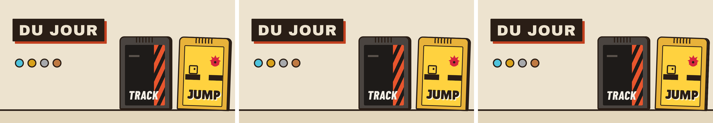

# Lot B1b — `main` rouge : l'image de partage du portail trop lourde (Firefox)

**Cause** : ni les polices, ni la découpe de B1. Le job `e2e-parts (navigateurs firefox)` n'installe que Firefox ; `scripts/images-partage.mjs`, appelé par `site.mjs` depuis `domaine`, `iphone` et `portail-journee`, **retombait sur le navigateur installé** faute de Chromium. Firefox écrit la même page en PNG RGBA : 75 742 o (Chromium : PNG RGB, 42 752 o). Avant B1 le plafond était 150 Kio, donc personne ne le voyait ; B1 l'a posé à 48 Ko sur la mesure de Chromium.

**Mesures** (même page, `main` d'avant B1 `3b39256` et ce lot) :

| image | Chromium avant B1 | Chromium après | Firefox (avant = après) |
|---|---|---|---|
| `portail.png` | 42 752 | 42 752 (identique octet pour octet) | **75 742** |
| `track.png` | 28 036 | 28 036 | 48 887 (aussi au-dessus de 48 000) |
| `jump.png` | 29 491 | 29 491 | 45 050 |

Les trois polices (Archivo Black, Barlow Condensed 800 italique, Lilita One) sont chargées dans Firefox : aucune police de repli. Les pixels diffèrent peu (0,6 % des pixels, antialiasing). **Deux plafonds** : `POIDS_MAX = 48_000` était recopié dans `images-partage.mjs` (pas dans `site.mjs`) ; `budgets.md` dit 48 Ko (le « 150 Ko » ne subsistait que dans `apps/portail/CLAUDE.md`).

**Correction**
- `images-partage.mjs` : **Chromium seul**, plus de repli (message clair s'il manque) ; `POIDS_MAX` **lu dans la ligne `partage.image` de `budgets.md`** (`lirePlafonds`) : un seul plafond.
- `ci.yml` (`e2e-parts`) et `stabilite.yml` : Firefox et WebKit installent **aussi Chromium** (navigateur, clé de cache et paquets système : `paquets-playwright.sh` accepte des navigateurs en plus).
- Tests : `apercus.test.ts` (Chromium seul, CI qui l'installe), `polices.test.ts` (texte de l'image couvert par la découpe). Aucun plafond relevé.

**Images côte à côte** (`lot-B1b/portail-cote-a-cote.png`, réduites de moitié) : Chromium avant B1 · Chromium après ce lot (identique à la production, dessinée par Chromium dans `deploy-site.yml`) · Firefox (ce que le job rouge dessinait).

**Vérifié** : `npm run verifier -- --sans-e2e` vert ; `node scripts/securite-workflows.mjs` : 0 écart ; `site.mjs` assemblé avec Chromium (images 41,8 / 27,4 / 28,8 ko). **Run de CI** : voir ci-dessous.

**Run `main` forcé (Firefox, WebKit, Chromium)** : à compléter.
