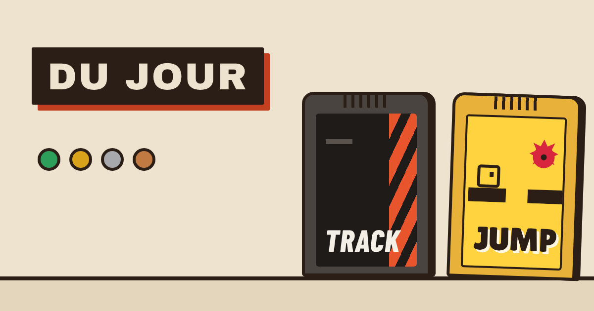
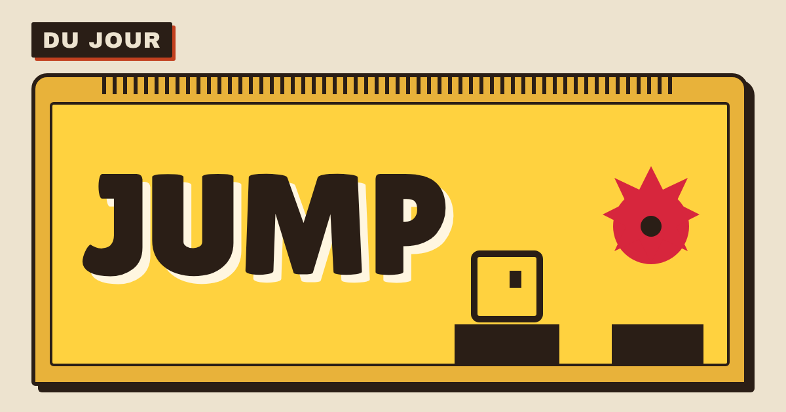

# Lot I6 — Finitions (plateforme, phase 3)

Dernier lot de la phase 3 (`docs/plateforme/seed-phase-3.md`, § 9 : « Mentions en anglais, titres et aperçus de partage, relecture des traductions »). Ce qu'on voit quand on partage un lien, ce qu'il restait à traduire, à nettoyer, et une passe d'accessibilité. Branche `claude/jolly-dirac-n7c6cs`. Charte : `docs/plateforme/identite.md` (révision 8 pendant le lot ; **révision 9** posée par la retouche avant fusion, fournie par Nathan). Rien ne change dans les règles des jeux (golden, `sim`, `jump-sim` intacts).

## 0. En bref

| Livrable | Où | Tests |
|---|---|---|
| Mentions légales en anglais (`/legal/`), la française fait foi | `apps/portail/legal/index.html`, `cheminMentions` (`@cdj/ui`) | `apps/portail/test/mentions.test.ts`, e2e `domaine.spec.ts` |
| Aperçus de partage (`/`, `/track/`, `/jump/`), images produites à la construction, icônes, manifeste | `index.html` des trois, `apps/portail/partage/images.html`, `scripts/images-partage.mjs`, `scripts/site.mjs`, `deploy-site.yml` | `apps/portail/test/apercus.test.ts`, e2e `domaine.spec.ts` |
| Page 404 | `apps/portail/404.html`, `src/introuvable.css` | `apercus.test.ts`, e2e `domaine.spec.ts` |
| Relecture des traductions | `npm run traductions` → `docs/plateforme/traductions.md` | `packages/ui/test/traductions.test.ts` |
| Plus de `message` dans les erreurs du serveur | `apps/api/src/api.ts`, `codesErreur.ts`, `codes-erreur.md` | `apps/api/test/codesErreur.test.ts`, `helpers.ts` (`verifierErreur`) |
| Accessibilité (axe, dialogues) | `@axe-core/playwright`, `apps/web/e2e/axe.ts`, `suivreDialogue` (`@cdj/ui`) | e2e `accessibilite.spec.ts` (Track, Jump), `portail-journee.spec.ts`, `domaine.spec.ts` |
| Nettoyage, budgets | 35 clés retirées, `docs/plateforme/budgets.md`, `scripts/budgets.mjs` | `packages/ui/test/clesUtilisees.test.ts`, `apps/portail/test/budgets.test.ts` |

## 1. Les mentions légales en anglais

- **`/legal/`** (`apps/portail/legal/index.html`) : la traduction fidèle de `/mentions-legales/`, **statique** comme elle (aucun script, aucun cookie, aucune ressource extérieure ; la même feuille `src/mentions.css`). En tête : **« The French version is the reference »** (et sur la française : **« La version française fait foi »**), avec le lien vers l'autre page ; chaque page renvoie à l'autre (barre, en-tête, pied, `<link rel="alternate" hreflang>`). Mêmes constantes (éditeur MZC Studios, particulier ; contact ; hébergeurs Google Cloud France et ChiselStrike ; données gardées) : chaque durée tirée du code porte `data-constante` / `data-valeur`, dites en anglais (« 20 seconds », « 1 hour »).
- **Fidélité au code, relue au passage** : depuis les lots I4 et I5, le profil n'est plus dans « Réglages › Profil » des jeux mais dans le **profil Du Jour** (l'avatar du portail, ou Réglages › « Mon profil Du Jour ») ; la langue se choisit aussi dans un jeu. Les deux pages le disent maintenant (date de mise à jour : 21 octobre 2026).
- **Les liens « Mentions légales » ouvrent la page de la langue choisie** : `cheminMentions(langue, racine)` de `@cdj/ui` (`mentions-legales/` ou `legal/`) — pied du portail, du profil et du classement ; pause et Réglages des deux jeux (`data-mentions` / `lierMentions`, mis à jour au changement de langue). Le libellé anglais du pied n'est plus « Legal notice and privacy (in French) ».
- **`mentions.test.ts`** vérifie les deux pages : mêmes constantes (et leur texte dans chaque langue), mêmes rubriques (identifiants des titres), mêmes tables décrites, même nombre d'éléments de liste, mêmes liens extérieurs, même date, aucune ressource extérieure, `lang`, l'en-tête « fait foi », le renvoi de l'une à l'autre, et les liens des applications.

## 2. Les aperçus de partage

### Textes (**validés tels quels par Nathan**, retouche avant fusion)
Clés `apercu.titre`, `apercu.description`, `apercu.image` (texte de l'image), dans un catalogue **lu seulement à la construction** (`apps/portail/src/catalogueApercu.ts`, `apps/web/src/catalogue.apercu.ts`, `apps/jump/src/catalogue.apercu.ts`) : français au lancement, anglais prêt.

| Page | Titre | Description (FR) | Description (EN, prête) |
|---|---|---|---|
| `/` | Du Jour — les jeux du jour | Chaque jour, un circuit Track et un niveau Jump, les mêmes pour tout le monde. Joue, compare, partage ta journée. | Every day, one Track circuit and one Jump level, the same for everyone. Play, compare, share your day. |
| `/track/` | Track — Du Jour | Un circuit par jour, le même pour tous. Un tour, un chrono, le fantôme du premier à battre. | One track a day, the same for everyone. One lap, one time, the leader's ghost to beat. |
| `/jump/` | Jump — Du Jour | Un niveau par jour, le même pour tous. Les scies tournent déjà. Tu vas mourir. Beaucoup. | One level a day, the same for everyone. The saws are already spinning. You will die. A lot. |

Ton de la charte § 7 : Du Jour chaleureux et court, Track sec (les chiffres d'abord), Jump drôle et un peu cruel. Balises : `<title>`, `description`, `og:title`, `og:description`, `og:image` (+ `og:image:type`, `width` 1200, `height` 630, `alt`), `og:url`, `og:type` `website`, `og:site_name` « Du Jour », `og:locale` `fr_FR`, `og:locale:alternate` `en_GB`, `twitter:card` `summary_large_image`.

### Images (1200 × 630, PNG)
Dessinées selon la charte dans `apps/portail/partage/images.html` (jetons et polices hébergées de `@cdj/ui`, seulement les noms de la marque : les mêmes images en français et en anglais), **produites au moment de la construction** par le Chromium de Playwright (`scripts/images-partage.mjs`, appelé par `node scripts/site.mjs site`) puis copiées dans `site/partage/` : aucune image extérieure, aucun service tiers, aucune dépendance. Statiques (pas d'image du jour).

| Portail (42,7 ko) | Track (28,0 ko) | Jump (29,5 ko) |
|---|---|---|
|  |  |  |

Icônes « Ajouter à l'écran d'accueil » : la cartouche de l'onglet, plein cadre (`icone-180.png` en `apple-touch-icon`, `icone-192.png` et `icone-512.png` du manifeste) : . Manifeste `manifest.webmanifest` (écrit par `scripts/site.mjs`) : nom « Du Jour », `background_color` et `theme_color` crème (jetons), `display: standalone`, `start_url` `/`. **Pas de service worker.**

Garde-fous de `images-partage.mjs` : la construction échoue si une police de la charte n'est pas chargée, si une image n'a pas sa taille ou dépasse 150 ko. Sans Chromium (une part Firefox ou WebKit de la CI qui assemble le site pour `domaine.spec.ts`), un autre navigateur de Playwright installé dessine les images.

### Adresses absolues
Les pages portent le jeton `__ORIGINE_DU_SITE__` dans `og:url` et `og:image` ; `scripts/site.mjs` le remplace par **l'origine du site déployé** (`--origine`) : la production a **toujours** `https://playdujour.com` (une autre origine est refusée) ; la recette `https://recette.playdujour.com` ; **un aperçu de PR, l'adresse de son canal** — `deploy-site.yml` retrouve ou crée le canal (`hosting:channel:list` / `create`, comme `recette.yml`) **avant** la construction, sinon l'aperçu montrerait l'image de la production. `deploy-site.yml` installe aussi Chromium (cache Playwright) et s'authentifie avant la construction (les étapes d'authentification ont été remontées).

### Tests
`apps/portail/test/apercus.test.ts` : chaque page déclare ses balises (clés et valeurs), les textes existent en français et en anglais (titre ≤ 60, description 40–160 caractères), la source des images n'a aucune ressource extérieure ni couleur en dur, `origineDuSite` (production, recette, aperçu, refus), le jeton remplacé, le manifeste (couleurs des jetons), `deploy-site.yml` (origine avant la construction, Chromium). e2e `domaine.spec.ts` (site assemblé avec `--origine http://localhost:4177`) : les balises de `/`, `/track/`, `/jump/`, **chaque image servie à 1200 × 630 et sous 150 ko à l'adresse absolue de CE site**, plus aucun jeton dans aucune page, l'icône 180, le manifeste et ses icônes.

## 3. La page 404

`apps/portail/404.html` (+ `src/introuvable.css`) : cadre crème de la charte, logo DU JOUR, « Cette page n'existe pas » et “This page doesn't exist” (**les deux langues sur la page** : sans script, la langue choisie n'est pas lue), un bouton de marque et un bouton secondaire vers le portail, `noindex`. Statique, **chemins absolus** (`/assets/…` : `vite.config.ts` les réécrit, la page est servie à n'importe quelle profondeur). **Firebase Hosting sert d'office `404.html` de la racine pour toute adresse inconnue** ; `/api/**` est renvoyé au serveur avant (sa 404 reste `{ "error": "not_found" }`). `firebase.json` ne change pas. Le serveur local des e2e (`domaine-serveurs.ts`) fait de même. Tests : `apercus.test.ts` (source, configuration, `site.mjs` refuse un site sans 404), e2e `domaine.spec.ts` (`/xyz` et `/a/b/c/` : statut 404, la charte chargée, les deux titres, le bouton ramène au portail ; `/api/inconnue` reste le JSON du serveur ; axe).

## 4. La relecture des traductions

- **`npm run traductions`** écrit `docs/plateforme/traductions.md` : **920 clés**, toutes les chaînes anglaises du catalogue commun, du portail (dont la vitrine et la démonstration de la recette, signalées), de Track et de Jump, **rangées par application puis par écran** (le premier mot de la clé), la clé et le français en face. `-- --verifier` échoue si le fichier n'est pas à jour ; **`packages/ui/test/traductions.test.ts`** fait la même vérification et exige que la liste des catalogues soit celle de `packages/ui/test/applications.ts`.
- **Corrigé à la relecture** : « ↑ or Z to accelerate » → « ↑ or W » (le jeu lit la touche physique `KeyW` : « Z » en AZERTY, « W » sur un clavier anglais ; l'aide anglaise disait déjà W) ; l'aperçu anglais de Track disait « circuit » (le reste dit « track »).
- **Les choix discutables — tranchés par Nathan à la retouche avant fusion** (le détail de chaque choix suit) : 1 « Name » gardé ; 2 **« Leaderboard » partout**, portail compris (« Today's leaderboard ») ; 3 « Done » gardé ; 4 **caméra « Close » partout**, Réglages compris ; 5, 6, 8, 9, 10 gardés ; 7 **« Banquise » → “Ice floe”** (« Mountain pass » et « Countryside » gardés). Appliqué dans les catalogues, puis `npm run traductions`.
  1. **« Pseudo » → “Name”** partout (champ, colonne, messages) — “Nickname” ou “Username” ?
  2. **« Classement » → “Leaderboard” dans les jeux, “Ranking” au portail** (le classement du jour tous jeux) : deux mots exprès, ou un seul ?
  3. **« Fini » → “Done”** (statut du portail, « 3 fini(s) sur 5 » → “3 of 5 done”) — ou “Finished” ?
  4. **Caméra « proche » → “Close” (course, rediffusion) mais “Near” (Réglages)** : à unifier.
  5. **« Point de contrôle » (Track) et « point de passage » (Jump) → “Checkpoint”** tous les deux ; « PC 3/5 » → “CP 3/5”.
  6. **Médaille « Auteur » → “Author”** (le mot de Trackmania) ; « Temps de l'auteur battu ! » → “Author time beaten!”.
  7. **Thèmes** : « Banquise » → “Pack ice”, « Col alpin » → “Mountain pass”, « Campagne » → “Countryside”.
  8. **« Salon » → “Room”** (décision de Nathan au lot I4, à confirmer à la lecture : « Rejoindre le Salon » → “Join the Room”).
  9. **Les répliques de Jump, adaptées et non traduites** : « Les pics, eux, ne bougent pas. » → “The spikes, sadly, aren't.” ; « La place est chaude. » → “The seat is warm.” ; « À ce stade, c'est toi le décor. » → “At this point, you're part of the scenery.”
  10. **Les noms lus par un lecteur d'écran changés pour axe** (§ 6) : « Revoir le tour : le meilleur du jour » / “Watch the lap: today's best”, « Jeu suivant du jour : {jeu}, à jouer » / “Next game of the day: {jeu}, to play”, “Play again: {jeu}”.

## 5. Le serveur ne renvoie plus de `message`

- `apps/api` : `reply(e.status, { error: e.code, ...e.details })` ; `corpsErreur(code)` → `{ error }` ; `ERREUR_INTERNE` = `{ error: "internal" }` ; `/api/health` en 503 : `error: "db_unavailable"` sans message. Le texte de `HttpError` reste dans le code (il explique le refus à qui lit le code), il ne sort plus. **Les codes ne changent pas.** La réponse des vies de Jump (un succès) perd aussi son `message` (le jeu ne le lisait pas ; `overCap` et `cap` disent le plafond).
- `verifierErreur` (`apps/api/test/helpers.ts`, appliqué à toute réponse d'erreur des tests de l'API) **refuse maintenant un `message`** ; les tests qui lisaient un message lisent le code. `smoke` ne lisait que les codes : inchangé. `docs/plateforme/codes-erreur.md` et `apps/api/CLAUDE.md` à jour.
- La page d'administration de Track (outil interne, en français) affichait le `message` d'une erreur : elle lit maintenant `erreur.<code>` du catalogue commun (en français).
- **Non touché** : `packages/profile/src/client.ts` lit encore `json.message` et, absent, met « Erreur 409 » dans son `ApiResult.message`, qu'aucun écran n'affiche (tous lisent le code) ; le module de profil est une zone partagée que ce lot n'a pas à modifier. À retirer par le prochain lot qui touche `@cdj/profile`.

## 6. L'accessibilité

### axe
`@axe-core/playwright` **4.14.0** (dépendance de développement de `apps/web` et `apps/jump`, version exacte). **Pourquoi lui** : c'est le moteur de référence des tests d'accessibilité automatiques (axe-core, de Deque, sous licence MPL), il s'intègre à Playwright déjà présent (aucun service, aucun réseau), et il ne fait que lire la page ; rien n'entre dans ce que les joueurs téléchargent. Règles : WCAG 2.0, 2.1, 2.2 A et AA, plus les bonnes pratiques d'axe (`apps/web/e2e/axe.ts`, copié dans `apps/jump/e2e/axe.ts`). **Aucune violation « serious » ni « critical »** sur : le portail plein, le profil commun, le classement du jour (`portail-journee.spec.ts`, joueur de démonstration), les mentions FR et EN, la 404 (`domaine.spec.ts`), l'accueil, les réglages, la pause et l'arrivée de Track et de Jump, plus « Comment jouer » de Jump (`accessibilite.spec.ts` de chaque jeu) — **en français et en anglais**.

**Violations graves trouvées et corrigées** :
- `label-content-name-mismatch` (serious) : le nom lu ne contenait pas le texte visible — « Revoir le tour » (lu « Revoir le meilleur tour »), « Jeu suivant du jour : Jump › » (lu « Jouer au jeu suivant… »), “Play again” du portail (lu “Play Track again”), et le choix de langue (« FR » lu « Français ») : libellés corrigés ; `choixLangue` (socle) montre le code et fait lire le nom sans `aria-label`.
- `aria-allowed-attr` (critical) : les onglets des Réglages de Track portaient `aria-pressed` (interdit sur `role="tab"`) : retiré (la feuille suit `aria-selected`).
- `aria-prohibited-attr` (serious) : le chrono à cases de Jump portait un `aria-label` sur un `span` : il est maintenant un `role="timer"`.

**Restent, « moderate »** (dans les deux jeux, sur tous leurs écrans ; rien au portail, au profil, au classement, aux mentions ni à la 404) :
1. `meta-viewport` — **le zoom est bloqué** (`maximum-scale=1, user-scalable=no`) : voulu par les jeux (un pincement pendant la partie zoomerait au lieu de conduire ou sauter) ; iOS l'ignore de toute façon. **Tranché par Nathan (retouche avant fusion) : le zoom reste bloqué dans les jeux** — exception motivée, écrite dans `apps/web/CLAUDE.md`, `apps/jump/CLAUDE.md` et dans la liste des « moderate » acceptés du test (`MODERES_ACCEPTES` de `e2e/axe.ts`, chaque jeu) : un constat « moderate » qui n'y est pas fait maintenant échouer le test.
2. `region` — **la scène (`canvas`) et les plaques de la partie hors d'un repère** (`main`…) : la scène n'est pas du contenu lisible ; les écrans, eux, sont dans des dialogues avec leur `main`. Non changé ; accepté dans `MODERES_ACCEPTES` avec sa raison.

### Les écrans en surimpression sont des dialogues
`suivreDialogue` (nouveau, `packages/ui/src/dialogue.ts`) observe ce qui ouvre un écran (son attribut `hidden`, ou une classe de `body` pour la pause de Track) : **à l'ouverture**, le focus entre dedans (sur le bouton principal donné, sinon l'écran lui-même avec `tabindex="-1"` : le lecteur annonce son nom) — sauf si l'écran s'ouvre **sous** un autre dialogue qui a le focus ; **à la fermeture**, il revient à ce qui l'avait avant quand c'est un élément d'un autre écran encore ouvert (Réglages ouverts depuis l'accueil ou la pause → le bouton « Réglages »), sinon à l'écran resté dessous, **sinon à la page** : la pause et l'arrivée rendent le clavier à la partie (un bouton du HUD qui garderait le focus serait pressé par Espace — c'est la règle que les deux jeux suivaient déjà). Posé d'office par `creerCadre` (tous les écrans des jeux), et pour la pause de Track, « Comment jouer » des deux jeux et l'accueil de Jump. Chaque dialogue a `role="dialog"` et un nom (`aria-label`).
- **Défaut trouvé** : à la première visite de Jump, l'accueil (dessous) prenait le focus à « Comment jouer » (dessus) ; corrigé (l'accueil ne prend plus le focus d'un dialogue posé sur lui).
- **Vérifié par un test** (`accessibilite.spec.ts`, Track et Jump, FR et EN) : rôle et nom de l'accueil, des réglages, de la pause, de l'arrivée (et de « Comment jouer » pour Jump) ; focus dedans à l'ouverture ; Réglages fermés par Échap → focus sur le bouton qui les a ouverts (depuis l'accueil, et pour Track depuis la pause) ; pause fermée → focus sur la page ; arrivée de Track quittée par « Recourir » → focus hors de l'arrivée.
- **Non vérifié** : avec un vrai lecteur d'écran (VoiceOver, TalkBack, NVDA) — seulement l'arbre d'accessibilité vu par axe et les tests de focus.

## 7. Le nettoyage et les budgets

- **Une clé de catalogue jamais lue est refusée** : `packages/ui/test/clesUtilisees.test.ts` (une clé est lue si le code ou le HTML de son application la nomme en clair, ou sous un préfixe calculé `` `theme.${…}` `` / `"erreur." + code` ; catalogues et tests ne comptent pas). Il a trouvé **35 clés** (70 entrées fr + en), toutes vérifiées à la main puis retirées : catalogue commun 1 (`barre.portail.aria`), portail 7 (`classement.jour`, `classement.rang`, `classement.taLigne`, `classement.fini`, `vitrine.medaille.obtenues`, `vitrine.medaille.pasEncore`, `demo.installe`), Track 23 (`page.chargement`, `medaille.aucune`, `commun.fermer`, `commun.copier`, `commun.copie`, `commun.annuler`, `commun.pilote`, `accueil.apercu.ariaPasse`, `accueil.revoir`, `palmares.rang`, `palmares.sansMedaille`, `course.meta.salon`, `course.objectif.mot`, `course.dernierePlace`, `arrivee.rang`, `arrivee.rejouer`, `arrivee.enregistre`, `arrivee.sessionTerminee`, `tactile.camera`, `tactile.reglages`, `tactile.pleinEcran`, `salon.classement.revoir`, `revoir.camera`), Jump 4 (`commun.fermer`, `hud.objectif`, `carnage.aria`, `tactile.aria`). Un test de Track qui essayait les pluriels sur `commun.pilote` les essaie sur `archives.pilotes`.
- **Styles et éléments morts** : cherchés (classes et identifiants de chaque feuille de Track, de Jump, du portail et du socle, contre leur code et leur HTML ; modules plus importés) — **aucun** : le lot I4b avait déjà retiré les règles mortes de Track (son README, § 3), et le seul module que seul un test importe (`apps/jump/src/windSafety.ts`) est la logique de ce test (lot 13). Rien d'autre à retirer.
- **Textes des aperçus hors du paquet** et **l'anglais du catalogue commun sorti du premier chargement** des jeux (il voyage maintenant avec l'anglais du jeu, chargé à la demande : `CATALOGUE_COMMUN_EN`, `packages/ui/src/catalogue.en.ts`).
- **`docs/plateforme/budgets.md`, la référence des budgets** : pour le portail, Track et Jump, le budget, le chiffre actuel et la marge, avec la colonne du test qui le garde ; `apps/portail/test/budgets.test.ts` vérifie que ses limites sont celles des tests et que chaque marge est juste ; `node scripts/budgets.mjs` remesure (même méthode que les tests). **Avant / après** (octets compressés, construction locale) :

| | `main` (`df53a33`) | fin du lot | budget | marge avant → après |
|---|---|---|---|---|
| Track, JS + CSS du premier chargement | 283 365 | 283 486 | < 284 100 | 735 → **614** (620 après la retouche, § 12) |
| Jump, JS + CSS du premier chargement | 375 298 | 375 344 | ≤ 378 490 | 3 192 → **3 146** |
| Portail, premier chargement | 22 360 | 22 810 | ≤ 30 720 | 8 360 → **7 910** |

Le brief annonçait une marge de 1,4 ko pour Track et 3,6 ko pour Jump « après I5 » : **remesurées sur `main` au début du lot, elles étaient de 735 o et 3 192 o** (le lot I4b l'avait déjà noté pour Track). **Le nettoyage rend de la marge (Track 283 264 o à mi-lot, +101 o de marge), mais l'accessibilité la reprend** : le suivi du focus coûte ≈ 600 o à chaque jeu ; sortir l'anglais commun du premier chargement en a rendu ≈ 420. Bilan : Track −121 o de marge, Jump −46 o, le portail +450 o (les balises de partage dans son HTML). **Aucun budget n'est relevé.** Les marges serrées (Track 614 o, fil des miniatures 615 o) sont listées dans `budgets.md`.

## 8. Décisions laissées à Nathan

**Tranchées à la retouche avant fusion** : textes des aperçus validés tels quels (§ 2) ; choix de traduction (§ 4) ; zoom bloqué gardé, en exception motivée (§ 6) ; débordement « AUTOMATIC » corrigé (§ 12) ; lots en parallèle (§ 12).

**Restent à Nathan** :
1. **Budget de Track** : 620 o de marge ; le prochain lot qui ajoute du code au jeu devra en retirer ailleurs ou relever le budget avec Nathan (règle écrite dans `docs/orchestration.md` § 10).
2. **Les questions ouvertes des lots en parallèle** (§ 12) : tests du serveur DailyTrack hors des zones, synthèse de Track dans sa zone, relevé des traductions en exception.
3. **L'étiquette `jeu:track` / `jeu:jump`** : à créer dans le dépôt (réglage GitHub ; un agent ne crée pas de ressource) ; sans elle, le nom de branche suffit.

## 9. Vérifié / non vérifié

**Vérifié ici** (Chromium, rendu logiciel) :
- `npm run typecheck`, `npx tsc -p apps/portail` ; `npx vitest run --project sqlite` sur `packages/ui`, `apps/portail`, `apps/web/test`, `apps/jump/test`, `apps/api` (dont `codesErreur`, `mentions`, `apercus`, `budgets`, `traductions`, `clesUtilisees`) : verts (le détail complet sur les deux bases est celui de la CI, § 10) ; `npm run build` ; `node scripts/site.mjs site` (images, manifeste, 404, origine) ; `npm run traductions -- --verifier`.
- e2e Chromium : `accessibilite.spec.ts` de Track et de Jump (FR et EN), `domaine.spec.ts` (14 tests), les tests « lot I6 » de `portail-journee.spec.ts`, et en régression **toute la suite de Jump** et une large sélection de Track (voir § 10 pour les chiffres).
- Les trois images regardées à l'œil (ci-dessus) et la 404 servie en profondeur.

**Non vérifié** :
- **La carte affichée par WhatsApp ou Discord** : il faut l'aperçu déployé et les vraies applications (scénario ci-dessous).
- Un vrai lecteur d'écran ; Firefox et WebKit en local (la CI les lance : sous-ensemble sur la PR, tout sur `main`).
- La production de l'image par Firefox ou WebKit (le repli de `images-partage.mjs`) : il sert seulement aux parts Firefox et WebKit de la CI sur `main` ; la CI le dira.

**Scénario pour Nathan (2 clics)** : (1) coller l'adresse de l'aperçu de la PR (puis `…/jump/`) dans une conversation WhatsApp ou Discord : la carte s'affiche avec l'image Du Jour (puis celle de Jump) et la description. (2) Sur le téléphone, ouvrir l'aperçu en EN → pied du portail → « Legal notice and privacy » : la page anglaise ; puis taper une adresse au hasard (`…/xyz`) : la page 404 de la charte.

## 10. Runs de CI

**PR [Nathan-Te/DailyTrack#98](https://github.com/Nathan-Te/DailyTrack/pull/98)** (le lot, fusionnée) — run [39603336725](https://github.com/Nathan-Te/DailyTrack/actions/runs/39603336725) (mode `pr`, dernier commit `0d224f0`) : **vert**.

| Job | Verdict | Durée |
|---|---|---|
| `unit (1/3)`, `unit (2/3)`, `unit (3/3)` → `test` | ✔ | 2 min 42 s, 2 min 25 s, 2 min 48 s |
| `scope` | ✔ (Track, Jump, serveur) | 10 s |
| `api-image` | ✔ | 49 s |
| `e2e-parts` Chromium 1 à 8 | ✔ | 4 à 11 min 19 s par part |
| `e2e-parts` Firefox 1–2, WebKit 1–2 (sous-ensemble multi-navigateurs) | ✔ | 3 s à 1 min 21 s |
| `e2e-parts` Jump Chromium 1 à 3, Jump Firefox, Jump WebKit | ✔ | 1 à 3 min 49 s |
| `e2e` (verdict) | ✔ — **412 réussis, 0 instable, 0 échec**, 73 sautés (sans WebGL) | 22 s |

Aperçu de la PR vérifié (`playdujour-recette--pr-98-…web.app`) : balises `og:*` sur l'origine du canal, `jump.png` 200 (29,6 ko), `/xyz` → 404 de la charte, `/legal/` 200, manifeste servi.

**`main` après la fusion** — run [39604752428](https://github.com/Nathan-Te/DailyTrack/actions/runs/39604752428) (mode `complet` : tout, trois navigateurs) : **rouge** (653 réussis, **2 échecs, 2 instables**). Le run `main` précédent (fusion du lot I4b, [39595973881](https://github.com/Nathan-Te/DailyTrack/actions/runs/39595973881)) était **déjà rouge sur les deux mêmes échecs** : ils ne viennent pas du lot I6, mais tant qu'ils restent, « Mettre en production » est refusé. La retouche les corrige (§ 12) :
- `firefox` · `domaine.spec.ts` › mentions légales au doigt en portrait : `#mentions` mesuré **43,99994 px** pour un `min-height: 44px` — l'unité de mise en page de Firefox (1/60 px) à une ordonnée fractionnaire, pas une cible trop petite ;
- `firefox` · `portail-journee.spec.ts` › de Track vers Jump : **délai du test (5 min) dépassé** — sans WebGL (Firefox de la CI), le jeu ne démarre pas et l'attente de `__cdj` passait **avant** le `test.skip` sans WebGL ;
- instable `jump-webkit` · `accessibilite.spec.ts` (EN) — **le lot I6** : à « Comment jouer », axe auditait toute la page et calculait une fois sur deux le contraste de « Jouer » (accueil, **sous** le voile du dialogue) contre le voile (`color-contrast`, serious) ;
- instable `chromium` · `cuves.spec.ts` › sur la paroi, la même voiture que Node — **hors de la zone du lot** (simulation de Track) : signalé, non touché (à suivre dans `docs/orchestration.md` § 8 par un lot Track).

**PR de la retouche** : voir § 12.

## 11. Ce qui reste après la phase 3

- **Une image de partage du jour** (le circuit ou le niveau du jour, la journée d'un joueur) : hors de ce lot.
- **Service worker et mode hors ligne** : hors de ce lot (le manifeste est là).
- **La publicité et le bandeau de consentement** : phase 4 (et la relecture juridique des mentions, qui devront alors changer).
- **Côté serveur** : l'identifiant de DailyTrack dans l'adresse (`?player=`) et le coût du rang à l'envoi (lots du serveur à venir) ; retirer la lecture de `json.message` de `@cdj/profile` (§ 5).
- **Accessibilité** : tester avec un vrai lecteur d'écran (le zoom des jeux est tranché : il reste bloqué).

## 12. Retouche avant fusion (décisions de Nathan)

La PR du lot ([Nathan-Te/DailyTrack#98](https://github.com/Nathan-Te/DailyTrack/pull/98)) était **déjà fusionnée** quand la retouche est arrivée : elle part dans **une nouvelle PR** depuis `main` à jour (même branche, repartie de `main`).

- **Charte** : `docs/plateforme/identite.md` remplacée par la **révision 9** fournie par Nathan (aucun autre changement de la charte).
- **Traductions** (§ 4, puis `npm run traductions`) : « Leaderboard » partout (portail : “Today's leaderboard”, “Finish a game to enter the leaderboard”… ; Track : rang, envoi, Salon — “standings” disparaît) ; caméra « Close » aussi dans les Réglages ; « Banquise » → “Ice floe” (Track et portail). Les trois attentes anglaises de `portail-journee.spec.ts` suivent.
- **« AUTOMATIC » qui débordait en portrait anglais** (boutons à segments des Réglages de Track) : **corrigé par une règle de mise en page, sans poids notable** — `.segment__bouton { flex: 1 1 auto }` (au lieu de `1 1 0`) : un segment au mot long prend la place dont il a besoin, les autres se partagent le reste ; vérifié à 390 px en français et en anglais (aucun débordement, police réelle et police de repli).
- **Zoom bloqué dans les jeux** : gardé, **exception motivée** dans `apps/web/CLAUDE.md`, `apps/jump/CLAUDE.md` et `MODERES_ACCEPTES` (`e2e/axe.ts` de chaque jeu : `meta-viewport` et `region`, chacun avec sa raison) ; **tout autre constat « moderate » fait maintenant échouer le test**.
- **Lots en parallèle** : règles dans `docs/orchestration.md` § 10, résumé dans le `CLAUDE.md` racine ; garde **`scripts/zones-jeu.mjs`** (testé : `apps/api/test/zonesJeu.test.ts`, 15 tests) branchée au job **`zones`** de `ci.yml`, dont le verdict est porté par le statut obligatoire `test` (aucun réglage de protection à changer). Le jeu d'une PR : l'étiquette `jeu:track` / `jeu:jump`, sinon un morceau `track` / `jump` du nom de branche (deux étiquettes : refus ; deux jeux ou aucun dans le nom : PR de la plateforme, sans garde). Le diff part de la base commune (`origin/main...HEAD`) : fusionner `main` n'ajoute rien.
  - **Fichiers DailyTrack d'`apps/api`** (liste fermée, la même que `scripts/ci-scope.mjs`, vérifiée par le test) : `src/cdj.ts`, `src/salon.ts`, `test/salon.test.ts`, `test/planning.test.ts`, `scripts/measure-salon.ts`, `scripts/measure-generator.ts`, `scripts/measure-budget.ts`, `scripts/history-seed.ts`. **`history.ts` n'y est pas** : `jumpHistory.ts` et `classementDemo.ts` l'importent.
  - **Questions ouvertes pour Nathan** : (1) **les tests du serveur de DailyTrack** vivent surtout dans `api.test.ts` et `classement.test.ts`, qui passent par le cœur du serveur (zones partagées) : un lot Track qui change `cdj.ts` et doit changer ces tests s'arrêtera — proposition : un `apps/api/test/cdj*.test.ts` propre à Track (comme `jump*.test.ts`), à créer par un lot de la plateforme ; (2) **`docs/orchestration.md` est mis dans la zone de Track** (c'est sa synthèse, comme `docs/jump/synthese.md` pour Jump, que la règle range dans `docs/jump/**`) ; (3) **`docs/plateforme/traductions.md` est une exception tolérée** : `npm run traductions` le régénère après tout changement de catalogue, et son test échoue s'il n'est pas à jour — sans l'exception, aucun lot de jeu ne pourrait changer une clé ; (4) la garde vérifie **le fichier**, pas **la ligne** (`budgets.md`, `applications.ts`) : la relecture vérifie qu'un lot de jeu n'y change que la sienne ; (5) l'étiquette n'est relue qu'au push suivant (ajouter `labeled` aux événements de la CI relancerait toute la CI à chaque étiquette).
- **Les rouges de `main` (§ 10)** : `domaine.spec.ts` lit la hauteur d'une cible à l'unité de mise en page de Firefox près (1/60 px ; un vrai manque compte au moins 1/60 px) ; `portail-journee.spec.ts` vérifie WebGL **avant** d'attendre le jeu (Track et Jump) ; `accessibilite.spec.ts` (Track et Jump) audite **le dialogue ouvert seul** à « Comment jouer » et aux Réglages — l'écran dessous est audité seul à l'étape d'avant (aucune couverture perdue). `cuves.spec.ts` (instable, Chromium) : hors zone, non touché.
- **Budgets remesurés** (`node scripts/budgets.mjs`) : Track JS + CSS 283 480 o (marge **620 o**, +6), anglais de Track 7 245 o, portail 22 812 o, Jump inchangé ; `budgets.md` à jour.
- **CI de la PR de la retouche** ([Nathan-Te/DailyTrack#99](https://github.com/Nathan-Te/DailyTrack/pull/99)) : commit `ec4754a` marqué `[ci complet]` (tout, trois navigateurs : les deux échecs de `main` sont des tests Firefox hors du sous-ensemble d'une PR) — run [39607893430](https://github.com/Nathan-Te/DailyTrack/actions/runs/39607893430), mode `complet` : **vert**.

| Job | Verdict | Durée |
|---|---|---|
| `zones` | ✔ — « PR de la plateforme (aucune étiquette de jeu ni jeu dans le nom de branche) : pas de garde de zones » | 7 s |
| `unit (1/3)`, `(2/3)`, `(3/3)` → `test` (qui porte aussi `zones`) | ✔ | 2 min 51 s, 2 min 09 s, 2 min 49 s |
| `scope` | ✔ (mode `complet`) | 9 s |
| `api-image` | ✔ | 39 s |
| `e2e-parts` Chromium 1 à 8 | ✔ | 5 min 27 s à 11 min 20 s par part |
| `e2e-parts` **Firefox 1–2** (dont `domaine.spec.ts` et `portail-journee.spec.ts`, rouges sur `main`), **WebKit 1–2** | ✔ | 1 min 19 s à 3 min 11 s |
| `e2e-parts` Jump Chromium 1 à 3, Jump Firefox, Jump WebKit (dont `accessibilite.spec.ts`, instable sur `main`) | ✔ | 1 min 46 s à 4 min 05 s |
| `e2e` (verdict) | ✔ — **660 réussis, 0 instable, 0 échec**, 723 sautés (sans WebGL) | 21 s |

Recette et aperçu de la PR : verts (runs 39607893475 et 39607893503 ; aperçu `playdujour-recette--pr-99-t4s8obmh.web.app`). En local (Chromium) : `domaine`, `portail-journee`, `accessibilite`, `langue`, `hud-compact` de Track (34/34) et `accessibilite` de Jump (4/4). `cuves.spec.ts` (instable Chromium sur `main`, hors zone) est passé au premier essai ici ; il reste à suivre côté Track.
