# Relecture de novembre 2026 — constat (lot QA1)

Photographies du 12 novembre 2026 par `npm run relecture` : le site assemblé comme la recette, une base locale remplie par `recette:seed`, 7 tailles d'écran, français et anglais. 118 passages : 32 sujets du portail (26 pages et états dans les deux langues ; 3 images de partage et 3 écrans d'administration en français) et 6 écrans pour chacun des 5 jeux, dans les deux langues. Aucun manque. Les planches complètes et le détail des contrôles sont dans `relecture/index.html` (dossier local, hors du dépôt) ; les miniatures ci-dessous (ordinateur 1 440 px et téléphone 390 px) sont dans `captures/`.

**Gravité** — **bloquant** : un écran est cassé ou illisible pour un joueur ; **gênant** : on comprend mal, on cherche, ou une règle de la charte n'est pas tenue ; **détail** : finition.
**Source** — *planche* : vu sur les captures ; *contrôle* : relevé par un contrôle automatique (le nombre de pages touchées est dans le tableau de la fin).

Les numéros (A1, C2…) sont ceux que citent les légendes des maquettes `maquettes/*.html`.

## Ce qui ressort

1. **Un seul défaut bloquant sur le portail** : sur téléphone, le titre du fronton recouvre « Prochains niveaux dans » sur `/classement/` (C1) ; `/nouveautes/` s'en approche (S2).
2. **Le téléphone paie les commandes** : quatre rangées avant le premier joueur d'un classement (C2), un fronton sur trois lignes dès que le titre a deux mots (A1, M5).
3. **L'ordinateur a du vide mal placé** : sous la salle d'arcade (A4), à droite des pages de lecture (S1), sur les pages sans profil (V1).
4. **Les états vides sont une phrase** : sans profil, « Amis » et « Profil » n'offrent ni dessin ni bouton (V1, V2).
5. **Des cibles sous 44 px** sur les noms de groupes et les champs du groupe (C5, M6, P5) ; peu de textes sous 12 px (les mots de la barre d'onglets, les initiales des petits emblèmes : A2, C8).
6. **Le pied change d'une page à l'autre** et sort de la colonne de contenu (A8).
7. **Les jeux** : sur un téléphone en paysage, l'accueil des cinq jeux coupe son bouton « Jouer » au pli ; sur un grand écran, l'étiquette des jeux du kit reste petite. Détail plus bas, pour le lot QA2.

## Portail

### Accueil — `/`
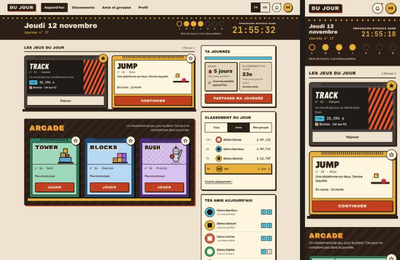

| n° | constat | gravité | source |
|---|---|---|---|
| A1 | Téléphone : « Jeudi 12 novembre » se coupe en deux lignes et serre le compte à rebours ; le fronton fait 200 px de haut. | gênant | planche |
| A2 | La légende « Série de 5 jours, 3 journées parfaites » est à 12 px, le minimum de la charte, en crème sur encre à côté de lampes de 26 px : elle se lit mal sur ordinateur. Les mots de la barre d'onglets du téléphone sont à 11 px sans être en capitales (charte § 4). | détail | planche, contrôle « Texte sous 12 px » |
| A3 | « 1 fini sur 1 » au-dessus de deux cartouches : seuls les jeux épinglés comptent (lot F1), rien ne le dit. De même « Journée parfaite aujourd'hui » alors que Jump est « En cours ». | gênant | planche |
| A4 | Ordinateur (1 440 px) : la colonne de gauche s'arrête à 985 px, celle de droite continue jusqu'à 1 650 px environ ; 650 px sont vides sous la salle d'arcade. | gênant | planche |
| A5 | « Tes amis aujourd'hui » : les pastilles T / J font environ 16 px, sans légende. | détail | planche |
| A6 | « Ta journée » : une barre bleue sans nom en tête du panneau ; les tuiles serrent trois lignes de 11 à 12 px sous leur valeur. | gênant | planche |
| A7 | « Classement du jour », ta ligne : « 1 sur 1 » à la place du temps, sans unité. | gênant | planche |
| A8 | Le pied est collé au bord gauche de la fenêtre, hors de la colonne de 1 208 px ; « Un bug ? Une idée ? » est un bouton dans la colonne de droite ; les autres pages ont un autre pied, sans Discord ni Ko-fi. | gênant | planche |
| A9 | Sans profil (`accueil-neuf`) : « Ta journée » montre une tuile au contenu « — » ; la colonne de droite est presque vide. | détail | planche |

États vus : sans profil, « Démo », journée parfaite — les trois tiennent à toutes les tailles, sans défilement horizontal.

### Classements — `/classement/`
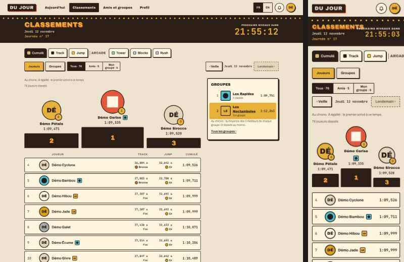

| n° | constat | gravité | source |
|---|---|---|---|
| C1 | Téléphone : « CLASSEMENTS » recouvre « PROCHAINS NIVEAUX DANS » dans le fronton — franchement à 360 px (relevé par le contrôle sur les 8 vues), sur les dernières lettres à 390 px. | **bloquant** | planche, contrôle « Textes qui se chevauchent » |
| C2 | Téléphone : vues, « Joueurs / Groupes », « Tous / Amis / Mon groupe », puis la date — quatre rangées ; le podium commence à 514 px. | gênant | planche |
| C3 | « Démo » est 23e, sous le pli, dans « Un jeu sur deux » : rien en haut de page ne dit sa place ni ce qu'il lui manque. | gênant | planche |
| C4 | Téléphone : la rangée des vues est coupée à « ARCAD », sans indice de défilement. | gênant | planche |
| C5 | Panneau « Groupes » : le nom d'un groupe est un lien de 21 px de haut (tablette, téléphone). Le titre dit « Groupes », pas « Groupes du jour » (révision 20). | gênant | contrôle « Cibles < 44 px » |
| C6 | Vue « Groupes » (`?mode=groupes`) à 390 et 360 px : la page fait 411 px de large, le bouton « Rush » sort de l'écran (défilement horizontal). | gênant | contrôle « Défilement horizontal » |
| C7 | Téléphone : les temps par jeu disparaissent, il ne reste que le cumul. | détail | planche |
| C8 | Les initiales de l'emblème de 22 px à côté d'un pseudo sont en 8 px. | détail | contrôle « Texte sous 12 px » |

Vues photographiées : cumul, Track, Tower (arcade), Amis, Amis sans ami, Mon groupe, Groupes, sans profil.

### Amis et groupes — `/amis/`
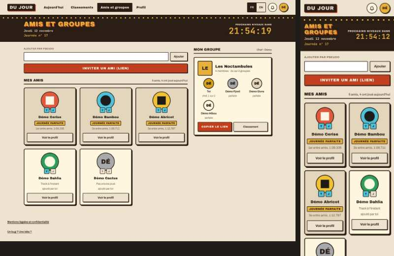

| n° | constat | gravité | source |
|---|---|---|---|
| M1 | Les trois amis en journée parfaite sont sur le fond le plus terne (`--dj-creme-2`), les deux autres sur le papier clair : la hiérarchie est à l'envers. | gênant | planche |
| M2 | « ajouté par toi » : le texte dit l'origine de l'amitié, pas son effet. | détail | planche |
| M3 | « INVITER UN AMI (LIEN) », en terre sur toute la largeur, pèse plus que la liste des amis ; le champ du pseudo n'a pas de texte d'exemple. | gênant | planche |
| M4 | Membres du groupe : « chef, 1 sur 2 », « parfaite » — statuts abrégés en minuscules. | gênant | planche |
| M5 | Téléphone : « AMIS ET GROUPES » sur deux lignes à côté du compte à rebours. | détail | planche |
| M6 | Le nom du groupe est un lien de 27 px de haut. | détail | contrôle |

### Profil — `/profil/`
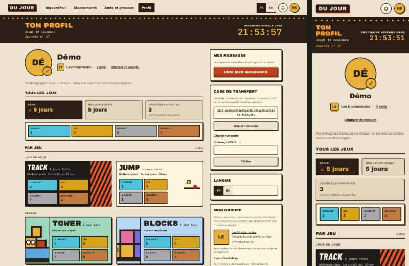

| n° | constat | gravité | source |
|---|---|---|---|
| P1 | « Mon groupe » d'un chef : treize boutons de même poids sur 1 250 px de haut ; « Dissoudre le groupe » ressemble à « Copier le lien ». La colonne de droite fait près de 2 000 px, deux fois le profil lui-même. | gênant | planche |
| P2 | « Tu comptes dans le classement du groupe depuis le 2026-11-11 » : une date en format technique. | détail | planche |
| P3 | Tower, Blocks, Rush jamais joués : « 0 jour fini », « Pas encore classé » et quatre cases pleines à 0. | gênant | planche |
| P4 | Les illustrations de Tower et de Blocks sont agrandies et rognées (un œil de Blocks sort du cadre). | gênant | planche |
| P5 | Téléphone : « 5 amis · » finit sur un point orphelin, « Changer de pseudo » passe seul à la ligne ; le lien du groupe fait 16 px de haut, les champs du groupe 27 px. | gênant | planche, contrôle |
| P6 | « Langue » : une barre vide de 300 px pour « FR EN ». La phrase sur les images est sous l'identité, loin du bouton de la photo. | détail | planche |

### Pages secondaires — `/nouveautes/`, `/messages/`, `/groupe/<nom>`
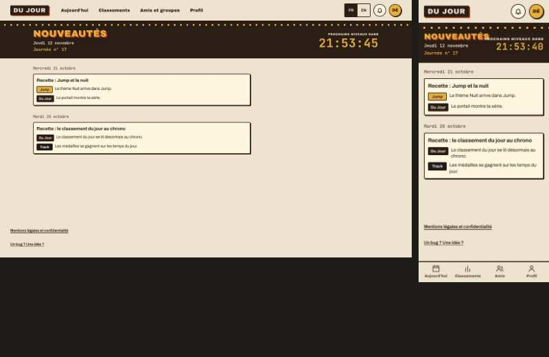

| n° | constat | gravité | source |
|---|---|---|---|
| S1 | Ordinateur (1 440 px) : la colonne de 760 px est collée à gauche du contenu, 560 px restent vides à droite ; le texte est en 14 px. | gênant | planche |
| S2 | Téléphone : « NOUVEAUTÉS » touche « PROCHAINS NIVEAUX DANS » (même cause que C1 : le titre déborde de sa boîte de 171 px). « MES MESSAGES » passe sur deux lignes. | gênant | planche |
| S3 | Aucun retour écrit : Nouveautés n'ouvre aucun onglet, Mes messages est sous « Profil ». | détail | planche |
| S4 | Mes messages : un fil est une carte de 40 px sur ordinateur, son état (« Lu ») est un mot gris. | détail | planche |
| S5 | Page d'un groupe : sur téléphone le fronton (emblème, nom sur deux lignes, date, compte à rebours) fait 220 px ; « Moins de 3 classés » est répété trois fois. | détail | planche |

### États vides et d'erreur
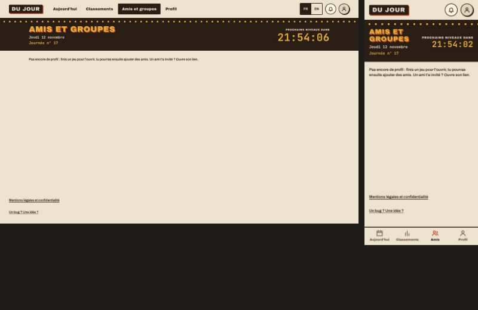

| n° | constat | gravité | source |
|---|---|---|---|
| V1 | « Amis et groupes » sans profil : une seule phrase en haut d'une page vide, sans lien vers un jeu. | gênant | planche |
| V2 | Profil sans profil : la même phrase, puis « Code de transfert » qui parle de garder un code que le joueur n'a pas. | gênant | planche |
| V3 | Sans ami : « 0 ami, 0 a joué aujourd'hui » ; l'état vide est un cadre pointillé d'une ligne. | détail | planche |
| V4 | Classement « Amis » sans ami : dans le filtre, « Amis · 0 » passe sur deux lignes. | détail | planche |
| V5 | Groupe introuvable : une phrase, aucune sortie. | gênant | planche |
| V6 | 404 : ni barre ni fronton de la salle (page statique, exprès) ; le français et l'anglais sont empilés à égalité. | détail | planche |
| V7 | « Serveur injoignable » : état non photographié (l'outil ne coupe pas encore le serveur). | — | manque |

### Mentions légales, images de partage, administration
- **Mentions** (`/mentions-legales/`, `/legal/`) : rien à signaler ; page de lecture propre aux sept tailles.
- **Images de partage** (`/partage/portail.png`, `track.png`, `jump.png`) : photographiées ; Tower, Blocks et Rush n'ont pas d'image de partage dans le site assemblé (détail, à voir à leur publication).
- **Administration** (`/admin/`, session de démonstration) : faite pour l'ordinateur. Relevé par les contrôles : « 0 blocage(s) » (un « (s) », détail) ; le tableau des retours déborde à 390 px (519 px de large, détail) ; les barres du graphique n'ont pas de focus visible (détail).

## Jeux (pour le lot QA2)

Six écrans par jeu : accueil, partie, pause, arrivée, classement, réglages. L'arrivée de Track, Jump et Tower est une vraie partie classée par le serveur local ; celle de Blocks et de Rush est l'écran d'essai du jeu (`?scenario=partage`, `?scenario=fin`).

### Commun aux cinq jeux
| n° | constat | gravité | source |
|---|---|---|---|
| J1 | Téléphone en paysage (844 × 390) : l'accueil ne tient pas à l'écran ; « Jouer » est coupé au pli pour Blocks et Rush, au bord pour Tower et Jump (Track colle « Courir » en bas, exprès). | gênant | planche |
| J2 | Grand écran (1 440 × 900) : l'étiquette de Tower, Blocks et Rush occupe environ 40 % de la largeur, à la taille du téléphone. | gênant | planche |
| J3 | Pause de Tower, Blocks et Rush : les réglages de la musique sont dans la pause, qui dépasse l'écran en paysage (elle défile). | détail | planche |
| J4 | Blocks et Rush demandent `/<jeu>/jours/<date>.json` et reçoivent 404 quand le jour n'est pas figé : une erreur dans la console à chaque ouverture. | détail | contrôle « Erreurs de console » |
| J5 | Le titre « Musique » des réglages et de la pause (composant commun) est à 11 px sans être en capitales. | détail | contrôle « Texte sous 12 px » |
| J6 | Les pseudos longs sont coupés par des points de suspension dans les classements de Track, Jump et Tower (voulu, à vérifier avec des pseudos de 20 caractères). | détail | contrôle « Texte coupé » |

### Track
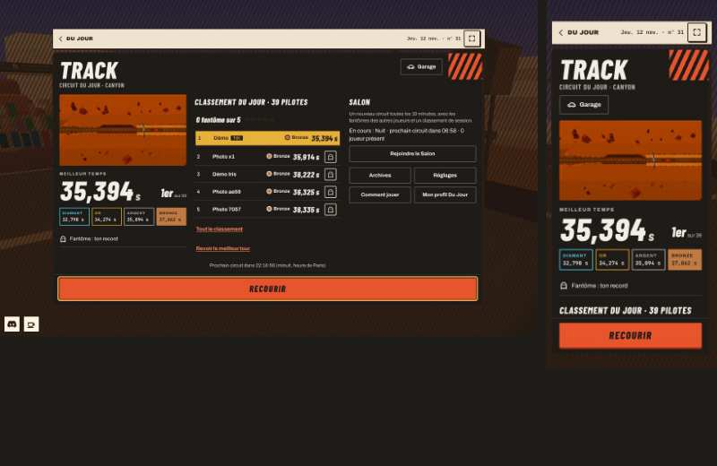
- **T1 (gênant, contrôle)** Réglages : « Un bug ? Une idée ? » (`#settings-retours`) a un contraste de 1,46:1 (texte clair sur fond clair).
- **T2 (détail, contrôle)** En course : le seuil de l'objectif de médaille (`.objectif__valeur`) est à 11 px.
- **T3 (détail, planche)** Portrait : la course et la pause sont couvertes par « Tourne ton téléphone » (voulu) ; l'accueil et l'arrivée s'affichent.
- **T4 (détail, planche)** Arrivée sur ordinateur : la carte reste étroite au milieu d'un écran de 1 440 px.

### Jump
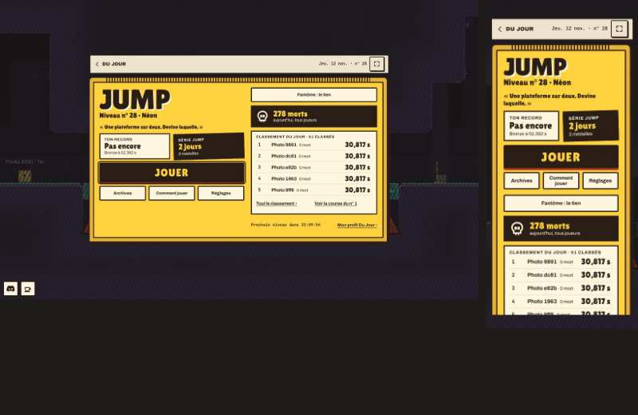
- **JU1 (gênant, contrôle)** Classement : les lignes (`button.ligne__bouton`) n'ont ni contour ni ombre au focus du clavier, et font 21 px de haut sur tablette et téléphone (cible sous 44 px).
- **JU2 (détail, planche)** Arrivée sur téléphone : le classement commence sous « Rejouer » ; la ligne du joueur peut être sous le pli.

### Tower
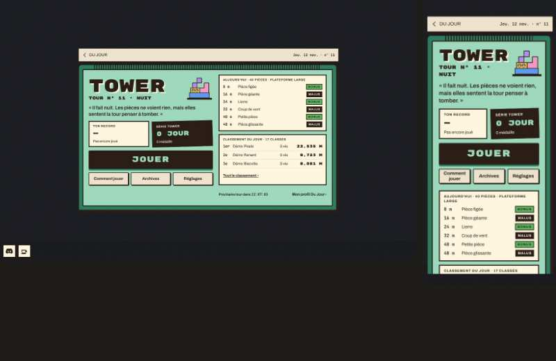
- **TO1 (gênant, contrôle)** En partie, tactile : « Taquet à gauche » et « Taquet à droite » font 40 px de haut ; dans le classement, le pseudo-bouton d'une ligne fait 36 px.
- **TO2 (détail, contrôle)** Arrivée : la note des médailles (« Bronze : encore 4,381 m ») est à 11 px.
- **TO3 (détail, planche)** Accueil sur ordinateur : la plus petite étiquette des cinq jeux (voir J2).

### Blocks
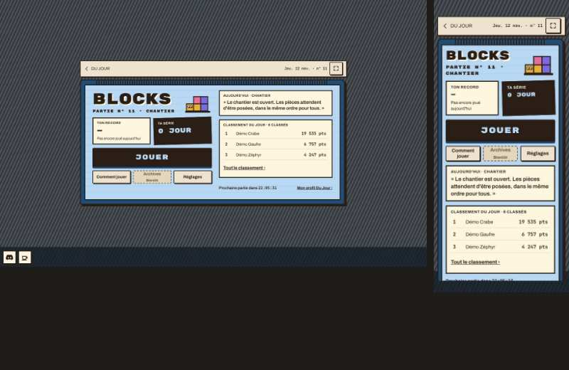
- **B1 (gênant, planche)** Partie en portrait : la grille est en haut, les pièces en bas, et le milieu ne porte qu'une phrase d'aide.
- **B2 (détail, contrôle)** Accueil : la mention « Bientôt » (`small`) est à 11,7 px.

### Rush
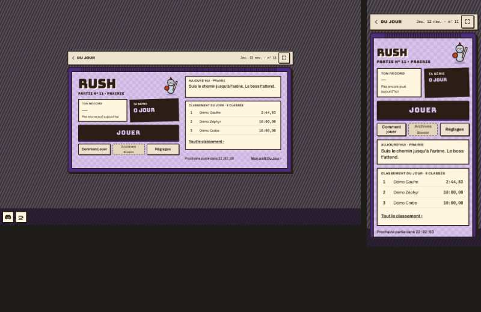
- **R1 (gênant, planche)** Accueil en paysage : « Jouer » est coupé au pli (voir J1) ; c'est le cas le plus net des cinq.
- **R2 (détail, contrôle)** Accueil : même « Bientôt » à 11,7 px que Blocks.
- **R3 (détail, planche)** Classement de démonstration : « 10:00,00 » pour presque tous (temps plafond des parties scriptées) — pas un défaut d'affichage.

## Contrôles automatiques — nombre de constats par page (français)

Un nombre = des constats à regarder, pas un verdict ; « · » = rien. Le détail de chaque constat (élément, tailles) est dans `relecture/index.html`.

<!-- tableau:debut -->
| page | Contraste AA | Cibles < 44 px | Défilement horizontal | Texte coupé | Textes qui se chevauchent | Texte sous 12 px | Textes interdits | Focus invisible | Images sans alt | Erreurs de console |
|---|---:|---:|---:|---:|---:|---:|---:|---:|---:|---:|
| accueil-neuf | · | · | · | · | · | 4 | · | · | · | · |
| accueil-demo | · | · | · | · | · | 4 | · | · | · | · |
| accueil-parfaite | · | · | · | · | · | 4 | · | · | · | · |
| classement-cumul | · | 10 | · | · | 1 | 4 | · | · | · | · |
| classement-jeu-du-jour | · | 10 | · | · | 1 | 4 | · | · | · | · |
| classement-arcade | · | · | · | · | 1 | 4 | · | · | · | · |
| classement-amis | · | 10 | · | · | 1 | 4 | · | · | · | · |
| classement-amis-vide | · | 10 | · | · | 1 | 4 | · | · | · | · |
| classement-mon-groupe | · | 10 | · | · | 1 | 4 | · | · | · | · |
| classement-groupes | · | 15 | 2 | · | 1 | 4 | · | · | · | · |
| classement-neuf | · | 10 | · | · | 1 | 4 | · | · | · | · |
| amis-demo | · | 3 | · | · | · | 4 | · | · | · | · |
| amis-vide | · | · | · | · | · | 4 | · | · | · | · |
| amis-neuf | · | · | · | · | · | 4 | · | · | · | · |
| profil-demo | · | 11 | · | · | · | 4 | · | · | · | · |
| profil-parfaite | · | 7 | · | · | · | 4 | · | · | · | · |
| profil-neuf | · | · | · | · | · | 4 | · | · | · | · |
| nouveautes | · | · | · | · | · | 4 | · | · | · | · |
| messages-demo | · | · | · | · | · | 4 | · | · | · | · |
| messages-fil | · | · | · | · | · | 4 | · | · | · | · |
| messages-neuf | · | · | · | · | · | 4 | · | · | · | · |
| groupe-membre | · | · | · | · | · | 4 | · | · | · | · |
| groupe-visiteur | · | · | · | · | · | 4 | · | · | · | · |
| groupe-inconnu | · | · | · | · | · | 4 | · | · | · | · |
| partage-portail | · | · | · | · | · | · | · | · | · | · |
| partage-track | · | · | · | · | · | · | · | · | · | · |
| partage-jump | · | · | · | · | · | · | · | · | · | · |
| mentions | · | · | · | · | · | · | · | · | · | · |
| introuvable | · | · | · | · | · | · | · | · | · | · |
| admin-accueil | · | 9 | · | · | · | · | 1 | 1 | · | · |
| admin-jeux | · | · | · | · | · | · | · | · | · | · |
| admin-retours | · | 3 | 2 | · | · | · | · | · | · | · |
| track-accueil | · | · | · | 4 | 3 | · | · | · | · | · |
| track-partie | · | · | · | 1 | 1 | 1 | · | · | · | · |
| track-pause | · | · | · | · | 5 | · | · | · | · | · |
| track-arrivee | · | · | · | · | 5 | · | · | · | · | · |
| track-classement | · | 19 | · | 35 | · | · | · | · | · | · |
| track-reglages | 1 | · | · | · | · | · | · | · | · | · |
| jump-accueil | · | · | · | 5 | 1 | · | · | · | · | · |
| jump-partie | · | · | · | · | · | · | · | · | · | · |
| jump-pause | · | · | · | · | · | · | · | · | · | · |
| jump-arrivee | · | · | · | · | 1 | · | · | · | · | · |
| jump-classement | · | 40 | · | · | · | · | · | 10 | · | · |
| jump-reglages | · | · | · | · | · | 1 | · | · | · | · |
| tower-accueil | · | · | · | 3 | 4 | · | · | · | · | · |
| tower-partie | · | 2 | · | · | · | · | · | · | · | · |
| tower-pause | · | · | · | · | · | 1 | · | · | · | · |
| tower-arrivee | · | · | · | · | · | 1 | · | · | · | 1 |
| tower-classement | · | 68 | · | 3 | 91 | · | · | · | · | · |
| tower-reglages | · | · | · | · | 1 | 1 | · | · | · | · |
| blocks-accueil | · | · | · | · | · | 1 | · | · | · | 1 |
| blocks-partie | · | · | · | · | · | · | · | · | · | 1 |
| blocks-pause | · | · | · | · | 1 | 1 | · | · | · | 1 |
| blocks-arrivee | · | · | · | · | · | · | · | · | · | 1 |
| blocks-classement | · | · | · | · | · | · | · | · | · | 1 |
| blocks-reglages | · | · | · | · | · | 1 | · | · | · | 1 |
| rush-accueil | · | · | · | · | · | 1 | · | · | · | 1 |
| rush-partie | · | · | · | · | · | · | · | · | · | 1 |
| rush-pause | · | · | · | · | · | · | · | · | · | 1 |
| rush-arrivee | · | · | · | · | 1 | · | · | · | · | · |
| rush-classement | · | · | · | · | · | · | · | · | · | 1 |
| rush-reglages | · | · | · | · | · | · | · | · | · | 1 |
<!-- tableau:fin -->

## Ce que l'outil ne voit pas
- « Textes qui se chevauchent » donne beaucoup de faux signaux dans les jeux : un titre et son sous-titre serrés, ou l'écran du dessous resté dans la page sous un dialogue (classement de Tower). Sur le portail il n'a relevé que le vrai défaut (C1).
- Les contrôles tournent à l'ouverture de la page : pas après une action (dialogue ouvert, feuille de la cloche, recadrage de la photo).
- Les marges de sécurité de l'iPhone sont simulées par le protocole de Chromium ; Safari n'est pas lancé.
- Vertige et Cibles ne sont pas photographiés (pas encore en aperçu). « Serveur injoignable », minuit et le message en direct non plus.
