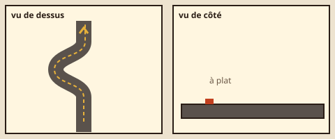
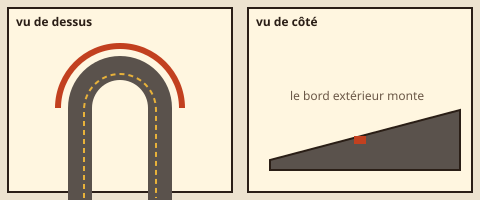
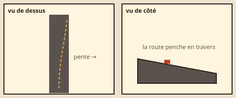
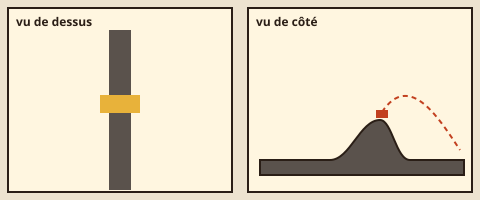
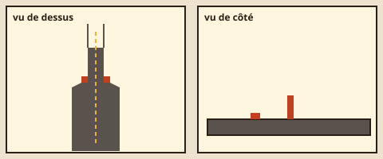
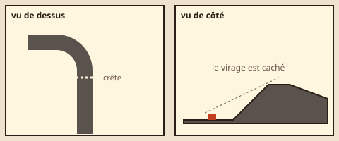
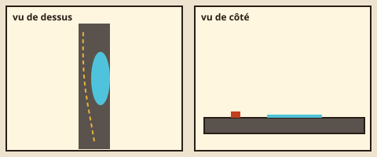
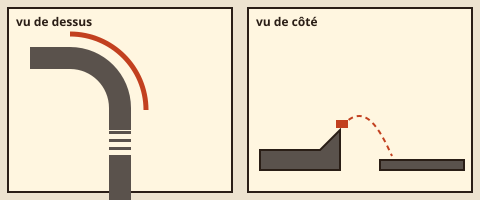

# Blocs proposés pour Track (lot V2 → choix de Nathan pour le lot V2b)

**Rien n'est construit** : ce sont des propositions. Huit blocs, dont **six techniques** (1, 2, 3, 5, 6, 7). Chacun a un schéma vu de dessus et de côté (`docs/track/blocs-proposes/*.svg`, à la charte, sans dégradé : route en gris, ligne du pilote en pointillé moutarde, voiture en terre), ce qu'il demande au pilote, ses biomes, son effet probable sur le temps de l'auteur, son coût et ses risques.

**Les coûts en octets sont des estimations** (rien n'est construit, rien n'est mesuré). Repères : un bloc nouveau = `SIM_VERSION` +1 **sauf** s'il n'existe dans aucun circuit enregistré (règle du lot 48 : un nouvel identifiant, les anciens rejouent au bit près) ; le premier chargement de Track n'a plus que **≈ 50 o de marge** après ce lot (`docs/plateforme/budgets.md`) : la géométrie d'un bloc (`track.ts`, `world.ts`, `trackMesh.ts`) est dans le premier chargement, sa pose (`figures.ts`, `generator.ts`) dans le fil des circuits (≈ 540 o de marge) et du Salon (≈ 400 o). Tout bloc qui touche la géométrie du sol demande donc **un relèvement du plafond par Nathan**.

## 1. Chicane serrée — technique

- **Ce qu'il demande** : un S complet dans une seule cellule (≈ 10 m de décalage latéral sur 32 m), gauche-droite sans ligne droite entre les deux ; se placer dehors, couper le premier point de corde, et repartir droit.
- **Biomes** : Ville (entre les immeubles), Rallye (entre les arbres), Canyon. Aujourd'hui deux serrés ne peuvent jamais se suivre : c'est ce qui manque à la Ville et au Canyon.
- **Temps de l'auteur** : +0,4 à +0,8 s par chicane (freinage à ≈ 30 m/s).
- **Coût** : géométrie d'une cellule (une courbe en S, comme la transition de largeur : `blockHalfWidth` déjà fait le lissage), rebords, rendu du ruban ; ≈ 300 o au premier chargement, ≈ 150 o au fil des circuits.
- **Risques** : déterminisme faible (des polynômes, comme les transitions) ; le pilote doit couper la corde sans toucher le rebord (marge de 3,6 m sur 14 m : à vérifier, sinon chicane seulement sur 20 m) ; lisible sur téléphone (la caméra voit la cellule entière).

## 2. Épingle relevée — technique

- **Ce qu'il demande** : un demi-tour serré (deux cellules) dont le bord extérieur monte : on peut entrer vite et « s'appuyer » sur le relevé, ou freiner et prendre la corde à plat ; deux trajectoires, deux temps.
- **Biomes** : Stade (le vélodrome), Col alpin (les lacets), Nuit.
- **Temps de l'auteur** : −0,3 à −0,6 s contre l'épingle plate d'aujourd'hui (deux serrés et une droite) ; le pilote doit apprendre la trajectoire haute.
- **Coût** : le relevé existe (`bankAt`, quintique) ; un demi-tour d'une pièce est un nouveau `curveSize` (géométrie, cellules, `racingLine`) ; ≈ 400 o au premier chargement.
- **Risques** : le pilote d'auteur prend les relevés à 1,5 m de l'axe (lot 8) : il faudrait lui apprendre la ligne haute, sinon il est lent et l'or devient facile ; caméra qui roule dans le relevé (déjà réglée pour les cuves).

## 3. Dévers — technique

- **Ce qu'il demande** : une ligne droite dont la route penche en travers (pente latérale 0,1 à 0,15) : la voiture dérive vers le bas, il faut contre-braquer un peu, et le virage suivant est plus facile du côté haut.
- **Biomes** : Col alpin (route à flanc de montagne), Campagne (chemin creux), Rallye.
- **Temps de l'auteur** : presque nul (+0,1 s) ; il change la trajectoire, pas la vitesse.
- **Coût** : faible en simulation (la pente latérale existe pour les relevés : `ay -= gravité × pente`) ; rendu : un ruban incliné ; ≈ 200 o au premier chargement.
- **Risques** : peu lisible au téléphone si la caméra ne roule pas (il faut l'incliner un peu, comme dans les cuves) ; sinon le joueur croit à un défaut de direction.

## 4. Bosse qui fait décoller — saut

- **Ce qu'il demande** : une bosse franche (2 à 3 m, sans vide derrière) qui fait décoller au-delà de 45 m/s : lever le pied pour rester au sol, ou passer à fond et figer la caisse au frein (lot 19).
- **Biomes** : Rallye (sa signature naturelle), Campagne, Canyon.
- **Temps de l'auteur** : +0 à +0,3 s (le pilote ralentit pour ne pas voler trop loin si un virage suit).
- **Coût** : faible (`B` existe à 1 m : une hauteur de plus, ou `B2`) ; ≈ 100 o au premier chargement, la balistique et la réception existent.
- **Risques** : déterminisme : aucun (même physique) ; le pilote d'auteur ne sait pas lever le pied avant une bosse (il freine en l'air) : à apprendre, sinon il atterrit mal ; lisible (la bosse se voit de loin).

## 5. Rétrécissement soudain (goulet) — technique

- **Ce qu'il demande** : la route passe de 20 à 8 m en quelques mètres, entre deux plots : viser le milieu à pleine vitesse ; un plot touché coûte de la vitesse.
- **Biomes** : Ville (une porte, un pont étroit), Canyon (une faille), Nuit.
- **Temps de l'auteur** : +0 à +0,2 s (le pilote passe au milieu).
- **Coût** : une largeur nouvelle (8 m) ou un obstacle ponctuel (deux disques de collision, comme les rebords) ; ≈ 250 o au premier chargement.
- **Risques** : le pilote et ses marges (3,6 m de chaque côté : il ne reste que 0,8 m sur 8 m) ; sur téléphone, viser 8 m à 60 m/s demande une caméra assez haute ; anti-traversée à 88 m/s à revérifier (`vitesse.test.ts`).

## 6. Virage en aveugle derrière une crête — technique

- **Ce qu'il demande** : le sommet de la crête est **dans** le virage (pas avant, comme la figure `virage-aveugle` d'aujourd'hui) : on tourne sans voir la sortie, la voiture s'allège au sommet.
- **Biomes** : Campagne, Col alpin, Rallye.
- **Temps de l'auteur** : +0,2 à +0,5 s.
- **Coût** : un virage avec une pente qui change de signe au milieu (le relief d'un virage existe : `bankAt` et les pentes) ; ≈ 200 o au premier chargement.
- **Risques** : la caméra de poursuite voit trop loin au téléphone : le virage n'est plus aveugle (il faudrait baisser la caméra sur ce bloc) ; le pilote freine déjà en haut des montées.

## 7. Portion à faible adhérence (tache) — technique

- **Ce qu'il demande** : une tache (huile, eau, boue) sur une **moitié** de la route seulement : choisir le côté propre, ou passer dessus en ligne droite sans braquer.
- **Biomes** : Ville (flaque), Campagne (boue), Banquise (plaque de verglas), Nuit (huile).
- **Temps de l'auteur** : presque nul (il prend le côté propre) ; pour un joueur, une décision de plus.
- **Coût** : le revêtement par position en travers existe (vibreurs et bas-côtés, lot 21 : `Surface.kind` du point) ; un revêtement de plus sur une demi-largeur ; ≈ 150 o au premier chargement, rendu d'une tache plate.
- **Risques** : déterminisme : aucun (même table `SURFACES`) ; lisibilité au téléphone : la tache doit trancher sur la route (couleur de la charte, sans transparence).

## 8. Saut avec réception en virage relevé — saut

- **Ce qu'il demande** : on retombe directement dans un virage relevé (le relevé reçoit la voiture et l'aide à tourner) : la bonne vitesse au bord de la rampe, puis tourner dès qu'on touche.
- **Biomes** : Stade, Nuit, Canyon.
- **Temps de l'auteur** : −0,2 à +0,3 s (selon la fenêtre de vitesse).
- **Coût** : aujourd'hui la réception d'un virage n'existe que pour un virage ample à plat (`CURVE_LANDING`, lot 49) ; la réception sur un relevé demande la réception dans un plan incliné (`land`, car.ts : déjà en pentes) ; ≈ 250 o au premier chargement, ≈ 200 o au fil des circuits (la fenêtre de `trackJumps`).
- **Risques** : le pilote d'auteur doit partir de l'axe et viser le relevé (lot 49 : il n'a pas su le faire derrière un virage large) ; une mauvaise réception sur une pente latérale fait rouler la caisse : à mesurer (`air.test.ts`).

## Ce que je proposerais d'abord (à Nathan de choisir)

1, 4 et 7 : les moins chers (une géométrie connue, aucune physique nouvelle), et ils donnent à la Ville, au Rallye et à la Campagne ce que les fiches de biomes ne peuvent pas faire avec les blocs existants (deux serrés de suite, une bosse qui fait voler, un choix de côté). 2 et 8 demandent d'apprendre une trajectoire au pilote d'auteur : un lot à part.
